1. 初识Kafka

## 1.1　发布与订阅消息系统

数据（消息）的发送者（发布者）不会直接把消息发送给接收者，这是发布与订阅消息系统的一个特点。发布者以某种方式对消息进行分类，接收者（订阅者）通过订阅它们来接收特定类型的消息。发布与订阅系统一般会有一个broker，也就是发布消息的地方。

真正需要的是一个单一的集中式系统，它可以用来发布通用的数据，并且规模可以随着公司业务的增长而增长。

## 1.2　Kafka登场

Kafka就是为了解决上述问题而设计的一款基于发布与订阅模式的消息系统。

### 1.2.1　消息和批次

Kafka的数据单元被称为消息。如果在使用Kafka之前你已经有使用数据库的经验，那么可以把消息看成数据库中的一个“数据行”或一条“记录”​。

Kafka的数据单元被称为消息。消息可以有一个可选的元数据，也就是键。当需要以一种可控的方式将消息写入不同的分区时，需要用到键。最简单的例子就是为键生成一个一致性哈希值，然后用哈希值对主题分区数进行取模，为消息选取分区。这样可以保证具有相同键的消息总是会被写到相同的分区中（前提是分区数量没有发生变化）​。

为了提高效率，消息会被分成批次写入Kafka。批次包含了一组属于同一个主题和分区的消息。如果每一条消息都单独穿行于网络中，那么就会导致大量的网络开销，把消息分成批次传输可以减少网络开销。不过，这需要在时间延迟和吞吐量之间做出权衡：批次越大，单位时间内处理的消息就越多，对单条消息来说，其传输时间就越长。消息批次会被压缩，这样可以提升数据的传输和存储性能，但需要做更多的计算处理。

理解：如果消息都比较小，那么建议不分批次写入，这样效率更高；如果消息都比较大，那么应分批次写入，这样可以减少因为报文过大而导致的网络重传，以及内部系统对于报文大小限制的影响。

### 1.2.2　模式

### 1.2.3　主题和分区

Kafka的消息通过主题进行分类。主题就好比数据库的表或文件系统的文件夹。主题可以被分为若干个分区，一个分区就是一个提交日志。

需要注意的是，由于一个主题一般包含几个分区，因此无法在整个主题范围内保证消息的顺序，但可以保证消息在单个分区内是有序的。

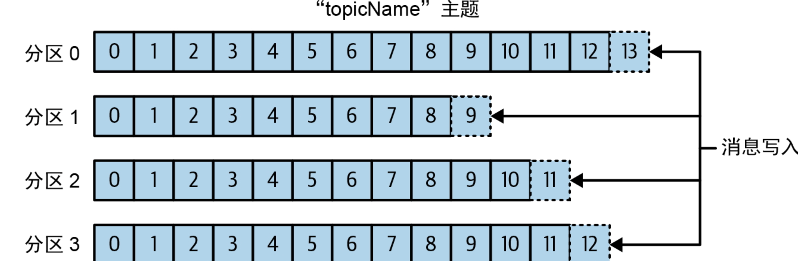

生产者创建消息。在其他发布与订阅系统中，生产者可能被称为发布者或写入者。一条消息会被发布到一个特定的主题上。在默认情况下，生产者会把消息均衡地分布到主题的所有分区中。不过，在某些情况下，生产者会把消息直接写入指定的分区，这通常是通过消息键和分区器来实现的。分区器会为键生成一个哈希值，并将其映射到指定的分区，这样可以保证包含同一个键的消息被写入同一个分区。生产者也可以使用自定义的分区器，根据不同的业务规则将消息映射到不同的分区。

消费者读取消息。在其他发布与订阅系统中，消费者可能被称为订阅者或读取者。消费者会订阅一个或多个主题，并按照消息写入分区的顺序读取它们。消费者通过检查消息的偏移量来区分已经读取过的消息。偏移量（不断递增的整数值）是另一种元数据，在创建消息时，Kafka会把它添加到消息里。在给定的分区中，每一条消息的偏移量都是唯一的，越往后消息的偏移量越大（但不一定是严格单调递增）​。消费者会把每一个分区可能的下一个偏移量保存起来（通常保存在Kafka中）​，如果消费者关闭或重启，则其读取状态不会丢失。

消费者可以是消费者群组的一部分，属于同一群组的一个或多个消费者共同读取一个主题。群组可以保证每个分区只被这个群组里的一个消费者读取

消费者与分区之间的映射通常被称为消费者对分区的所有权关系。

通过这种方式，消费者可以读取包含大量消息的主题。而且，如果一个消费者失效，那么群组里的其他消费者可以接管失效消费者的工作。

### 1.2.5　broker和集群

一台单独的Kafka服务器被称为broker。broker会接收来自生产者的消息，为其设置偏移量，并提交到磁盘保存。broker会为消费者提供服务，对读取分区的请求做出响应，并返回已经发布的消息。

broker组成了集群。每个集群都有一个同时充当了集群控制器角色的broker（自动从活动的集群成员中选举出来）​。控制器负责管理工作，包括为broker分配分区和监控broker。在集群中，一个分区从属于一个broker，这个broker被称为分区的首领。一个被分配给其他broker的分区副本（参见图1-7）叫作这个分区的“跟随者”​。分区复制提供了分区的消息冗余，如果一个broker发生故障，则其中的一个跟随者可以接管它的领导权。所有想要发布消息的生产者必须连接到首领，但消费者可以从首领或者跟随者那里读取消息。第7章将详细介绍如何操作集群（包括复制分区）​。

保留消息（在一定期限内）是Kafka的一个重要特性。broker默认的消息保留策略是这样的：要么保留一段时间（如7天）​，要么保留消息总量达到一定的字节数（如1 GB）​。当消息数量达到这些上限时，旧消息就会过期并被删除。

### 1.2.6　多集群

随着broker数量的增加，最好使用多个集群，原因如下。
● 数据类型分离
● 安全需求隔离
● 多数据中心（灾难恢复）

需要注意的是，Kafka的消息复制机制只能在单个集群中而不能在多个集群之间进行。

Kafka提供了一个叫作 MirrorMaker 的工具，我们可以用它将数据复制到其他集群中。MirrorMaker的核心组件包括一个消费者和一个生产者，它们之间通过队列相连。

## 1.3　为什么选择Kafka

### 1.3.1　多个生产者

Kafka可以无缝支持多个生产者，不管客户端消费的是单个主题还是多个主题。所以，它很适用于从多个前端系统收集数据，并以统一的格式对外提供数据。

### 1.3.2　多个消费者

除了支持多个生产者，Kafka也支持多个消费者从一个单独的消息流读取数据，而且消费者之间互不影响。这与其他队列系统不同。在其他队列系统中，消息一旦被一个客户端读取，就无法再被其他客户端读取。多个消费者还可以组成一个群组，它们共享一个消息流，并保证整个群组只处理一次给定的消息。

### 1.3.3　基于磁盘的数据保留

Kafka不仅支持多个消费者，还允许消费者非实时地读取消息，这要归功于Kafka的数据保留特性。消息会被提交到磁盘，并根据设置的保留策略进行保存。每个主题可以设置单独的保留策略，以满足不同消费者的需求。各个主题还可以保留不同数量的消息。消费者可能会因为处理速度慢或突发的流量高峰而无法及时读取消息，在这种情况下，持久化的数据可以保证数据不会丢失

### 1.3.4　伸缩性

为了能够轻松地处理大量数据，Kafka从一开始就被设计成一个具备灵活伸缩性的系统。用户可以在开发阶段使用单个broker，然后再扩展到包含3个broker的小型开发集群。随着数据量不断增长，在部署到生产环境时，集群可以包含上百个broker。对在线集群进行扩展丝毫不影响系统的整体可用性。也就是说，一个包含多个broker的集群，即使个别broker失效，仍然可以持续地为客户端提供服务

### 1.3.5　高性能

### 1.3.6　平台特性

Kafka核心项目还加入了一些流式平台特性，从而使开发人员能够更容易执行一些常见的任务。结构化运行时环境）​，但这些特性会以API和开。

### 1.4　数据生态系统

应用场景：

- 活动跟踪
- 传递消息
- 指标和日志记录
- 提交日志
- 流式处理

# 第2章　安装Kafka

## 2.1　环境配置

### 2.1.1　选择操作系统

### 2.1.2　安装Java

在安装ZooKeeper或Kafka之前，需要有一个Java运行时环境。Kafka和ZooKeeper可以运行在所有基于OpenJDK的Java运行时中，包括OracleJDK。

### 2.1.3　安装ZooKeeper

为了保证高可用，ZooKeeper以集群（被称为群组）的方式运行。由于使用了再均衡算法，建议一个ZooKeeper集群应该包含奇数个节点（比如3个、5个等）​。只有当群组中的大多数节点（也就是所谓的仲裁）处于可用状态时，ZooKeeper才能处理外部请求。也就是说，一个包含3个节点的群组允许1个节点失效，而一个包含5个节点的群组允许2个节点失效（也就是大于一半的数量）。

## 2.2　安装broker

根据时间保留数据是通过检查日志片段文件的最后修改时间来实现的。一般来说，最后修改时间就是日志片段的关闭时间，也就是文件中最后一条消息的时间戳。不过，如果使用管理工具在服务器间移动分区，那么最后修改时间就不准确了，这种误差可能会导致这些分区过多地保留数据。

## 2.3　配置broker

### 2.3　配置broker

- 1.broker.id：每个broker都需要有一个整数标识符，该标识符是使用broker.id指定的。它的默认值是0，但可以被设置成其他任意整数。这个值在整个Kafka集群中必须是唯一的，并且可以在服务器节点间移动。建议把ID设置成与主机名具有相关性的整数，这样就可以很容易地将ID与主机名映射起来。

- 2.listeners：如果使用了Kafka自带的示例配置，那么Kafka在启动时会在TCP端口9092上设置一个监听器。如果使用了Kafka自带的示例配置，那么Kafka在启动时会在TCP端口9092上设置一个监听器。监听的端口号不建议筱雨1024。

- 3.zookeeper.connect：用于保存broker元数据的ZooKeeper地址是通过zookeeper.connect来指定的。

- 4.log.dirs：Kafka把所有消息都保存在磁盘上，存放日志片段的目录是通过log.dir来指定的。

- 5.num.recovery.threads.per.data.dir：Kafka使用线程池来处理日志片段。

- 6.auto.create.topics.enable：在默认情况下，Kafka会在如下几种情形中自动创建主题。在默认情况下，Kafka会在如下几种情形中自动创建主题。当一个消费者开始从主题读取消息时。当客户端向主题发送获取元数据的请求时。

- 7.auto.leader.rebalance.enable：为了确保主题的所有权不会集中在一台broker上，可以将这个参数设置为true，让主题的所有权尽可能地在集群中保持均衡。

- 8.delete.topic.enable：根据应用场景和数据保留策略的不同，你可能希望将集群锁定，以防主题被随意删除。把这个参数设置为false就可以禁用主题删除功能。

### 2.3.2　主题的默认配置

- 1.num.partitions：num.partitions参数指定了新创建的主题将包含多少个分区，特别是如果启用了主题自动创建功能（默认是启用的）​，那么主题的分区数就是这个参数指定的值。默认是1个分区。需要注意的是，可以增加主题的分区数，但不能减少。所以，如果要让一个主题的分区数小于num.partitions指定的值，则需要手动创建主题。如果你已经估算出主题吞吐量和消费者吞吐量，那么可以用主题吞吐量除以消费者吞吐量来计算分区数。如果要向主题写入和从主题读取1 GBps的数据，并且每个消费者可以处理50 MBps的数据，那么至少需要20个分区。这样就可以让20个消费者同时读取这些分区，从而达到1 GBps的吞吐量。

- 2.default.replication.factor：如果启用了自动创建主题功能，那么这个参数的值就是新创建主题的复制系数。不同的集群持久性或可用性需求需要不同的复制策略。建议将复制系数设置为至少比min.insync.replicas大1的数。为了提升故障对抗能力，如果你有足够大的集群和足够多的硬件资源，则可以将复制系数设置为比min.insync.replicas大2的数（简写为RF++）​。RF++ 让集群维护变得更加容易，也能更好地防止停机，因为它允许集群内同时发生一次计划内停机和一次计划外停机。

- 3.log.retention.ms：Kafka通常根据配置的时间长短来决定数据可以被保留多久。我们使用log.retention.hours参数来配置时间，默认为168小时，也就是1周。根据时间保留数据是通过检查日志片段文件的最后修改时间来实现的。一般来说，最后修改时间就是日志片段的关闭时间，也就是文件中最后一条消息的时间戳。不过，如果使用管理工具在服务器间移动分区，那么最后修改时间就不准确了，这种误差可能会导致这些分区过多地保留数据。

- 4.log.retention.bytes：另一种数据保留策略是通过计算已保留的消息的字节总数来判断旧消息是否过期。这个字节总数阈值通过参数log.retention.bytes来指定，对应的是每一个分区。也就是说，如果一个主题包含8个分区，并且log.retention.bytes被设置为1 GB，那么这个主题最多可以保留8 GB的数据。如果同时指定了log.retention.bytes和log.retention.ms（或另一个按时间保留的参数）​，那么只要任意一个条件得到满足，消息就会被删除。

- 5.log.segment.bytes：当日志片段大小达到log.segment.bytes指定的上限（默认是1 GB）时，当前日志片段会被关闭，一个新的日志片段会被打开。一旦日志片段被关闭，就可以开始进入过期倒计时。这个参数的值越小，关闭和分配新文件就会越频繁，从而降低整体的磁盘写入效率。

- 6.log.roll.ms：它指定了多长时间之后日志片段可以被关闭。就像log.retention.bytes和log.retention.ms一样，log.segment.bytes和log.roll.ms并不互斥。日志片段会在大小或时间达到上限时被关闭，就看哪个条件先得到满足。

- 7.min.insync.replicas：为了提升集群的数据持久性，可以将min.insync.replicas设置为2，确保至少有两个副本跟生产者保持“同步”​。生产者需要配合将ack设置为all，这样就可以确保至少有两个副本（首领和另一个副本）确认写入成功，从而防止在以下情况下丢失数据：首领确认写入，然后发生停机，所有权被转移到一个副本，但这个副本没有写入成功。如果没有这些配置，则生产者会认为已经写入成功，但实际上消息丢失了。不过，这样做是有副作用的，因为需要额外的开销，所以效率会有所降低。因此，对于能够容忍偶尔消息丢失的高吞吐量集群，不建议修改这个参数的默认值。第7章会讨论这方面的更多内容。

- 8.message.max.bytes：broker通过设置message.max.bytes参数来限制单条消息的大小，默认值是1 000 000，也就是1 MB。如果生产者尝试发送超过这个大小的消息，那么不仅消息不会被broker接收，还会收到broker返回的错误信息。与其他broker配置参数一样，这个参数指的是压缩后的消息大小，也就是说，消息的实际大小可以远大于message.max.bytes，只要压缩后小于这个值即可。

## 2.6 配置Kafka集群

### 2.6.1　需要多少个broker

一个Kafka集群需要多少个broker取决于以下几个因素。
● 磁盘容量
● 单个broker的复制容量
● CPU
● 网络

目前，建议每个broker的分区副本不超过14 000个，每个集群的分区副本不超过100万个。

在大多数情况下，CPU通常不是主要瓶颈，但如果有很多客户端连接和请求，则CPU可能会成为瓶颈。

### 2.6.2　broker配置

要让一个broker加入集群，只需要修改两个配置参数。首先，所有broker都必须配置相同的zookeeper.connect，这个参数指定了用于保存元数据的ZooKeeper的群组和路径。其次，每个broker都必须为broker.id指定唯一的值。如果两个broker使用相同的broker.id，那么第二个broker将无法启动

### 2.6.3　操作系统调优

对大多数应用程序（特别是那些依赖吞吐量的应用程序）来说，要尽量避免内存交换。内存页和磁盘之间的数据交换对Kafka各方面的性能都有重大影响。Kafka大量使用了系统页面缓存，如果虚拟内存被交换到磁盘，则说明已经没有多余内存可以分配给页面缓存。

一种避免内存交换的方法是不设置任何交换分区。内存交换不是必需的，不过它确实能够在系统发生灾难性错误时提供一些帮助。内存交换可以防止操作系统由于内存不足而突然终止进程。基于上述原因，建议把vm.swappiness参数的值设置得小一些，比如设置为1。这个参数是指虚拟机子系统使用交换分区的权重百分比。要优先考虑减小页面缓存，而不是进行内存交换。

我们可以将vm.dirty_background_ratio设置为小于默认值10的数字。这个参数是指脏页占系统内存的百分比，大多数情况下设置为5就可以了。它不应该被设置为0，因为那样会促使内核频繁地刷新页面，从而降低内核为磁盘写入提供缓冲的能力。

如果要增加被内核进程刷新到磁盘之前的脏页数量，那么可以将vm.dirty_ratio设置为大于20的值（这个数值也是指脏页占系统内存的百分比）​。这个值可设置的范围很广，60~80是一个比较合理的区间。不过修改这个参数会带来一些风险，比如未刷新的磁盘操作的数量会增加，以及同步刷新导致的I/O等待时间会更长。如果将vm.dirty_ratio设置了较高的值，那么建议启用Kafka的复制功能，避免因系统崩溃造成数据丢失。

一个broker如果有很多分区，那么它至少还需要 ( 分区数量 )×(分区大小 / 日志片段大小 ) 个文件描述符来跟踪所有的日志片段。因此，建议将vm.max_map_count设置为一个非常大的数字（基于前面的公式）​。根据环境的不同，将这个值设置为400 000或600 000是没有问题的。另外，建议将vm.overcommit_memory设置为0。0表示内核会根据应用程序来确定空闲内存的数量。如果这个参数被设置为0以外的值，则可能会导致操作系统夺走过多内存，从而减少Kafka的运行内存，这种情况在高摄取率的应用程序中很常见。

有很多种文件系统可供选择，对本地文件系统来说，Ext4（第四代扩展文件系统）和XFS（扩展文件系统）最为常见。XFS是很多Linux发行版默认的文件系统，因为它只需要做少量调优就可以承担大部分的工作负载，表现要优于Ext4。

XFS为Kafka提供了更好的性能，除了文件系统提供的自动调优，不需要再做额外的调优。另外，XFS的批量磁盘写入的效率更高，所有这些组合在一起，提高了整体的I/O吞吐量。

要合理设置挂载点的noatime属性。文件元数据包含3个时间戳：创建时间(ctime)、最后修改时间(mtime)和最后访问时间(atime)。在默认情况下，每次文件被读取后都会更新atime，这会导致大量的磁盘写操作。atime属性的用处并不大，除非应用程序想要知道某个文件在最近一次修改后有没有被访问过（对于这种情况可以使用relatime）​。Kafka没有用到atime这个属性，所以完全可以将其禁用。设置挂载点的noatime属性可以避免更新atime，但又不影响ctime和mtime。当有大量磁盘写入时，通过设置largeio也有助于提升Kafka的效率。

调整Kafka的网络配置与调整其他大部分Web服务器和网络应用程序的网络配置是一样的。首先，可以调整分配给socket读写缓冲区的默认内存和最大内存，这样可以显著提升大流量网络的传输性能。socket读写缓冲区内存对应的参数分别是net.core.wmem_default和net.core.rmem_default，合理的值是131 072（也就是128 KiB）​。读写缓冲区最大内存对应的参数分别是net.core.wmem_max和net.core.rmem_max，合理的值是2 097 152（也就是2 MiB）​。需要注意的是，最大值并不意味着每个socket一定要分配这么大的缓冲空间，只是在必要的情况下才会达到这个上限。

除了配置socket参数，还需要配置TCP socket的读写缓冲区，对应的参数分别是net.ipv4.tcp_wmem和net.ipv4.tcp_rmem。这些参数的值由3个整数组成，使用空格分隔，分别表示最小值、默认值和最大值。最大值不能大于net.core.wmem_max和net.core.rmem_max指定的大小。例如，​“4096 65536 2048000”表示最小值是4 KiB、默认值是64 KiB、最大值是2 MiB

## 2.7　生产环境的注意事项

### 2.7.1　垃圾回收器选项

建议将G1GC作为Kafka的默认垃圾回收器。在应用程序的整个生命周期中，G1GC会根据工作负载进行自我调节，并且停顿时间是恒定的。它可以轻松收集大块堆内存，把堆内存分为若干小块区域，并不是每次都回收整个堆空间。

MaxGCPauseMillis：该参数指定了每次垃圾回收的默认停顿时间。这个值不是固定的，G1GC可以根据具体情况进行调整，默认是200毫秒。G1GC可以决定垃圾回收的频率，以及每一轮需要回收多少个区域，这样算下来，每一轮垃圾回收大概需要200毫秒。

InitiatingHeapOccupancyPercent：该参数指定了在G1GC启动新一轮垃圾回收之前可以使用的堆内存百分比，默认是45。也就是说，在堆内存使用率达到45%之前，G1GC不会启动垃圾回收。这个百分比包括新生代和老年代的内存。

Kafka使用堆内存以及处理垃圾对象的效率是比较高的，所以可以把这些参数设置得小一些。如果一台服务器有64 GB内存，并使用5 GB堆内存来运行Kafka，那么可以将MaxGCPauseMillis设置为20毫秒，将InitiatingHeapOccupancyPercent设置为35，让垃圾回收比默认的早一些启动。Kafka是在G1GC之前发布的，因此，它默认使用的是CMS（并发标记和清除）垃圾回收器，以确保与所有的JVM兼容。

### 2.7.2　数据中心布局

Kafka可以将新创建的分区分配给部署在不同机架上的broker（机架感知）​，确保单个分区的副本不会都位于同一个机架。

总的来说，最好把集群的broker安装在不同的机架上，至少不要让它们共享可能出现单点故障的基础设施，比如电源和网络。也就是说，部署服务器需要至少两个电源连接（两个不同的回路）和两个网络交换器（保证可以进行无缝的故障切换）​。除了使用两个电源连接，最好把broker安装在不同的机架上。

### 2.7.3　共享ZooKeeper

Kafka使用ZooKeeper保存broker、主题和分区的元数据。只有当消费者群组成员或Kafka集群本身发生变化时才会向ZooKeeper写入数据。这些流量通常很小，所以没有必要为单个Kafka集群使用专门的ZooKeeper群组。实际上，有很多Kafka部署环境使用单个ZooKeeper群组来保存多个Kafka集群的元数据（正如本章之前所描述的那样，每个Kafka集群使用一个单独的chroot路径）​。

- Kafka 2.8.0（2021年）：首次引入 KRaft 模式（早期测试版，不推荐生产环境）。
- Kafka 3.0+（2022年）：KRaft 进入**生产就绪（Production-Ready）**阶段，但仍需谨慎评估。
- Kafka 3.3+（2023年）：进一步优化稳定性与性能，社区推荐新集群直接使用 KRaft。
- Kafka 3.5+（最新版本）：KRaft 已成为默认模式，ZooKeeper 模式逐步进入弃用流程。


# 第3章　Kafka生产者——向Kafka写入数据

多样的应用场景意味着多样的需求：是否每条消息都很重要？是否允许丢失一小部分消息？是否可以接受偶尔出现重复消息？是否有严格的延迟和吞吐量需求？不同的应用场景直接影响如何使用和配置生产者API。

先从创建一个ProducerRecord对象开始，其中需要包含目标主题和要发送的内容。另外，还可以指定键、分区、时间戳或标头。在发送ProducerRecord对象时，生产者需要先把键和值对象序列化成字节数组，这样才能在网络上传输。

接下来，如果没有显式地指定分区，那么数据将被传给分区器。分区器通常会基于ProducerRecord对象的键选择一个分区。选好分区以后，生产者就知道该往哪个主题和分区发送这条消息了。紧接着，该消息会被添加到一个消息批次里，这个批次里的所有消息都将被发送给同一个主题和分区。有一个独立的线程负责把这些消息批次发送给目标broker。

broker在收到这些消息时会返回一个响应。如果消息写入成功，就返回一个RecordMetaData对象，其中包含了主题和分区信息，以及消息在分区中的偏移量。如果消息写入失败，则会返回一个错误。生产者在收到错误之后会尝试重新发送消息，重试几次之后如果还是失败，则会放弃重试，并返回错误信息。

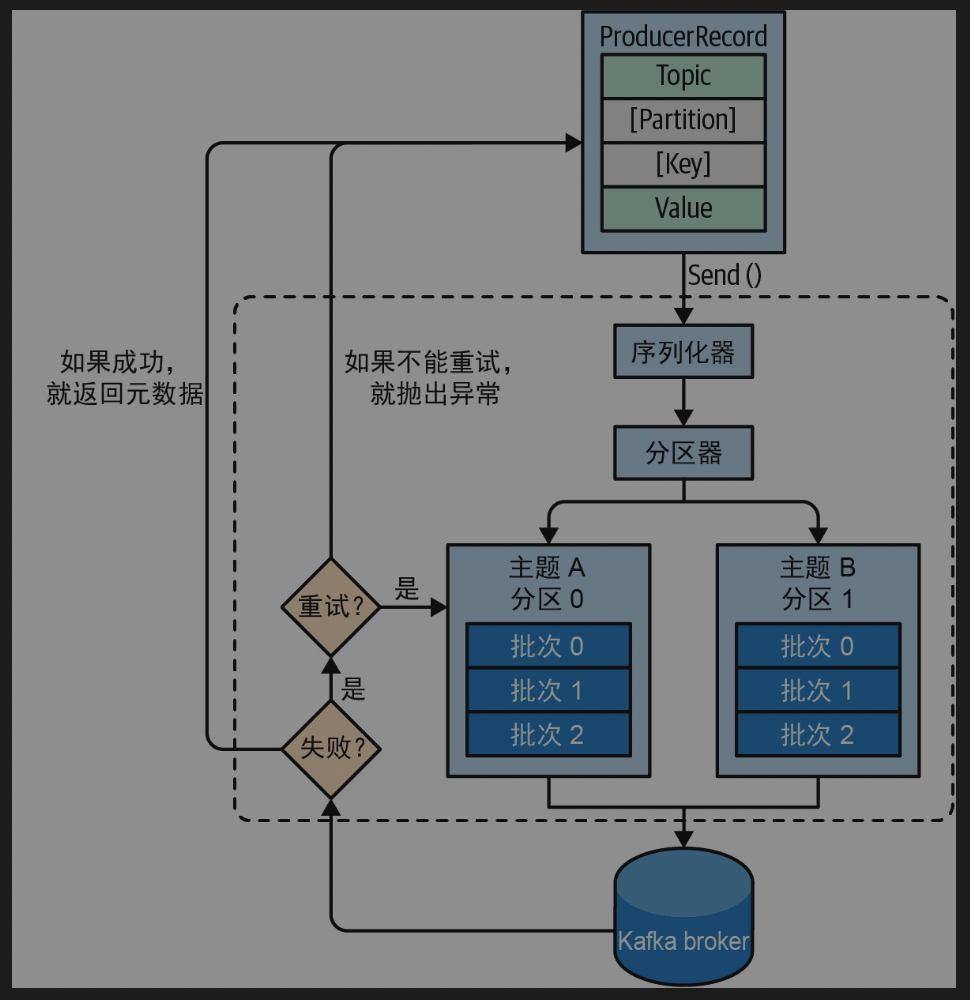

## 3.2　创建Kafka生产者

Kafka生产者有3个必须设置的属性。

- bootstrap.servers：broker的地址。可以由多个host:port组成，生产者用它们来建立初始的Kafka集群连接。它不需要包含所有的broker地址，因为生产者在建立初始连接之后可以从给定的broker那里找到其他broker的信息。不过还是建议至少提供两个broker地址，因为一旦其中一个停机，则生产者仍然可以连接到集群。

- key.serializer：一个类名，用来序列化消息的键。broker希望接收到的消息的键和值都是字节数组。生产者可以把任意Java对象作为键和值发送给broker，但它需要知道如何把这些Java对象转换成字节数组。key.serializer必须被设置为一个实现了org.apache.kafka.common.serialization.Serializer接口的类，生产者会用这个类把键序列化成字节数组。Kafka客户端默认提供了ByteArraySerializer、StringSerializer和IntegerSerializer等，如果你只使用常见的几种Java对象类型，就没有必要实现自己的序列化器。需要注意的是，必须设置key.serializer这个属性，尽管你可能只需要将值发送给Kafka。如果只需要发送值，则可以将Void作为键的类型，然后将这个属性设置为VoidSerializer。

- value.serializer：一个类名，用来序列化消息的值。与设置key.serializer属性一样，需要将value.serializer设置成可以序列化消息值对象的类。

```java
Properties kafkaProps = new Properties(); ➊
kafkaProps.put("bootstrap.servers", "broker1:9092,broker2:9092");
kafkaProps.put("key.serializer",
    "org.apache.kafka.common.serialization.StringSerializer"); ➋
kafkaProps.put("value.serializer",
    "org.apache.kafka.common.serialization.StringSerializer");

producer = new KafkaProducer<String, String>(kafkaProps); ➌
```

发送消息主要有以下3种方式。

- 发送并忘记：把消息发送给服务器，但并不关心它是否成功送达。大多数情况下，消息可以成功送达，因为Kafka是高可用的，而且生产者有自动尝试重发的机制。但是，如果发生了不可重试的错误或超时，那么消息将会丢失，应用程序将不会收到任何信息或异常。

- 同步发送：一般来说，生产者是异步的——我们调用send()方法发送消息，它会返回一个Future对象。可以调用get()方法等待Future完成，这样就可以在发送下一条消息之前知道当前消息是否发送成功。

- 异步发送：调用send()方法，并指定一个回调函数，当服务器返回响应时，这个函数会被触发。

## 3.3 发送消息到Kafka

```java
ProducerRecord<String, String> record =
    new ProducerRecord<>("CustomerCountry", "Precision Products",
        "France"); ➊
try {
    producer.send(record); ➋
} catch (Exception e) {
    e.printStackTrace(); ➌
}
```

```java
ProducerRecord<String, String> record =
    new ProducerRecord<>("CustomerCountry", "Precision Products", "France");
try {
    producer.send(record).get(); ➊
} catch (Exception e) {
    e.printStackTrace(); ➋
}
```

```java
private class DemoProducerCallback implements Callback { ➊
    @Override
    public void onCompletion(RecordMetadata recordMetadata, Exception e) {
        if (e != null) {
            e.printStackTrace(); ➋
        }
    }
}

ProducerRecord<String, String> record =
    new ProducerRecord<>("CustomerCountry", "Biomedical Materials", "USA"); ➌
producer.send(record, new DemoProducerCallback()); ➍
```

## 3.4　生产者配置

### 3.4.1　client.id

client.id是客户端标识符，它的值可以是任意字符串，broker用它来识别从客户端发送过来的消息。选择一个好的客户端标识符可以让故障诊断变得更容易些.

### 3.4.2　acks

acks指定了生产者在多少个分区副本收到消息的情况下才会认为消息写入成功。在默认情况下，Kafka会在首领副本收到消息后向客户端回应消息写入成功（Kafka 3.0预计会改变这个默认行为）​。这个参数对写入消息的持久性有重大影响，对于不同的场景，使用默认值可能不是最好的选择。

- acks=0: 如果acks=0，则生产者不会等待任何来自broker的响应。也就是说，如果broker因为某些问题没有收到消息，那么生产者便无从得知，消息也就丢失了。不过，因为生产者不需要等待broker返回响应，所以它们能够以网络可支持的最大速度发送消息，从而达到很高的吞吐量。

- acks=1: 如果acks=1，那么只要集群的首领副本收到消息，生产者就会收到消息成功写入的响应。如果消息无法到达首领副本（比如首领副本发生崩溃，新首领还未选举出来）​，那么生产者会收到一个错误响应。为了避免数据丢失，生产者会尝试重发消息。不过，在首领副本发生崩溃的情况下，如果消息还没有被复制到新的首领副本，则消息还是有可能丢失。

- acks=all: 如果acks=all，那么只有当所有副本全部收到消息时，生产者才会收到消息成功写入的响应。这种模式是最安全的，它可以保证不止一个broker收到消息，就算有个别broker发生崩溃，整个集群仍然可以运行（第6章将讨论更多的细节）​。不过，它的延迟比acks=1高，因为生产者需要等待不止一个broker确认收到消息。

### 3.4.3　消息传递时间

从Kafka 2.1开始，我们将ProduceRecord的发送时间分成如下两个时间间隔，它们是被分开处理的。

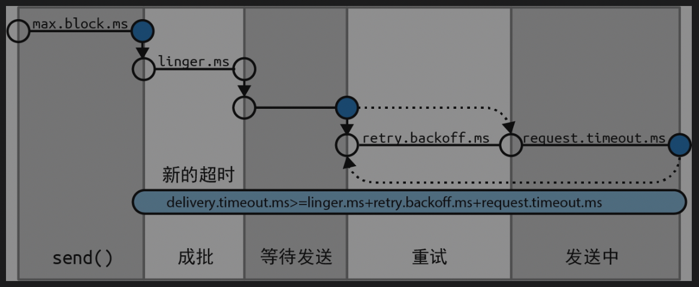

● 异步调用send()所花费的时间。在此期间，调用send()的线程将被阻塞。
● 从异步调用send()返回到触发回调（不管是成功还是失败）的时间，也就是从ProduceRecord被放到批次中直到Kafka成功响应、出现不可恢复异常或发送超时的时间。

- max.block.ms：这个参数用于控制在调用send()或通过partitionsFor()显式地请求元数据时生产者可以发生阻塞的时间。当生产者的发送缓冲区被填满或元数据不可用时，这些方法就可能发生阻塞。当达到max.block.ms配置的时间时，就会抛出一个超时异常。

- delivery.timeout.ms这个参数用于控制从消息准备好发送（send()方法成功返回并将消息放入批次中）到broker响应或客户端放弃发送（包括重试）所花费的时间。如图3-2所示，这个时间应该大于linger.ms和request.timeout.ms。如果配置的时间不满足这一点，则会抛出异常。通常，成功发送消息的速度要比delivery.timeout.ms快得多。一般建议这个时间大于broker重新选举的时间30s，建议可以配置为120。

- request.timeout.ms这个参数用于控制生产者在发送消息时等待服务器响应的时间。需要注意的是，这是指生产者在放弃之前等待每个请求的时间，不包括重试、发送之前所花费的时间等。如果设置的值已触及，但服务器没有响应，那么生产者将重试发送，或者执行回调，并传给它一个TimeoutException。

- retries 和retry.backoff.ms当生产者收到来自服务器的错误消息时，这个错误有可能是暂时的（例如，一个分区没有首领）​。在这种情况下，retries参数可用于控制生产者在放弃发送并向客户端宣告失败之前可以重试多少次。在默认情况下，重试时间间隔是100毫秒，但可以通过retry.backoff.ms参数来控制重试时间间隔。

生产者并不会重试所有的错误。有些错误不是暂时的，生产者就不会进行重试（例如，​“消息太大”错误）​。通常，对于可重试的错误，生产者会自动进行重试，所以不需要在应用程序中处理重试逻辑。你要做的是集中精力处理不可重试的错误或者当重试次数达到上限时的情况。

### 3.4.4　linger.ms

这个参数指定了生产者在发送消息批次之前等待更多消息加入批次的时间。生产者会在批次被填满或等待时间达到linger.ms时把消息批次发送出去。在默认情况下，只要有可用的发送者线程，生产者都会直接把批次发送出去，就算批次中只有一条消息。把linger.ms设置成比0大的数，可以让生产者在将批次发送给服务器之前等待一会儿，以使更多的消息加入批次中。虽然这样会增加一点儿延迟，但也极大地提升了吞吐量。这是因为一次性发送的消息越多，每条消息的开销就越小，如果启用了压缩，则计算量也更少了。

### 3.4.5　buffer.memory

这个参数用来设置生产者要发送给服务器的消息的内存缓冲区大小。如果应用程序调用send()方法的速度超过生产者将消息发送给服务器的速度，那么生产者的缓冲空间可能会被耗尽，后续的send()方法调用会等待内存空间被释放，如果在max.block.ms之后还没有可用空间，就抛出异常。需要注意的是，这个异常与其他异常不一样，它是send()方法而不是Future对象抛出来的。

### 3.4.6　compression.type

在默认情况下，生产者发送的消息是未经压缩的。这个参数可以被设置为snappy、gzip、lz4或zstd，这指定了消息被发送给broker之前使用哪一种压缩算法。snappy压缩算法由谷歌发明，虽然占用较少的CPU时间，但能提供较好的性能和相当可观的压缩比。如果同时有性能和网络带宽方面的考虑，那么可以使用这种算法。gzip压缩算法通常会占用较多的CPU时间，但提供了更高的压缩比。如果网络带宽比较有限，则可以使用这种算法。使用压缩可以降低网络传输和存储开销，而这些往往是向Kafka发送消息的瓶颈所在。

### 3.4.7　batch.size

当有多条消息被发送给同一个分区时，生产者会把它们放在同一个批次里。这个参数指定了一个批次可以使用的内存大小。需要注意的是，该参数是按照字节数而不是消息条数来计算的。当批次被填满时，批次里所有的消息都将被发送出去。但是生产者并不一定都会等到批次被填满时才将其发送出去。那些未填满的批次，甚至只包含一条消息的批次也有可能被发送出去。所以，就算把批次大小设置得很大，也不会导致延迟，只是会占用更多的内存而已。但如果把批次大小设置得太小，则会增加一些额外的开销，因为生产者需要更频繁地发送消息。

### 3.4.8　max.in.flight.requests.per.connection

这个参数指定了生产者在收到服务器响应之前可以发送多少个消息批次。它的值越大，占用的内存就越多，不过吞吐量也会得到提升。在单数据中心环境中，该参数被设置为2时可以获得最佳的吞吐量，但使用默认值5也可以获得差不多的性能。

Kafka可以保证同一个分区中的消息是有序的。也就是说，如果生产者按照一定的顺序发送消息，那么broker会按照这个顺序把它们写入分区，消费者也会按照同样的顺序读取它们。在某些情况下，顺序是非常重要的。

### 3.4.9　max.request.size

这个参数用于控制生产者发送的请求的大小。它限制了可发送的单条最大消息的大小和单个请求的消息总量的大小。另外，broker对可接收的最大消息也有限制(message.max.bytes)，其两边的配置最好是匹配的，以免生产者发送的消息被broker拒绝。

### 3.4.10　receive.buffer.bytes和send.buffer.bytes

这两个参数分别指定了TCP socket接收和发送数据包的缓冲区大小。如果它们被设为–1，就使用操作系统默认值。如果生产者或消费者与broker位于不同的数据中心，则可以适当加大它们的值，因为跨数据中心网络的延迟一般都比较高，而带宽又比较低。

### 3.4.11　enable.idempotence

为了避免broker出现重复的消息，可以将enable.idempotence设置为true。当幂等生产者被启用时，生产者将给发送的每一条消息都加上一个序列号。如果broker收到具有相同序列号的消息，那么它就会拒绝第二个副本，而生产者则会收到DuplicateSequenceException，这个异常对生产者来说是无害的。

如果要启用幂等性，那么max.in.flight.requests.per.connection应小于或等于5、retries应大于0，并且acks被设置为all。如果设置了不恰当的值，则会抛出ConfigException异常。

## 3.5　序列化器

### 3.5.1　自定义序列化器

如果要发送给Kafka的对象不是简单的字符串或整型，则既可以用通用的序列化框架（比如Avro、Thrift或Protobuf）来创建消息，也可以使用自定义序列化器。强烈建议使用通用的序列化框架。

## 3.6　分区

在上面的例子中，ProducerRecord对象包含了主题名称、记录的键和值。Kafka消息就是一个个的键–值对，ProducerRecord对象可以只包含主题名称和值，键默认情况下是null。不过，大多数应用程序还是会用键来发送消息。键有两种用途：一是作为消息的附加信息与消息保存在一起，二是用来确定消息应该被写入主题的哪个分区（键在压缩主题中也扮演了重要角色），具有相同键的消息将被写入同一个分区。如果一个进程只从主题的某些分区读取数据，那么具有相同键的所有记录都会被这个进程读取。

```java
ProducerRecord<String, String> record =
    new ProducerRecord<>("CustomerCountry", "Laboratory Equipment", "USA");
```

```java
ProducerRecord<String, String> record =
    new ProducerRecord<>("CustomerCountry", "USA"); //这里的键将被设置为null。
```

如果键为null，并且使用了默认的分区器，那么记录将被随机发送给主题的分区。分区器使用轮询调度(round-robin)算法将消息均衡地分布到各个分区中。从Kafka 2.4开始，在处理键为null的记录时，默认分区器使用的轮询调度算法具备了黏性。也就是说，在切换到下一个分区之前，它会将同一个批次的消息全部写入当前分区。这样就可以使用更少的请求发送相同数量的消息，既降低了延迟，又减少了broker占用CPU的时间。

如果键不为空且使用了默认的分区器，那么Kafka会对键进行哈希（使用Kafka自己的哈希算法，即使升级Java版本，哈希值也不会发生变化）​，然后根据哈希值把消息映射到特定的分区。这里的关键在于同一个键总是被映射到同一个分区，所以在进行映射时，会用到主题所有的分区，而不只是可用的分区。这也意味着，如果在写入数据时目标分区不可用，那么就会出错。不过这种情况很少发生。

除了默认的分区器，Kafka客户端还提供了RoundRobinPartitioner和UniformStickyPartitioner。在消息包含键的情况下，可以用它们来实现随机分区分配和黏性随机分区分配。也可以用UniformStickyPartitioner将负载均衡地分布到所有分区。

如果使用了默认的分区器，那么只有在不改变主题分区数量的情况下键与分区之间的映射才能保持一致。

除了哈希分区，有时也需要使用不一样的分区策略。假设你是B2B供应商，你有一个大客户，它是手持设备Banana的制造商。你的日常交易中有10%以上的交易与这个客户有关。如果使用默认的哈希分区算法，那么与Banana相关的记录就会和其他客户的记录一起被分配给相同的分区，导致这个分区比其他分区大很多。服务器可能会出现存储空间不足、请求处理缓慢等问题。因此，需要给Banana分配单独的分区，然后使用哈希分区算法将其他记录分配给其他分区。

```java
import org.apache.kafka.clients.producer.Partitioner;
import org.apache.kafka.common.Cluster;
import org.apache.kafka.common.PartitionInfo;
import org.apache.kafka.common.record.InvalidRecordException;
import org.apache.kafka.common.utils.Utils;

public class BananaPartitioner implements Partitioner {

    public void configure(Map<String, ?> configs) {} ➊

    public int partition(String topic, Object key, byte[] keyBytes,
                         Object value, byte[] valueBytes,
                         Cluster cluster) {
        List<PartitionInfo> partitions = cluster.partitionsForTopic(topic);
        int numPartitions = partitions.size();

        if ((keyBytes == null) || (!(key instanceOf String))) ➋
            throw new InvalidRecordException("We expect all messages "+
                "to have customer name as key");

        if (((String) key).equals("Banana"))
            return numPartitions - 1; // Banana的记录总是被分配到最后一个分区

        // 其他记录被哈希到其他分区
        return Math.abs(Utils.murmur2(keyBytes)) % (numPartitions - 1);
    }

    public void close() {}
}
```

## 3.7　标头

除了键和值，记录还可以包含标头(可以理解为报文头信息)。可以在不改变记录键–值对的情况下向标头中添加一些有关记录的元数据。标头指明了记录数据的来源，可以在不解析消息体的情况下根据标头信息来路由或跟踪消息（消息有可能被加密，而路由器没有访问加密数据的权限）​。

标头由一系列有序的键–值对组成。键是字符串，值可以是任意被序列化的对象，就像消息里的值一样。

```java
ProducerRecord<String, String> record =
    new ProducerRecord<>("CustomerCountry", "Precision Products", "France");

record.headers().add("privacy-level","YOLO".getBytes(StandardCharsets.UTF_8));
```

## 3.8　拦截器

有时候，你希望在不修改代码的情况下改变Kafka客户端的行为。这或许是因为你想给公司所有的应用程序都加上同样的行为，或许是因为无法访问应用程序的原始代码。Kafka的ProducerInterceptor拦截器包含两个关键方法。ProducerRecord<K, V> onSend(ProducerRecord<K, V> record)

有时候，你希望在不修改代码的情况下改变Kafka客户端的行为。这或许是因为你想给公司所有的应用程序都加上同样的行为，或许是因为无法访问应用程序的原始代码。Kafka的ProducerInterceptor拦截器包含两个关键方法。ProducerRecord<K, V> onSend(ProducerRecord<K, V> record)。

void onAcknowledgement(RecordMetadata metadata, Exceptionexception) 这个方法会在收到Kafka的确认响应时调用。如果覆盖了这个方法，则不可以修改Kafka返回的响应，但可以捕获到有关响应的信息。常见的生产者拦截器应用场景包括：捕获监控和跟踪信息、为消息添加标头，以及敏感信息脱敏。

```java
public class CountingProducerInterceptor implements ProducerInterceptor {

  ScheduledExecutorService executorService =
          Executors.newSingleThreadScheduledExecutor();
  static AtomicLong numSent = new AtomicLong(0);
  static AtomicLong numAcked = new AtomicLong(0);

  public void configure(Map<String, ?> map) {
      Long windowSize = Long.valueOf(
              (String) map.get("counting.interceptor.window.size.ms")); ➊
      executorService.scheduleAtFixedRate(CountingProducerInterceptor::run,
              windowSize, windowSize, TimeUnit.MILLISECONDS);
  }

  public ProducerRecord onSend(ProducerRecord producerRecord) {
      numSent.incrementAndGet();
      return producerRecord; ➋
  }

  public void onAcknowledgement(RecordMetadata recordMetadata, Exception e) {
      numAcked.incrementAndGet(); ➌
  }

  public void close() {
      executorService.shutdownNow(); ➍
  }

  public static void run() {
      System.out.println(numSent.getAndSet(0));
      System.out.println(numAcked.getAndSet(0));
  }
}
```
## 3.9　配额和节流

Kafka可以限制生产消息和消费消息的速率，这是通过配额机制来实现的。Kafka提供了3种配额类型：生产、消费和请求。生产配额和消费配额限制了客户端发送和接收数据的速率（以字节 / 秒为单位）​。请求配额限制了broker用于处理客户端请求的时间百分比。

可以为所有客户端（使用默认配额）​、特定客户端、特定用户，或特定客户端及特定用户设置配额。特定用户的配额只在集群配置了安全特性并对客户端进行了身份验证后才有效。

默认的生产配额和消费配额是broker配置文件的一部分。如果要限制每个生产者平均发送的消息不超过2 MBps，那么可以在broker配置文件中加入quota.producer.default=2M。

也可以覆盖broker配置文件中的默认配额来为某些客户端配置特定的配额，尽管不建议这么做。如果允许clientA的配额达到4 MBps、clientB的配额达到10 MBps，则可以这样配置：quota.producer.override="clientA:4M,clientB:10M"。

特定客户端的配额通常采用动态配置。可以用kafkaconfig.sh或AdminClient API来动态设置配额。

```bash
bin/kafka-configs --bootstrap-server localhost:9092 --alter --add-config 'producer_
byte_rate=1024' --entity-name clientC --entity-type clients ➊

bin/kafka-configs --bootstrap-server localhost:9092 --alter --add-config 'producer_
byte_rate=1024,consumer_byte_rate=2048' --entity-name user1 --entity-type users ➋

bin/kafka-configs --bootstrap-server localhost:9092 --alter --add-config 'consumer_
byte_rate=2048' --entity-type users ➌
```

❶ 限制clientC（通过客户端ID来识别）每秒平均发送不超过1024字节。❷ 限制user1（通过已认证的账号来识别）每秒平均发送不超过1024字节以及每秒平均消费不超过2048字节。 ❸ 限制所有用户每秒平均消费不超过2048字节，有覆盖配置的特定用户除外。这也是动态修改默认配置的一种方式。

当客户端触及配额时，broker会开始限制客户端请求，以防止超出配额。这意味着broker将延迟对客户端请求做出响应。对大多数客户端来说，这样会自动降低请求速率（因为执行中的请求数量也是有限制的）​，并将客户端流量降到配额允许的范围内。但是，被节流的客户端还是有可能向服务器端发送额外的请求，为了不受影响，broker将在一段时间内暂停与客户端之间的通信通道，以满足配额要求。

节流行为通过produce-throttle-time-avg、produce-throttle-time-max、fetch-throttle-time-avg和fetch-throttle-time-max暴露给客户端，这几个参数是生产请求和消费请求因节流而被延迟的平均时间和最长时间

如果你异步调用Producer.send()，并且发送速率超过了broker能够接受的速率（无论是由于配额的限制还是由于处理能力不足）​，那么消息将会被放入客户端的内存队列。如果发送速率一直快于接收速率，那么客户端最终将耗尽内存缓冲区，并阻塞后续的Producer.send()调用。如果超时延迟不足以让broker赶上生产者，使其清理掉一些缓冲区空间，那么Producer.send()最终将抛出TimeoutException异常。或者，批次里的记录因为等待时间超过了delivery.timeout.ms而过期，导致执行send()的回调，并抛出TimeoutException异常。因此，要做好计划和监控，确保broker的处理能力总是与生产者发送数据的速率相匹配。

# 第4章　Kafka消费者——从Kafka读取数据

## 4.1　Kafka消费者相关概念

### 4.1.1　消费者和消费者群组

就像多个生产者可以向相同的主题写入消息一样，也可以让多个消费者从同一个主题读取消息。Kafka消费者从属于消费者群组。一个群组里的消费者订阅的是同一个主题，每个消费者负责读取这个主题的部分消息。

假设主题T1有4个分区，我们创建了消费者C1，它是群组G1中唯一的消费者，用于订阅主题T1。消费者C1将收到主题T1全部4个分区的消息。

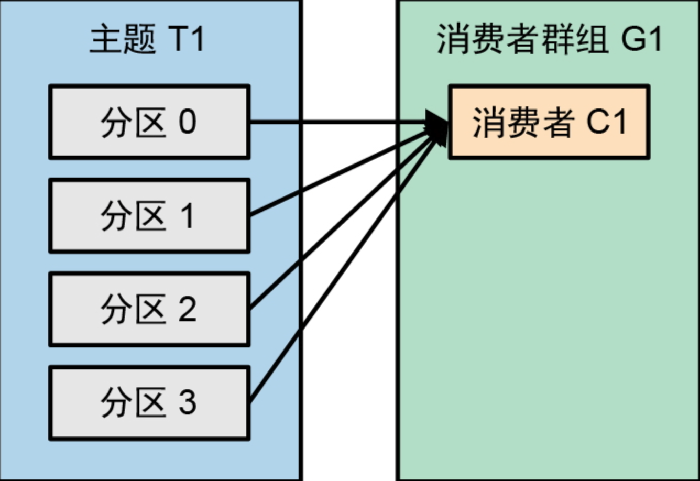

如果在群组G1里新增一个消费者C2，那么每个消费者将接收到两个分区的消息。假设消费者C1接收分区0和分区2的消息，消费者C2接收分区1和分区3的消息。

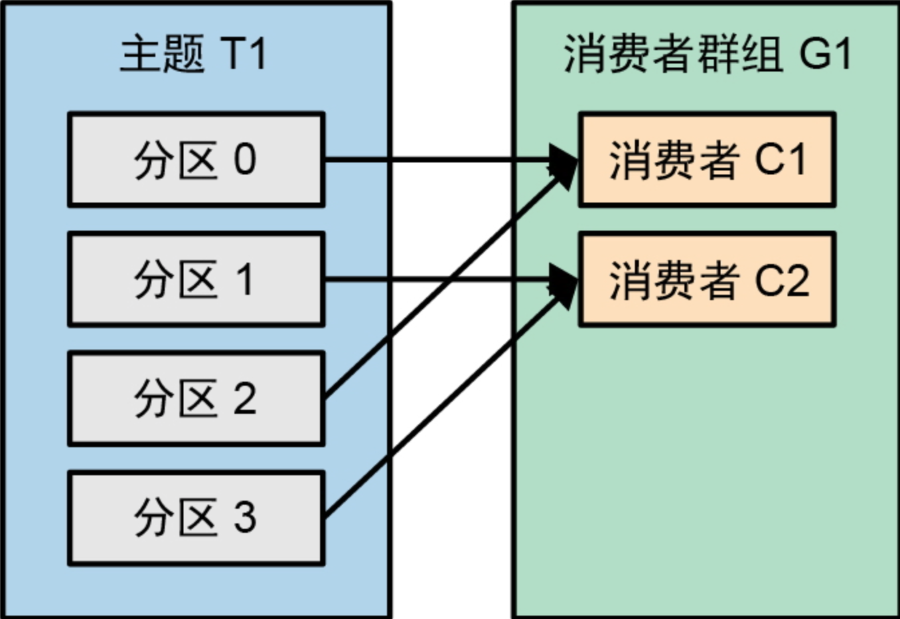

如果群组G1有4个消费者，那么每个消费者将可以分配到一个分区。

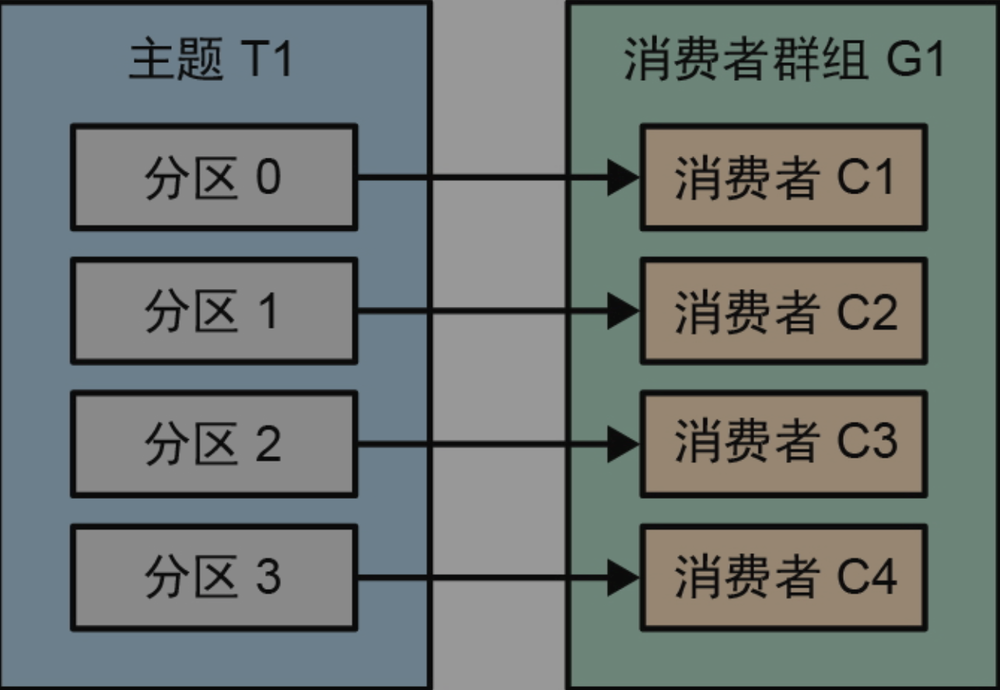

如果向群组里添加更多的消费者，以致超过了主题的分区数量，那么就会有一部分消费者处于空闲状态，不会接收到任何消息。

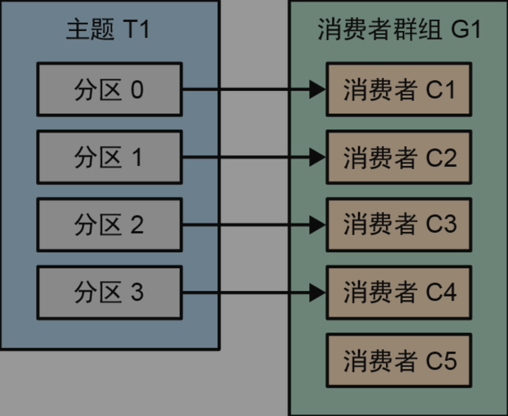

向群组里添加消费者是横向扩展数据处理能力的主要方式。Kafka消费者经常需要执行一些高延迟的操作，比如把数据写到数据库或用数据做一些比较耗时的计算。在这些情况下，单个消费者无法跟上数据生成的速度，因此可以增加更多的消费者来分担负载，让每个消费者只处理部分分区的消息，这是横向扩展消费者的主要方式。于是，我们可以为主题创建大量的分区，当负载急剧增长时，可以加入更多的消费者。不过需要注意的是，不要让消费者的数量超过主题分区的数量，因为多余的消费者只会被闲置。向群组里添加消费者是横向扩展数据处理能力的主要方式。

除了通过增加消费者数量来横向伸缩单个应用程序，我们还经常遇到多个应用程序从同一个主题读取数据的情况。实际上，Kafka的一个主要设计目标是让Kafka主题里的数据能够满足企业各种应用场景的需求。在这些应用场景中，我们希望每一个应用程序都能获取到所有的消息，而不只是其中的一部分。只要保证每个应用程序都有自己的消费者群组就可以让它们获取到所有的消息。不同于传统的消息系统，横向伸缩消费者和消费者群组并不会导致Kafka性能下降。在之前的例子中，如果新增一个只包含一个消费者的群组G2，那么这个消费者将接收到主题T1的所有消息，与群组G1之间互不影响。群组G2可以增加更多的消费者，每个消费者会读取若干个分区，就像群组G1里的消费者那样。作为整体来说，群组G2还是会收到所有消息，不管有没有其他群组存在。

总的来说，就是为每一个需要获取主题全部消息的应用程序创建一个消费者群组，然后向群组里添加更多的消费者来扩展读取能力和处理能力，让群组里的每个消费者只处理一部分消息。

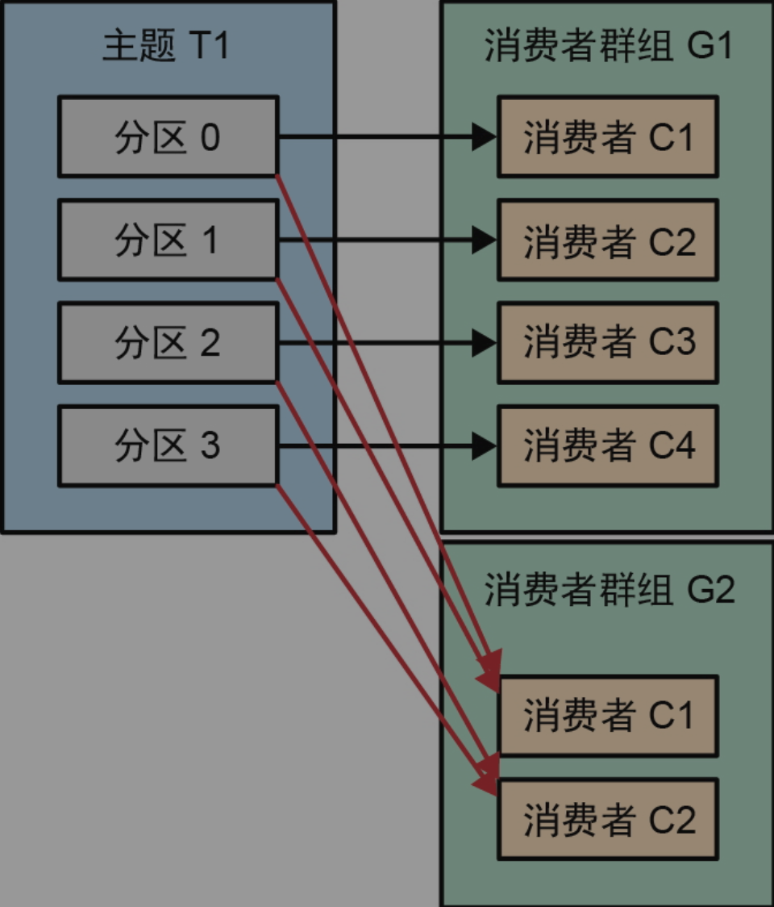

### 4.1.2　消费者群组和分区再均衡

消费者群组里的消费者共享主题分区的所有权。当一个新消费者加入群组时，它将开始读取一部分原本由其他消费者读取的消息。当一个消费者被关闭或发生崩溃时，它将离开群组，原本由它读取的分区将由群组里的其他消费者读取。主题发生变化（比如管理员添加了新分区）会导致分区重分配。

分区的所有权从一个消费者转移到另一个消费者的行为称为再均衡。再均衡非常重要，它为消费者群组带来了高可用性和伸缩性（你可以放心地添加或移除消费者）​。不过，在正常情况下，我们并不希望发生再均衡。

__主动再均衡__

在进行主动再均衡期间，所有消费者都会停止读取消息，放弃分区所有权，重新加入消费者群组，并获得重新分配到的分区。这样会导致整个消费者群组在一个很短的时间窗口内不可用。主动再均衡包含两个不同的阶段：第一个阶段，所有消费者都放弃分区所有权；第二个阶段，消费者重新加入群组，获得重新分配到的分区，并继续读取消息。

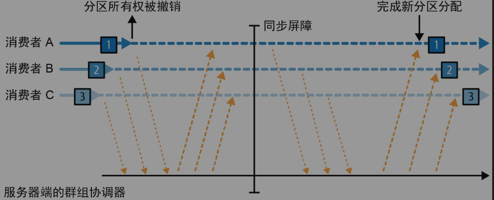

__协作再均衡__

协作再均衡（也称为增量再均衡）通常是指将一个消费者的部分分区重新分配给另一个消费者，其他消费者则继续读取没有被重新分配的分区。这种再均衡包含两个或多个阶段。

在第一个阶段，消费者群组首领会通知所有消费者，它们将失去部分分区的所有权，然后消费者会停止读取这些分区，并放弃对它们的所有权。在第二个阶段，消费者群组首领会将这些没有所有权的分区分配给其他消费者。虽然这种增量再均衡可能需要进行几次迭代，直到达到稳定状态，但它避免了主动再均衡中出现的“停止世界”停顿。

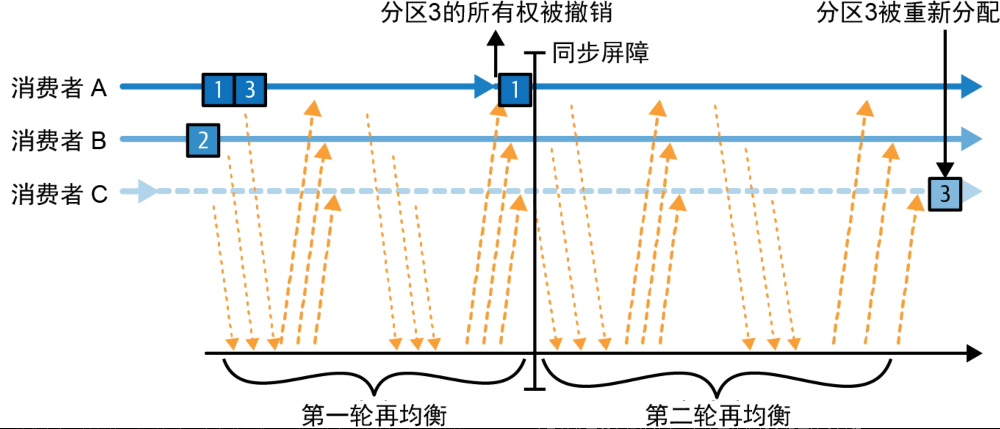

消费者会向被指定为群组协调器的broker（不同消费者群组的协调器可能不同）发送心跳，以此来保持群组成员关系和对分区的所有权关系。心跳是由消费者的一个后台线程发送的，只要消费者能够以正常的时间间隔发送心跳，它就会被认为还“活着”​。如果消费者在足够长的一段时间内没有发送心跳，那么它的会话就将超时，群组协调器会认为它已经“死亡”​，进而触发再均衡。

### 4.1.3　群组固定成员

在默认情况下，消费者的群组成员身份标识是临时的。当一个消费者离开群组时，分配给它的分区所有权将被撤销；当该消费者重新加入时，将通过再均衡协议为其分配一个新的成员ID和新分区。可以给消费者分配一个唯一的group.instance.id，让它成为群组的固定成员。通常，当消费者第一次以固定成员身份加入群组时，群组协调器会按照分区分配策略给它分配一部分分区。当这个消费者被关闭时，它不会自动离开群组——它仍然是群组的成员，直到会话超时。当这个消费者重新加入群组时，它会继续持有之前的身份，并分配到之前所持有的分区。群组协调器缓存了每个成员的分区分配信息，只需要将缓存中的信息发送给重新加入的固定成员，不需要进行再均衡。

如果应用程序需要维护与消费者分区所有权相关的本地状态或缓存，那么群组固定成员关系就非常有用。如果重建本地缓存非常耗时，那么你肯定不希望在每次重启消费者时都经历这个过程。更重要的是，在消费者重启时，消费者所拥有的分区不会被重新分配。在重启过程中，消费者不会读取这些分区，所以当消费者重启完毕时，读取进度会稍稍落后，但你要相信它们一定会赶上。需要注意的是，群组的固定成员在关闭时不会主动离开群组，它们何时“真正消失”取决于session.timeout.ms参数。你可以将这个参数设置得足够大，避免在进行简单的应用程序重启时触发再均衡，但又要设置得足够小，以便在出现严重停机时自动重新分配分区，避免这些分区的读取进度出现较大的滞后。

## 4.2　创建Kafka消费者

在读取消息之前，需要先创建一个KafkaConsumer对象。创建KafkaConsumer对象与创建KafkaProducer对象非常相似——把想要传给消费者的属性放在Properties对象里。本章后续部分将深入介绍所有的配置属性。这里只提供3个必要的属性：bootstrap.servers、key.deserializer和value.deserializer。

第一个属性bootstrap.servers指定了连接Kafka集群的字符串。另外两个属性key.deserializer和value.deserializer，把字节数组转成Java对象。

第4个属性group.id不是必需的，但会经常被用到。它指定了一个消费者属于哪一个消费者群组。也可以创建不属于任何一个群组的消费者，只是这种做法不太常见，所以本书的大部分章节会假设消费者属于某个群组。

```java
Properties props = new Properties();
props.put("bootstrap.servers", "broker1:9092,broker2:9092");
props.put("group.id", "CountryCounter");
props.put("key.deserializer",
    "org.apache.kafka.common.serialization.StringDeserializer");
props.put("value.deserializer",
    "org.apache.kafka.common.serialization.StringDeserializer");

KafkaConsumer<String, String> consumer =
    new KafkaConsumer<String,String>(props);
```

## 4.3　订阅主题

在创建好消费者之后，下一步就可以开始订阅主题了。subscribe()方法会接收一个主题列表作为参数。

```java
consumer.subscribe(Collections.singletonList("customerCountries")); 
```

也可以在调用subscribe()方法时传入一个正则表达式。正则表达式可以匹配多个主题，如果有人创建了新主题，并且主题的名字与正则表达式匹配，那么就会立即触发一次再均衡，然后消费者就可以读取新主题里的消息。比如要订阅所有与测试相关的主题，那么可以这样做。

```java
consumer.subscribe(Pattern.compile("test.*"));
```

如果你的Kafka集群包含了大量分区（比如30 000个或更多）​，则需注意，主题的过滤是在客户端完成的。当你使用正则表达式而不是指定列表订阅主题时，消费者将定期向broker请求所有已订阅的主题及分区。然后，客户端会用这个列表来检查是否有新增的主题，如果有，就订阅它们。如果主题很多，消费者也很多，那么通过正则表达式订阅主题就会给broker、客户端和网络带来很大的开销。在某些情况下，主题元数据使用的带宽会超过用于发送数据的带宽。另外，为了能够使用正则表达式订阅主题，需要授予客户端获取集群全部主题元数据的权限，即全面描述整个集群的权限。

## 4.4　轮询

消费者API最核心的东西是通过一个简单的轮询向服务器请求数据.

```java
Duration timeout = Duration.ofMillis(100);

while (true) { ➊
    ConsumerRecords<String, String> records = consumer.poll(timeout); ➋

    for (ConsumerRecord<String, String> record : records) { ➌
        System.out.printf("topic = %s, partition = %d, offset = %d, " +
                        "customer = %s, country = %s\n",
        record.topic(), record.partition(), record.offset(),
                record.key(), record.value());
        int updatedCount = 1;
        if (custCountryMap.containsKey(record.value())) {
            updatedCount = custCountryMap.get(record.value()) + 1;
        }
        custCountryMap.put(record.value(), updatedCount);

        JSONObject json = new JSONObject(custCountryMap);
        System.out.println(json.toString()); ➍
    }
}
```
❷ 这一行代码非常重要。消费者必须持续对Kafka进行轮询，否则会被认为已经“死亡”​，它所消费的分区将被移交给群组里其他的消费者。传给poll()的参数是一个超时时间间隔，用于控制poll()的阻塞时间（当消费者缓冲区里没有可用数据时会发生阻塞）​。如果这个参数被设置为0或者有可用的数据，那么poll()就会立即返回，否则它会等待指定的毫秒数。

❸ poll()方法会返回一个记录列表。列表中的每一条记录都包含了主题和分区的信息、记录在分区里的偏移量，以及记录的键–值对。我们一般会遍历这个列表，逐条处理记录。

轮询不只是获取数据那么简单。在第一次调用消费者的poll()方法时，它需要找到GroupCoordinator，加入群组，并接收分配给它的分区。如果触发了再均衡，则整个再均衡过程也会在轮询里进行，包括执行相关的回调

需要注意的是，如果超过max.poll.interval.ms没有调用poll()，则消费者将被认为已经“死亡”​，并被逐出消费者群组。因此，要避免在轮询循环中做任何可能导致不可预知的阻塞的操作。

__线程安全__

按照规则，一个消费者使用一个线程。如果要在应用程序的同一个消费者群组里运行多个消费者，则需要让每个消费者运行在自己的线程中。最好是把消费者的逻辑封装在自己的对象里，然后用Java的ExecutorService启动多个线程，让每个消费者运行在自己的线程中。

在旧版本Kafka中，轮询方法的完整签名是poll(long)。现在，这个签名被弃用了，新API的签名是poll(Duration)。除了参数类型发生变化，方法体里的阻塞语义也发生了细微的改变。原来的方法会一直阻塞，直到从Kafka获取所需的元数据，即使阻塞时间比指定的超时时间还长。新方法将遵守超时限制，不会一直等待元数据返回。如果你已经有一个消费者使用poll(0) 来获取Kafka元数据（不消费任何记录，这是一种相当常见的做法）​，那么就不要指望把它改成poll(Duration.ofMillis(0)) 后还能获得同样的效果。你需要想新的办法来达到目的。通常的解决办法是将逻辑放在rebalanceListener.onPartitionAssignment()方法里，这个方法一定会在获取分区元数据之后以及记录开始到达之前被调用。

## 4.5　配置消费者

### 4.5.1　fetch.min.bytes

这个属性指定了消费者从服务器获取记录的最小字节数，默认是1字节。broker在收到消费者的获取数据请求时，如果可用数据量小于fetch.min.bytes指定的大小，那么它就会等到有足够可用数据时才将数据返回。这样可以降低消费者和broker的负载，因为它们在主题流量不是很大的时候（或者一天里的低流量时段）不需要来来回回地传输消息。如果消费者在没有太多可用数据时CPU使用率很高，或者在有很多消费者时为了降低broker的负载，那么可以把这个属性的值设置 得比默认值大。但需要注意的是，在低吞吐量的情况下，加大这个值会增加延迟。

### 4.5.2　fetch.max.wait.ms

通过设置fetch.min.bytes，可以让Kafka等到有足够多的数据时才将它们返回给消费者，feth.max.wait.ms则用于指定broker等待的时间，默认是500毫秒。如果没有足够多的数据流入Kafka，那么消费者获取数据的请求就得不到满足，最多会导致500毫秒的延迟。如果要降低潜在的延迟（为了满足SLA）​，那么可以把这个属性的值设置得小一些。如果fetch.max.wait.ms被设置为100毫秒，fetch.min.bytes被设置为1 MB，那么Kafka在收到消费者的请求后，如果有1 MB数据，就将其返回，如果没有，就在100毫秒后返回，就看哪个条件先得到满足。

### 4.5.3　fetch.max.bytes

这个属性指定了Kafka返回的数据的最大字节数（默认为50 MB）​。消费者会将服务器返回的数据放在内存中，所以这个属性被用于限制消费者用来存放数据的内存大小。broker端也有一个与之对应的配置属性，Kafka管理员可以用它来限制最大获取数量。请求的数据量越大，需要从磁盘读取的数据量就越大，通过网络发送数据的时间就越长，这可能会导致资源争用并增加broker的负载。

### 4.5.4　max.poll.records

这个属性用于控制单次调用poll()方法返回的记录条数。可以用它来控制应用程序在进行每一次轮询循环时需要处理的记录条数（不是记录的大小）​。

### 4.5.5　max.partition.fetch.bytes

这个属性指定了服务器从每个分区里返回给消费者的最大字节数（默认值是1MB）​。当KafkaConsumer.poll()方法返回ConsumerRecords时，从每个分区里返回的记录最多不超过max.partition.fetch.bytes指定的字节。需要注意的是，使用这个属性来控制消费者的内存使用量会让事情变得复杂，因为你无法控制broker返回的响应里包含多少个分区的数据。因此，对于这种情况，建议用fetch.max.bytes替代，除非有特殊的需求，比如要求从每个分区读取差不多的数据量。

### 4.5.6　session.timeout.ms和heartbeat.interval.ms

session.timeout.ms指定了消费者可以在多长时间内不与服务器发生交互而仍然被认为还“活着”​，默认是10秒。如果消费者没有在session.timeout.ms指定的时间内发送心跳给群组协调器，则会被认为已“死亡”​，协调器就会触发再均衡，把分区分配给群组里的其他消费者。session.timeout.ms与heartbeat.interval.ms紧密相关。heartbeat.interval.ms指定了消费者向协调器发送心跳的频率，session.timeout.ms指定了消费者可以多久不发送心跳。因此，我们一般会同时设置这两个属性，heartbeat.interval.ms必须比session.timeout.ms小，通常前者是后者的1/3。如果session.timeout.ms是3秒，那么heartbeat.interval.ms就应该是1秒。把session.timeout.ms设置得比默认值小，可以更快地检测到崩溃，并从崩溃中恢复，但也会导致不必要的再均衡。把session.timeout.ms设置得比默认值大，可以减少意外的再均衡，但需要更长的时间才能检测到崩溃。

### 4.5.7　max.poll.interval.ms

这个属性指定了消费者在被认为已经“死亡”之前可以在多长时间内不发起轮询。前面提到过，心跳和会话超时是Kafka检测已“死亡”的消费者并撤销其分区的主要机制。我们也提到了心跳是通过后台线程发送的，而后台线程有可能在消费者主线程发生死锁的情况下继续发送心跳，但这个消费者并没有在读取分区里的数据。要想知道消费者是否还在处理消息，最简单的方法是检查它是否还在请求数据。比如应用程序假死了，虽然还存活但是已经无法再消费消息。但是，即使设置了max.poll.records，调用poll()的时间间隔仍然很难预测。于是，设置max.poll.interval.ms就成了一种保险措施。它必须被设置得足够大，让正常的消费者尽量不触及这个阈值，但又要足够小，避免有问题的消费者给应用程序造成严重影响。这个属性的默认值为5分钟。当这个阈值被触及时，后台线程将向broker发送一个“离开群组”的请求，让broker知道这个消费者已经“死亡”​，必须进行群组再均衡，然后停止发送心跳。

### 4.5.8　default.api.timeout.ms

如果在调用消费者API时没有显式地指定超时时间，那么消费者就会在调用其他API时使用这个属性指定的值。默认值是1分钟，因为它比请求超时时间的默认值大，所以可以将重试时间包含在内。poll()方法是一个例外，因为它需要显式地指定超时时间。

### 4.5.9　request.timeout.ms

这个属性指定了消费者在收到broker响应之前可以等待的最长时间。如果broker在指定时间内没有做出响应，那么客户端就会关闭连接并尝试重连。它的默认值是30秒。不建议把它设置得比默认值小。在放弃请求之前要给broker留有足够长的时间来处理其他请求，因为向已经过载的broker发送请求几乎没有什么好处，况且断开并重连只会造成更大的开销。

### 4.5.10　auto.offset.reset

这个属性指定了消费者在读取一个没有偏移量或偏移量无效（因消费者长时间不在线，偏移量对应的记录已经过期并被删除）的分区时该做何处理。它的默认值是latest，意思是说，如果没有有效的偏移量，那么消费者将从最新的记录（在消费者启动之后写入Kafka的记录）开始读取。另一个值是earliest，意思是说，如果没有有效的偏移量，那么消费者将从起始位置开始读取记录。如果将auto.offset.reset设置为none，并试图用一个无效的偏移量来读取记录，则消费者将抛出异常。

### 4.5.11　enable.auto.commit

这个属性指定了消费者是否自动提交偏移量，默认值是true。你可以把它设置为false，选择自己控制何时提交偏移量，以尽量避免出现数据重复和丢失。如果它被设置为true，那么还有另外一个属性auto.commit.interval.ms可以用来控制偏移量的提交频率。

### 4.5.12　partition.assignment.strategy

我们知道，分区会被分配给群组里的消费者。PartitionAssignor根据给定的消费者和它们订阅的主题来决定哪些分区应该被分配给哪个消费者。Kafka提供了几种默认的分配策略。

__区间(range)__

这个策略会把每一个主题的若干个连续分区分配给消费者。假设消费者C1和消费者C2同时订阅了主题T1和主题T2，并且每个主题有3个分区。那么消费者C1有可能会被分配到这两个主题的分区0和分区1，消费者C2则会被分配到这两个主题的分区2。因为每个主题拥有奇数个分区，并且都遵循一样的分配策略，所以第一个消费者会分配到比第二个消费者更多的分区。只要使用了这个策略，并且分区数量无法被消费者数量整除，就会出现这种情况。

__轮询(roundRobin)__

这个策略会把所有被订阅的主题的所有分区按顺序逐个分配给消费者。如果使用轮询策略为消费者C1和消费者C2分配分区，那么消费者C1将分配到主题T1的分区0和分区2以及主题T2的分区1，消费者C2将分配到主题T1的分区1以及主题T2的分区0和分区2。一般来说，如果所有消费者都订阅了相同的主题（这种情况很常见）​，那么轮询策略会给所有消费者都分配相同数量（或最多就差一个）的分区。

__黏性(sticky)__

设计黏性分区分配器的目的有两个：一是尽可能均衡地分配分区，二是在进行再均衡时尽可能多地保留原先的分区所有权关系，减少将分区从一个消费者转移给另一个消费者所带来的开销。如果所有消费者都订阅了相同的主题，那么黏性分配器初始的分配比例将与轮询分配器一样均衡。后续的重新分配将同样保持均衡，但减少了需要移动的分区的数量。如果同一个群组里的消费者订阅了不同的主题，那么黏性分配器的分配比例将比轮询分配器更加均衡。

__协作黏性(cooperative sticky)__

这个分配策略与黏性分配器一样，只是它支持协作（增量式）再均衡，在进行再均衡时消费者可以继续从没有被重新分配的分区读取消息

可以通过partition.assignment.strategy来配置分区策略，默认值是org.apache.kafka.clients.consumer.RangeAssignor，它实现了区间策略。你也可以把它改成org.apache.kafka.clients.consumer.RoundRobinAssignor、org.apache.kafka.clients.consumer.StickyAssignor或org.apache.kafka.clients.consumer.CooperativeStickyAssignor。还可以使用自定义分配策略，如果是这样，则需要把partition.assignment.strategy设置成自定义类的名字。

### 4.5.13　client.id

这个属性可以是任意字符串，broker用它来标识从客户端发送过来的请求，比如获取请求。它通常被用在日志、指标和配额中。

### 4.5.14　client.rack

在默认情况下，消费者会从每个分区的首领副本那里获取消息。但是，如果集群跨越了多个数据中心或多个云区域，那么让消费者从位于同一区域的副本那里获取消息就会具有性能和成本方面的优势。要从最近的副本获取消息，需要设置client.rack这个参数，用于标识客户端所在的区域。然后，可以将broker的replica.selector.class参数值改为org.apache.kafka.common.replica.RackAwareReplicaSelector。你也可以实现自己的replica.selector.class，根据客户端元数据和分区元数据选择想要读取的副本。

### 4.5.15　group.instance.id

这个属性可以是任意具有唯一性的字符串，被用于消费者群组的固定名称。

### 4.5.16　receive.buffer.bytes和send.buffer.bytes

这两个属性分别指定了socket在读写数据时用到的TCP缓冲区大小。如果它们被设置为–1，就使用操作系统的默认值。如果生产者或消费者与broker位于不同的数据中心，则可以适当加大它们的值，因为跨数据中心网络的延迟一般都比较高，而带宽又比较低。

### 4.5.17　offsets.retention.minutes

这是broker端的一个配置属性，需要注意的是，它也会影响消费者的行为。只要消费者群组里有活跃的成员（也就是说，有成员通过发送心跳来保持其身份）​，群组提交的每一个分区的最后一个偏移量就会被Kafka保留下来，在进行重分配或重启之后就可以获取到这些偏移量。但是，如果一个消费者群组失去了所有成员，则Kafka只会按照这个属性指定的时间（默认为7天）保留偏移量。一旦偏移量被删除，即使消费者群组又“活”了过来，它也会像一个全新的群组一样，没有了过去的消费记忆

## 4.6　提交和偏移量

每次调用poll()方法，它总是会返回还没有被消费者读取过的记录，这意味着我们有办法来追踪哪些记录是被群组里的哪个消费者读取过的。之前提到过，Kafka不像其他JMS队列系统那样需要收到来自消费者的确认，这是Kafka的一个独特之处。相反，消费者可以用Kafka来追踪已读取的消息在分区中的位置（偏移量）​。

我们把更新分区当前读取位置的操作叫作偏移量提交。与传统的消息队列不同，Kafka不会提交每一条记录。相反，消费者会将已成功处理的最后一条消息提交给Kafka，并假定该消息之前的每一条消息都已成功处理。

那么消费者是如何提交偏移量的呢？消费者会向一个叫作 __consumer_offset的主题发送消息，消息里包含每个分区的偏移量。如果消费者一直处于运行状态，那么偏移量就没有什么实际作用。但是，如果消费者发生崩溃或有新的消费者加入群组，则会触发再均衡。再均衡完成之后，每个消费者可能会被分配新的分区，而不是之前读取的那个。为了能够继续之前的工作，消费者需要读取每个分区最后一次提交的偏移量，然后从偏移量指定的位置继续读取消息。

如果最后一次提交的偏移量小于客户端处理的最后一条消息的偏移量，那么处于两个偏移量之间的消息就会被重复处理。

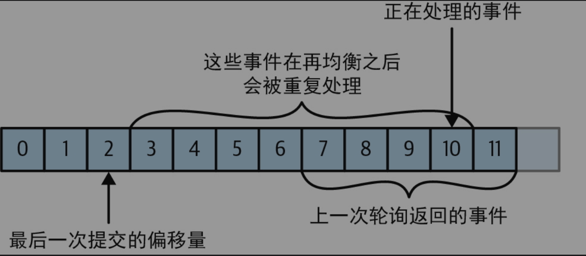

如果最后一次提交的偏移量大于客户端处理的最后一条消息的偏移量，那么处于两个偏移量之间的消息就会丢失。

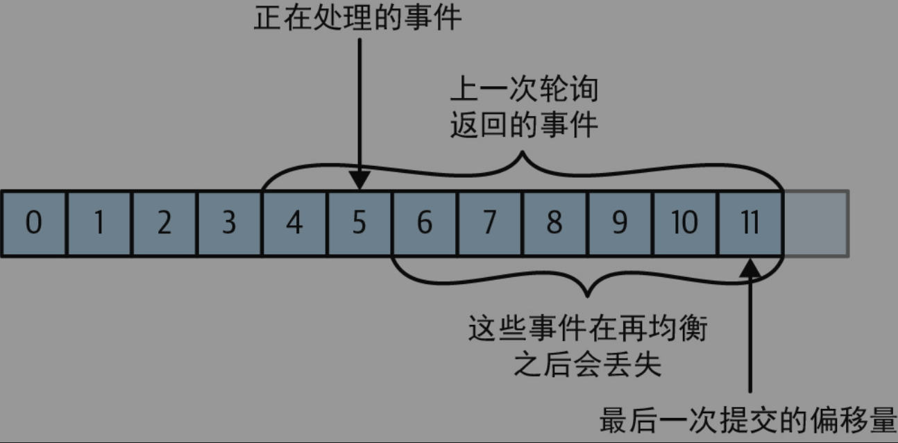

如果使用自动提交或不指定提交的偏移量，那么将默认提交poll()返回的最后一个位置之后的偏移量。

### 4.6.1　自动提交

最简单的提交方式是让消费者自动提交偏移量。如果enable.auto.commit被设置为true，那么每过5秒，消费者就会自动提交poll()返回的最大偏移量。提交时间间隔通过auto.commit.interval.ms来设定，默认是5秒。与消费者中的其他处理过程一样，自动提交也是在轮询循环中进行的。消费者会在每次轮询时检查是否该提交偏移量了，如果是，就会提交最后一次轮询返回的偏移量。

假设我们使用默认的5秒提交时间间隔，并且消费者在最后一次提交偏移量之后3秒会发生崩溃。再均衡完成之后，接管分区的消费者将从最后一次提交的偏移量的位置开始读取消息。这个偏移量实际上落后了3秒，所以在这3秒内到达的消息会被重复处理。

在使用自动提交时，到了该提交偏移量的时候，轮询方法将提交上一次轮询返回的偏移量，但它并不知道具体哪些消息已经被处理过了，所以，在再次调用poll()之前，要确保上一次poll()返回的所有消息都已经处理完毕（调用close()方法也会自动提交偏移量）​。通常情况下这不会有什么问题，但在处理异常或提前退出轮询循环时需要特别小心。虽然自动提交很方便，但是没有为避免开发者重复处理消息留有余地。

### 4.6.2　提交当前偏移量

消费者API提供了另一种提交偏移量的方式，开发者可以在必要的时候手动提交当前偏移量，而不是基于时间间隔提交。把enable.auto.commit设置为false，让应用程序自己决定何时提交偏移量。使用commitSync()提交偏移量是最简单可靠的方式。这个API会提交poll()返回的最新偏移量，提交成功后马上返回，如果由于某些原因提交失败就抛出异常。

需要注意的是，commitSync()将会提交poll()返回的最新偏移量，所以，如果你在处理完所有记录之前就调用了commitSync()，那么一旦应用程序发生崩溃，就会有丢失消息的风险（消息已被提交但未被处理）​。

```java
Duration timeout = Duration.ofMillis(100);

while (true) {
    ConsumerRecords<String, String> records = consumer.poll(timeout);
    for (ConsumerRecord<String, String> record : records) {
        System.out.printf("topic = %s, partition = %d, offset =
            %d, customer = %s, country = %s\n",
            record.topic(), record.partition(),
            record.offset(), record.key(), record.value()); ➊
    }
    try {
        consumer.commitSync(); ➋
    } catch (CommitFailedException e) {
        log.error("commit failed", e) ➌
    }
}
```
### 4.6.3　异步提交

手动提交有一个缺点，在broker对请求做出回应之前，应用程序会一直阻塞，这样会限制应用程序的吞吐量。可以通过降低提交频率来提升吞吐量，但如果发生了再均衡，则会增加潜在的消息重复。这个时候可以使用异步提交API。只管发送请求，无须等待broker做出响应。

```java
Duration timeout = Duration.ofMillis(100);

while (true) {
    ConsumerRecords<String, String> records = consumer.poll(timeout);
    for (ConsumerRecord<String, String> record : records) {
        System.out.printf("topic = %s, partition = %s,
            offset = %d, customer = %s, country = %s\n",
            record.topic(), record.partition(), record.offset(),
            record.key(), record.value());
    }
    consumer.commitAsync(); ➊
}
```
在提交成功或碰到无法恢复的错误之前，commitSync()会一直重试，但commitAsync()不会，这是commitAsync()的一个缺点。之所以不进行重试，是因为commitAsync()在收到服务器端的响应时，可能已经有一个更大的偏移量提交成功。假设我们发出一个提交偏移量2000的请求，这个时候出现了短暂的通信问题，服务器收不到请求，自然也不会做出响应。与此同时，我们处理了另外一批消息，并成功提交了偏移量3000。如果此时commitAsync()重新尝试提交偏移量2000，则有可能在偏移量3000之后提交成功。这个时候如果发生再均衡，就会导致消息重复。

commitAsync()也支持回调，回调会在broker返回响应时执行。回调经常被用于记录偏移量提交错误或生成指标，如果要用它来重试提交偏移量，那么一定要注意提交顺序。

```java
Duration timeout = Duration.ofMillis(100);

while (true) {
    ConsumerRecords<String, String> records = consumer.poll(timeout);
    for (ConsumerRecord<String, String> record : records) {
        System.out.printf("topic = %s, partition = %s,
        offset = %d, customer = %s, country = %s\n",
        record.topic(), record.partition(), record.offset(),
        record.key(), record.value());
    }
    consumer.commitAsync(new OffsetCommitCallback() {
        public void onComplete(Map<TopicPartition,
        OffsetAndMetadata> offsets, Exception e) {
            if (e != null)
                log.error("Commit failed for offsets {}", offsets, e);
        }
    }); ➊
}
```

可以用一个单调递增的消费者序列号变量来维护异步提交的顺序。每次调用commitAsync()后增加序列号，并在回调中更新序列号变量。在准备好进行重试时，先检查回调的序列号与序列号变量是否相等。如果相等，就说明没有新的提交，可以安全地进行重试。如果序列号变量比较大，则说明已经有新的提交了，此时应该停止重试。

### 4.6.4　同步和异步组合提交

如果是消费者被关闭，那么一般会使用commitAsync()和commitSync()的组合。这种模式的原理如下。

```java
Duration timeout = Duration.ofMillis(100);

try {
    while (!closing) {
        ConsumerRecords<String, String> records = consumer.poll(timeout);
        for (ConsumerRecord<String, String> record : records) {
            System.out.printf("topic = %s, partition = %s, offset = %d,
                customer = %s, country = %s\n",
                record.topic(), record.partition(),
                record.offset(), record.key(), record.value());
        }
        consumer.commitAsync();➊
    }
    consumer.commitSync();➋
} catch (Exception e) {
    log.error("Unexpected error", e);
} finally {
        consumer.close();
}
```
❶ 如果一切正常，就用commitAsync()提交偏移量。这样速度更快，而且即使这次提交失败，下一次提交也会成功。❷ 如果直接关闭消费者，那么就没有所谓的“下一次提交”了。commitSync()会一直重试，直到提交成功或发生无法恢复的错误。

### 4.6.5　提交特定的偏移量

提交最后一个偏移量的频率应该与处理消息批次的频率一样。但如果想要更频繁地提交偏移量该怎么办？如果poll()返回了一大批数据，那么为了避免可能因再均衡引起的消息重复，想要在批次处理过程中提交偏移量该怎么办？

消费者API允许在调用commitSync()和commitAsync()时传给它们想要提交的分区和偏移量。假设你正在处理一个消息批次，刚处理好来自主题“customers”的分区3的消息，它的偏移量是5000，那么就可以调用commitSync()来提交这个分区的偏移量5001。需要注意的是，因为一个消费者可能不止读取一个分区，你需要跟踪所有分区的偏移量，所以通过这种方式提交偏移量会让代码变得复杂。

```java
private Map<TopicPartition, OffsetAndMetadata> currentOffsets =
    new HashMap<>(); ➊
int count = 0;

....
Duration timeout = Duration.ofMillis(100);

while (true) {
    ConsumerRecords<String, String> records = consumer.poll(timeout);
    for (ConsumerRecord<String, String> record : records) {
        System.out.printf("topic = %s, partition = %s, offset = %d,
            customer = %s, country = %s\n",
            record.topic(), record.partition(), record.offset(),
            record.key(), record.value()); ➋
        currentOffsets.put(
            new TopicPartition(record.topic(), record.partition()),
            new OffsetAndMetadata(record.offset()+1, "no metadata")); ➌
        if (count % 1000 == 0) ➍
            consumer.commitAsync(currentOffsets, null); ➎
        count++;
    }
}
```

## 4.7　再均衡监听器

让你可以在消费者分配到新分区或旧分区被移除时执行一些代码逻辑。你所要做的就是在调用subscribe()方法时传进去一个ConsumerRebalanceListener对象。ConsumerRebalanceListener有3个需要实现的方法。

public void onPartitionsAssigned(Collection<TopicPartition> partitions)这个方法会在重新分配分区之后以及消费者开始读取消息之前被调用。你可以在这个方法中准备或加载与分区相关的状态信息、找到正确的偏移量，等等。这里所有的事情都应该保证在max.poll.timeout.ms内完成，以便消费者可以成功地加入群组。

public void onPartitionsRevoked(Collection<TopicPartition> partitions)这个方法会在消费者放弃对分区的所有权时调用——可能是因为发生了再均衡或者消费者正在被关闭。通常情况下，如果使用了主动再平衡算法，那么这个方法会在再平衡开始之前以及消费者停止读取消息之后调用。如果使用了协作再平衡算法，那么这个方法会在再均衡结束时调用，而且只涉及消费者放弃所有权的那些分区。如果你要提交偏移量，那么可以在这里提交，无论是哪个消费者接管这个分区，它都知道应该从哪里开始读取消息。

public void onPartitionsLost(Collection<TopicPartition> partitions)这个方法只会在使用了协作再均衡算法并且之前不是通过再均衡获得的分区被重新分配给其他消费者时调用（之前通过再均衡获得的分区被重新分配时会调用onPartitions Revoked()）​。你可以在这里清除与这些分区相关的状态或资源。需要注意的是，在清理状态时要非常小心，因为分区的新所有者可能也保存了分区状态，需要避免发生冲突。如果你没有实现这个方法，则onPartitionsRevoked()将被调用。

```java
private Map<TopicPartition, OffsetAndMetadata> currentOffsets =
    new HashMap<>();
Duration timeout = Duration.ofMillis(100);

private class HandleRebalance implements ConsumerRebalanceListener { ➊
    public void onPartitionsAssigned(Collection<TopicPartition>
        partitions) { ➋
    }

    public void onPartitionsRevoked(Collection<TopicPartition> partitions) {
        System.out.println("Lost partitions in rebalance. " +
            "Committing current offsets:" + currentOffsets);
        consumer.commitSync(currentOffsets); ➌
    }
}

try {
    consumer.subscribe(topics, new HandleRebalance()); ➍

    while (true) {
        ConsumerRecords<String, String> records = consumer.poll(timeout);
        for (ConsumerRecord<String, String> record : records) {
            System.out.printf("topic = %s, partition = %s, offset = %d,
                customer = %s, country = %s\n",
                record.topic(), record.partition(), record.offset(),
                record.key(), record.value());
            currentOffsets.put(
                new TopicPartition(record.topic(), record.partition()),
                new OffsetAndMetadata(record.offset()+1, null));
        }
        consumer.commitAsync(currentOffsets, null);
    }
} catch (WakeupException e) {
    // 忽略异常
} catch (Exception e) {
    log.error("Unexpected error", e);
} finally {
    try {
        consumer.commitSync(currentOffsets);
    } finally {
        consumer.close();
        System.out.println("Closed consumer and we are done");
    }
}
```

## 4.8　从特定偏移量位置读取记录

如果你想从分区的起始位置读取所有的消息，或者直接跳到分区的末尾读取新消息，那么Kafka API分别提供了两个方法：seekToBeginning(Collection<TopicPartition> tp) 和seekToEnd(Collection<TopicPartition> tp)。

Kafka还提供了用于查找特定偏移量的API。这个API有很多用途，比如，对时间敏感的应用程序在处理速度滞后的情况下可以向前跳过几条消息，或者如果消费者写入的文件丢失了，则它可以重置偏移量，回到某个位置进行数据恢复。

```java
Long oneHourEarlier = Instant.now().atZone(ZoneId.systemDefault())
          .minusHours(1).toEpochSecond();
Map<TopicPartition, Long> partitionTimestampMap = consumer.assignment()
        .stream()
        .collect(Collectors.toMap(tp -> tp, tp -> oneHourEarlier)); ➊
Map<TopicPartition, OffsetAndTimestamp> offsetMap
        = consumer.offsetsForTimes(partitionTimestampMap); ➋

for(Map.Entry<TopicPartition,OffsetAndTimestamp> entry: offsetMap.entrySet()) {
    consumer.seek(entry.getKey(), entry.getValue().offset()); ➌
}
```
## 4.9　如何退出

如果你确定马上要关闭消费者（即使消费者还在等待一个poll()返回）​，那么可以在另一个线程中调用consumer.wakeup()。如果轮询循环运行在主线程中，那么可以在ShutdownHook里调用这个方法。需要注意的是，consumer.wakeup()是消费者唯一一个可以在其他线程中安全调用的方法。调用consumer.wakeup()会导致poll()抛出WakeupException，如果调用consumer.wakeup()时线程没有在轮询，那么异常将在下一次调用poll()时抛出。不一定要处理WakeupException，但在退出线程之前必须调用consumer.close()。消费者在被关闭时会提交还没有提交的偏移量，并向消费者协调器发送消息，告知自己正在离开群组。协调器会立即触发再均衡，被关闭的消费者所拥有的分区将被重新分配给群组里其他的消费者，不需要等待会话超时。

```java
Runtime.getRuntime().addShutdownHook(new Thread() {
    public void run() {
        System.out.println("Starting exit...");
        consumer.wakeup(); ➊
        try {
            mainThread.join();
        } catch (InterruptedException e) {
            e.printStackTrace();
        }
    }
});

...
Duration timeout = Duration.ofMillis(10000); ➋

try {
    // 一直循环，直到按下Ctrl-C组合键，关闭钩子会在退出时做清理工作
    while (true) {
        ConsumerRecords<String, String> records =
            movingAvg.consumer.poll(timeout);
        System.out.println(System.currentTimeMillis() +
            "-- waiting for data...");
        for (ConsumerRecord<String, String> record : records) {
            System.out.printf("offset = %d, key = %s, value = %s\n",
                record.offset(), record.key(), record.value());
        }
        for (TopicPartition tp: consumer.assignment())
            System.out.println("Committing offset at position:" +
                consumer.position(tp));
        movingAvg.consumer.commitSync();
    }
} catch (WakeupException e) {
    // 忽略异常 ➌
} finally {
    consumer.close(); ➍
    System.out.println("Closed consumer and we are done");
}
```

❶ ShutdownHook运行在单独的线程中，所以退出轮询循环最安全的方式只能是调用wakeup()。❷ 一个比较长的轮询超时时间。如果轮询的时间足够短，并且你不介意在退出之前等一小会儿，那么就没有必要调用wakeup()，只需在每次轮询时检查一下原子布尔变量即可。较长的轮询超时时间在处理低吞吐量主题时比较有用，因为当broker没有新数据返回时，客户端在轮询时占用的CPU时间会更少。❸ 因为在另一个线程中调用了wakeup()，所以poll()会抛出WakeupException。你可能想捕获异常，确保应用程序不会意外退出，但实际上在这里无须对它做任何处理。❹ 在退出之前，确保彻底关闭了消费者。

## 4.10　反序列化器

很显然，生成消息所使用的序列化器与读取消息所使用的反序列化器应该是相对应的。如果用IntSerializer序列化对象，但用StringDeserializer反序列化它，那么就不会出现什么好结果。对开发者来说，他们必须知道写入主题的消息使用的是哪一种序列化器，并确保每个主题里只包含能够被反序列化器解析的数据。

## 4.11　独立的消费者：为什么以及怎样使用不属于任何群组的消费者

如果知道需要读取哪些分区，就不需要订阅主题了，可以直接将目标分区分配给消费者。消费者既可以订阅主题（并加入消费者群组）​，也可以为自己分配分区，但不能同时做这两件事情。

```java
Duration timeout = Duration.ofMillis(100);
List<PartitionInfo> partitionInfos = null;
partitionInfos = consumer.partitionsFor("topic"); ➊

if (partitionInfos != null) {
    for (PartitionInfo partition : partitionInfos)
        partitions.add(new TopicPartition(partition.topic(),
            partition.partition()));
    consumer.assign(partitions); ➋

    while (true) {
        ConsumerRecords<String, String> records = consumer.poll(timeout);

        for (ConsumerRecord<String, String> record: records) {
            System.out.printf("topic = %s, partition = %s, offset = %d,
                customer = %s, country = %s\n",
                record.topic(), record.partition(), record.offset(),
                record.key(), record.value());
        }
        consumer.commitSync();
    }
}
```
# 第5章　编程式管理Kafka

Kafka在0.11版本中加入了AdminClient，为之前只能通过命令行完成的管理功能提供了编程API：查看、创建和删除主题，描述集群，管理ACL和修改配置。

我们将重点关注最常用的功能：主题管理、消费者群组管理和配置管理。

## 5.1　AdminClient概览

### 5.1.1　异步和最终一致性API

AdminClient是异步的，它的每一个方法在向集群控制器发出请求后会立即返回一个或多个Future对象。Future对象是异步操作的结果，提供了用于检查异步操作状态、取消操作、等待操作完成以及在操作完成后执行其他函数的一些方法。AdminClient会将Future对象封装到Result对象中，Result对象提供了一些方法以用于等待操作完成和执行常见的后续操作。例如，KafkaAdminClient.createTopics会返回CreateTopicsResult对象，你可以用它来等待所有主题创建完成、检查每个主题的状态，并在主题创建成功之后获取主题的配置信息。

从控制器到broker的元数据传播是异步的，所以当控制器状态被完全更新时，AdminClient API返回的Future将被视为已完成。这个时候，并不是每个broker都知道发生了状态变更，所以listTopics请求可能会由不包含最新创建主题的broker负责处理。这叫作最终一致性：最终每个broker都会知道每一个主题的存在，但我们不能保证是在什么时候。

### 5.1.2　配置参数

AdminClient的每一个方法都会接受一个特定于该方法的Options对象作为参数。例如，listTopics方法的参数是ListTopicsOptions对象，describeCluster的参数是DescribeClusterOptions对象。这些对象包含了broker将如何处理请求的配置参数。所有AdminClient方法都会有的一个配置参数是timeoutMs：它指定了客户端在抛出TimeoutException之前等待集群返回响应的时间。这个参数用于限制应用程序被AdminClient操作阻塞的时间。其他参数还包括listTopics是否应该返回集群的内部主题，以及describeCluster是否应该返回客户端被授权了哪些集群操作。

### 5.1.3　扁平的结构

Kafka协议支持的所有管理操作都可以直接用KafkaAdminClient来实现。AdminClient的接口没有对象层次结构或命名空间，这有点儿争议，因为这个接口有很多方法，但这么做最主要的好处是，如果你想知道如何通过编程的方式执行Kafka管理操作，那么只需要搜索一个JavaDoc，无须担心忘记搜索哪里了，而且IDE可以自动完成代码，非常方便。如果你要找的东西不在AdminClient中，则说明它还没有被实现（但欢迎贡献者参与贡献）​。

## 5.2　AdminClient生命周期：创建、配置和关闭

要使用Kafka的AdminClient，首先需要构造一个AdminClient对象。

```java
Properties props = new Properties();
props.put(AdminClientConfig.BOOTSTRAP_SERVERS_CONFIG, "localhost:9092");
AdminClient admin = AdminClient.create(props);
// TODO: 用AdminClient做一些有用的事情
admin.close(Duration.ofSeconds(30));
```
create静态方法会接受一个包含配置参数的Properties对象作为参数。唯一必须提供的配置参数是集群的URI：用逗号分隔的要连接的broker地址清单。通常，在生产环境中至少需要指定3个broker地址，以防其中一个不可用。

### 5.2.1　client.dns.lookup

在默认情况下，Kafka根据连接串中提供的主机名来验证、解析和创建连接（然后是根据advertised.listeners指定的监听器监听的主机名）​。这种方式在大多数情况下没有问题，但不适用于两个重要的场景：使用DNS别名以及单个DNS映射了多个IP地址。二者看起来差不多，但还是略有不同。下面让我们更详细地了解一下这两个互斥场景。

__1.使用DNS别名__

假设你有多个broker，它们的命名规则是这样的：broker1.hostname.com、broker2.hostname.com，以此类推。与其在连接串中指定所有这些地址（维护起来比较困难）​，不如创建一个DNS别名，将其与所有的主机地址映射起来。可以用all-brokers.hostname.com作为连接串，因为你并不关心哪个broker将接受来自客户端的初始连接。这样做非常方便，除非你启用了SASL身份验证。如果使用了SASL，那么客户端会尝试对all-brokers.hostname.com进行身份验证，而实际的服务器主体可能是broker2.hostname.com。如果名字不匹配，则SASL将拒绝身份验证（broker认证有可能是中间人攻击）​，进而连接失败。对于这个场景，需要配置client.dns.lookup=resolve_canonical_bootstrap_servers_only，客户端将会“展开”DNS别名，其效果与在连接串中指定所有的broker主机地址一样。

__2.单个DNS映射了多个IP地址__

在现代网络架构中，通常会将所有的broker放在代理或负载均衡器后面。这在Kubernetes集群中尤为常见，因为Kubernetes集群需要用负载均衡器来转发外部连接。在这些场景中，我们不希望负载均衡器成为单点故障点。因此，常见的做法是将broker1.hostname.com指向一组IP地址，也就是负载均衡器的IP地址，它们总是能够将流量路由到相同的broker上。这些IP地址可能会发生变化。在默认情况 下，Kafka客户端会尝试连接第一个IP地址。如果这个IP地址不可用，那么客户端就无法连接到broker，即使broker是可用的。因此，建议配置client.dns.lookup=use_all_dns_ips，确保客户端可以充分利用高可用负载均衡器所带来的好处。

### 5.2.2　request.timeout.ms

这个参数指定了应用程序等待AdminClient返回响应的时间，包括客户端收到可重试错误时进行重试的时间。这个参数的默认值是120秒，时间有点儿长，但确实有一些AdminClient操作，特别是消费者群组操作，需要较长的时间。正如5.1节中提到的，每个AdminClient方法都会接受一个Options对象作为参数，这个对象可以包含超时时间。如果AdminClient操作位于应用程序的关键路径上，你可能就会想要设置短一点儿的超时时间，并通过其他方式处理Kafka未能及时做出响应的问题。一个常见的例子是，应用程序会在第一次启动时尝试验证主题是否存在，如果Kafka在30秒内未能做出响应，你可能就会选择继续启动应用程序，稍后再来验证主题是否存在（或者完全跳过验证）​。

## 5.3　基本的主题管理操作

先来列出集群的所有主题。

```java
ListTopicsResult topics = admin.listTopics();
topics.names().get().forEach(System.out::println);
```
需要注意的是，admin.listTopics()返回的ListTopicsResult是对一组Future对象的包装器。topics.name()返回的是一组主题名字的Future对象。当调用Future的get()方法时，执行线程将会等待，直到服务器返回一组主题名字或抛出超时异常。

现在，尝试做一些更有用的事情：检查主题是否存在，如果不存在，就创建一个。要检查主题是否存在，一种方法是获取所有主题的名字，然后检查你需要的主题是否在列表中。在大型集群中，这么做可能效率低下，况且有时候你可能不只想检查主题是否存在，还想知道主题分区和副本的数量是否正确。例如，Connect和Confluent模式注册表就使用一个主题来保存配置信息，在启动时，它们会检查这个主题是否存在、主题是否只有一个分区（确保配置变更严格有序）​、是否有3个副本（确保可用性）​，以及是否被压实（及时更新旧的配置信息）​。

```java
DescribeTopicsResult demoTopic = admin.describeTopics(TOPIC_LIST); ➊

try {
    topicDescription = demoTopic.values().get(TOPIC_NAME).get(); ➋
    System.out.println("Description of demo topic:" + topicDescription);

    if (topicDescription.partitions().size() != NUM_PARTITIONS) { ➌
      System.out.println("Topic has wrong number of partitions. Exiting.");
      System.exit(-1);
    }
} catch (ExecutionException e) { ➍
    // 对于大部分异常，提前退出
    if (! (e.getCause() instanceof UnknownTopicOrPartitionException)) {
        e.printStackTrace();
        throw e;
    }

    // 如果执行到这里，则说明主题不存在
    System.out.println("Topic " + TOPIC_NAME +
        " does not exist. Going to create it now");
    // 需要注意的是，分区和副本数是可选的
    // 如果没有指定，那么将使用broker的默认配置
    CreateTopicsResult newTopic = admin.createTopics(Collections.singletonList(
            new NewTopic(TOPIC_NAME, NUM_PARTITIONS, REP_FACTOR))); ➎

    // 检查主题是否已创建成功：
    if (newTopic.numPartitions(TOPIC_NAME).get() != NUM_PARTITIONS) { ➏
        System.out.println("Topic has wrong number of partitions.");
        System.exit(-1);
    }
}
```

现在我们有了一个主题，接下来把它删除。

```java
admin.deleteTopics(TOPIC_LIST).all().get();

// 检查主题是否已删除
// 需要注意的是，由于删除是异步操作，这个时候主题可能还存在
try {
    topicDescription = demoTopic.values().get(TOPIC_NAME).get();
    System.out.println("Topic " + TOPIC_NAME + " is still around");
} catch (ExecutionException e) {
    System.out.println("Topic " + TOPIC_NAME + " is gone");
}
```
到目前为止，所有的示例都调用了Future对象的get()方法。大多数时候，这些已经足够了，毕竟管理操作不会太多，而且等待操作完成或超时都是可接受的。但有一种情况例外：你正在向一个需要处理大量管理请求的服务器写入数据。在这种情况下，你并不希望在等待Kafka返回响应的同时阻塞服务器线程，而是希望服务器继续接受来自客户端的请求，然后将请求发送给Kafka，等Kafka返回响应后再将响应发送给客户端。这个时候，KafkaFuture会非常有用。下面是一个简单的例子。

```java
vertx.createHttpServer().requestHandler(request -> { ➊
    String topic = request.getParam("topic"); ➋
    String timeout = request.getParam("timeout");
    int timeoutMs = NumberUtils.toInt(timeout, 1000);

    DescribeTopicsResult demoTopic = admin.describeTopics( ➌
            Collections.singletonList(topic),
            new DescribeTopicsOptions().timeoutMs(timeoutMs));

    demoTopic.values().get(topic).whenComplete( ➍
            new KafkaFuture.BiConsumer<TopicDescription, Throwable>() {
               @Override
               public void accept(final TopicDescription topicDescription,
                                  final Throwable throwable) {
                   if (throwable != null) {
                      request.response().end("Error trying to describe topic "
                              + topic + " due to " + throwable.getMessage()); ➎
                   } else {
                       request.response().end(topicDescription.toString()); ➏
                   }
                }
            });
}).listen(8080);
```

## 5.4　配置管理

配置管理是通过描述和更新一系列配资资源(ConfigResource)来实现的。配置资源可以是broker、broker日志记录器和主题。我们通常会用kafka-config.sh或其他Kafka管理工具来检查和修改broker及broker日志配置，但主题配置管理是在应用程序中完成的。

例如，很多应用程序使用了压实的主题，它们会定期（为安全起见，要比默认的保留期限更加频繁一些）检查主题是否被压实，如果没有，就采取相应的行动来纠正主题配置。

```java
ConfigResource configResource =
        new ConfigResource(ConfigResource.Type.TOPIC, TOPIC_NAME); ➊
DescribeConfigsResult configsResult =
        admin.describeConfigs(Collections.singleton(configResource));
Config configs = configsResult.all().get().get(configResource);
// 打印非默认配置
configs.entries().stream().filter(
        entry -> !entry.isDefault()).forEach(System.out::println); ➋

// 检查主题是否被压实
ConfigEntry compaction = new ConfigEntry(TopicConfig.CLEANUP_POLICY_CONFIG,
        TopicConfig.CLEANUP_POLICY_COMPACT);
if (!configs.entries().contains(compaction)) {
    // 如果主题没有被压实，就将其压实
    Collection<AlterConfigOp> configOp = new ArrayList<AlterConfigOp>();
    configOp.add(new AlterConfigOp(compaction, AlterConfigOp.OpType.SET)); ➌
    Map<ConfigResource, Collection<AlterConfigOp>> alterConf = new HashMap<>();
    alterConf.put(configResource, configOp);
    admin.incrementalAlterConfigs(alterConf).all().get();
} else {
    System.out.println("Topic " + TOPIC_NAME + " is compacted topic");
}
```
## 5.5　消费者群组管理

但是，在某些情况下，即使应用程序没有预先内置这个功能，你也希望它们能够重新处理消息。一种情况是在发生事故期间对应用程序进行诊断，另一种情况是在故障转移过程中准备在新集群中运行应用程序.

### 5.5.1　查看消费者群组

```java
admin.listConsumerGroups().valid().get().forEach(System.out::println);
```

如果想了解更多有关某些群组的信息，那么可以用如下信息描述它们。

```java
ConsumerGroupDescription groupDescription = admin
        .describeConsumerGroups(CONSUMER_GRP_LIST)
        .describedGroups().get(CONSUMER_GROUP).get();
        System.out.println("Description of group " + CONSUMER_GROUP
                + ":" + groupDescription);
```

但这里缺了一个比较重要的信息——我们想要知道消费者群组最后消费的每个分区的偏移量以及相比最新消息滞后了多少。在过去，获取这些信息唯一的方法是解析消费者群组写到内部主题的偏移量消息。虽然这种方法可以实现我们的目的，但Kafka不保证内部消息格式是兼容的，因此不建议使用。下面来看看AdminClient是如何获取这些信息的。

```java
Map<TopicPartition, OffsetAndMetadata> offsets =
        admin.listConsumerGroupOffsets(CONSUMER_GROUP)
                .partitionsToOffsetAndMetadata().get(); ➊

Map<TopicPartition, OffsetSpec> requestLatestOffsets = new HashMap<>();

for(TopicPartition tp: offsets.keySet()) {
    requestLatestOffsets.put(tp, OffsetSpec.latest()); ➋
}

Map<TopicPartition, ListOffsetsResult.ListOffsetsResultInfo> latestOffsets =
        admin.listOffsets(requestLatestOffsets).all().get();

for (Map.Entry<TopicPartition, OffsetAndMetadata> e: offsets.entrySet()) { ➌
    String topic = e.getKey().topic();
    int partition =  e.getKey().partition();
    long committedOffset = e.getValue().offset();
    long latestOffset = latestOffsets.get(e.getKey()).offset();

    System.out.println("Consumer group " + CONSUMER_GROUP
            + " has committed offset " + committedOffset
            + " to topic " + topic + " partition " + partition
            + ". The latest offset in the partition is "
            + latestOffset + " so consumer group is "
            + (latestOffset - committedOffset) + " records behind");
}
```
❶ 获取消费者群组读取的所有主题和分区，以及每个分区最新的提交偏移量。与describeConsumerGroups不同，listConsumerGroupOffsets只接受一个消费者群组而不是一个集合作为参数。❷ 我们希望获取到结果集中每一个分区最后一条消息的偏移量。OffsetSpec提供了3个非常方便的实现：earliest()、latest()和forTimestamp()，分别用于获取分区中最早和最近的偏移量，以及在指定时间或紧接在指定时间之后写入的消息的偏移量。❸ 最后，遍历所有分区，将最近提交的偏移量、分区中最近的偏移量以及它们之间的差值打印出来。

### 5.5.2　修改消费者群组

到目前为止，我们都只是查看消费者群组的信息。AdminClient也提供了修改消费者群组的方法：删除群组、移除成员、删除提交的偏移量和修改偏移量。SRE通常用它们来构建临时工具，以在紧急情况下进行故障恢复。

在所有这些方法当中，修改偏移量是最有用的。删除偏移量似乎就是让消费者“从头开始”读取数据，但实际上也取决于消费者的配置——如果消费者在启动时没有可用的偏移量，那么是从头开始读取还是直接跳到最新的位置开始读取呢？除非配置了auto.offset.reset，否则就无从得知。显式地将提交的偏移量修改为最早的偏移量，可以强制消费者从主题开头位置开始读取，实际上就是“重置”消费者。

```java
Map<TopicPartition, ListOffsetsResult.ListOffsetsResultInfo> earliestOffsets =
    admin.listOffsets(requestEarliestOffsets).all().get(); ➊

Map<TopicPartition, OffsetAndMetadata> resetOffsets = new HashMap<>();
for (Map.Entry<TopicPartition, ListOffsetsResult.ListOffsetsResultInfo> e:
        earliestOffsets.entrySet()) {
  resetOffsets.put(e.getKey(), new OffsetAndMetadata(e.getValue().offset())); ➋
}

try {
  admin.alterConsumerGroupOffsets(CONSUMER_GROUP, resetOffsets).all().get(); ➌
} catch (ExecutionException e) {
  System.out.println("Failed to update the offsets committed by group "
            + CONSUMER_GROUP + " with error " + e.getMessage());
  if (e.getCause() instanceof UnknownMemberIdException)
      System.out.println("Check if consumer group is still active."); ➍
}
```

## 5.7　高级的管理操作

### 5.7.1　为主题添加分区

我们很少需要为主题添加分区，而且添加分区可能存在风险。你需要确保这个操作不会影响正在消费该主题的应用程序。但是，有时候确实会遇到已有分区的吞吐量达到上限的情况，这个时候则别无选择，只能添加分区。可以用createPartitions方法为主题添加分区。需要注意的是，如果一次性为多个主题添加分区，则可能会出现一些主题添加成功一些主题添加失败的情况。

```java
Map<String, NewPartitions> newPartitions = new HashMap<>();
newPartitions.put(TOPIC_NAME, NewPartitions.increaseTo(NUM_PARTITIONS+2)); ➊
admin.createPartitions(newPartitions).all().get();
```

❶ 在添加分区时，需要指定添加分区后主题将拥有的分区总数，而不是要添加的新分区的数量。


### 5.7.2　从主题中删除消息

deleteRecords方法会将所有偏移量早于指定偏移量的消息标记为已删除，使消费者无法读取这些数据。这个方法将返回被删除的消息的最大偏移量，这样我们就可以检查删除操作是否按预期执行了。从磁盘上彻底删除数据是异步进行的。需要注意的是，可以用listOffsets方法获取在特定时间点或之后写入的消息的偏移量。也可以组合使用这些方法来删除早于任意特定时间点的消息。

```java
Map<TopicPartition, ListOffsetsResult.ListOffsetsResultInfo> olderOffsets =
        admin.listOffsets(requestOlderOffsets).all().get();
Map<TopicPartition, RecordsToDelete> recordsToDelete = new HashMap<>();
for (Map.Entry<TopicPartition, ListOffsetsResult.ListOffsetsResultInfo>  e:
        olderOffsets.entrySet())
    recordsToDelete.put(e.getKey(),
            RecordsToDelete.beforeOffset(e.getValue().offset()));
admin.deleteRecords(recordsToDelete).all().get();
```

### 5.7.3　首领选举

__首选首领选举__

每一个分区都有一个可以被指定为首选首领的副本。如果所有分区的首领都是它们的首选首领副本，那么每个broker上的首领数量应该是均衡的。在默认情况下，Kafka每5分钟会检查一次首领是否就是首选首领副本，如果不是，但它有资格成为首领，就会选择首选首领副本作为首领。如果auto.leader.rebalance.enable被设置为false，或者你想快一点儿执行选举，则可以调用electLeader()方法。

__不彻底的首领选举__

如果一个分区的首领副本变得不可用，而其他副本没有资格成为首领（通常是因为缺少数据）​，那么这个分区将没有首领，也就不可用了。解决这个问题的一种方法是触发不彻底的首领选举，也就是选举一个本来没有资格成为首领的副本作为首领。这可能导致数据丢失——所有写入旧首领但未被复制到新首领的消息都将丢失。electLeader()方法也可以用来触发不彻底的首领选举。这个方法是异步的，也就是说，即使它成功返回，也需要一段时间才能让所有broker都知道发生了首领选举，在这期间调用describeTopics()可能会返回不一致的结果。如果你触发了多个分区的首领选举，则可能会导致一些分区执行成功，一些分区执行失败。

```java
Set<TopicPartition> electableTopics = new HashSet<>();
electableTopics.add(new TopicPartition(TOPIC_NAME, 0));
try {
    admin.electLeaders(ElectionType.PREFERRED, electableTopics).all().get(); ➊
} catch (ExecutionException e) {
    if (e.getCause() instanceof ElectionNotNeededException) {
        System.out.println("All leaders are preferred already"); ➋
    }
}
```

### 5.7.4　重新分配副本

有时候，你可能不喜欢某些副本所在的位置。例如，一个broker超载了，你可能想移走一些副本；或者你可能想增加更多的副本；或者你可能想将一个broker所有的副本都移走，以便关闭整台机器；又或者可能有一些主题太过繁杂，你想将它们与其他主题隔离开来。在这些场景中，可以用alterPartitionReassignments更细粒度地控制分区的每个副本要放在什么位置。需要注意的是，将副本从一个broker重新分配给另一个broker可能需要复制大量的数据。所以要注意可用的网络带宽，并在必要时使用配额限制数据复制。配额是broker级别的配置，可以用AdminClient来查看和修改它们。

假设有一个ID为0的broker。我们的主题有几个分区，每个分区都有一个副本位于这个broker上。在添加了一个新broker后，我们想用它来保存主题的一些副本，因此将通过一种略微不同的方式来分配主题分区。

```java
Map<TopicPartition, Optional<NewPartitionReassignment>> reassignment = new Hash-
Map<>();
reassignment.put(new TopicPartition(TOPIC_NAME, 0),
        Optional.of(new NewPartitionReassignment(Arrays.asList(0,1)))); ➊
reassignment.put(new TopicPartition(TOPIC_NAME, 1),
        Optional.of(new NewPartitionReassignment(Arrays.asList(1)))); ➋
reassignment.put(new TopicPartition(TOPIC_NAME, 2),
        Optional.of(new NewPartitionReassignment(Arrays.asList(1,0)))); ➌
reassignment.put(new TopicPartition(TOPIC_NAME, 3), Optional.empty()); ➍

admin.alterPartitionReassignments(reassignment).all().get();

System.out.println("currently reassigning: " +
        admin.listPartitionReassignments().reassignments().get()); ➎
demoTopic = admin.describeTopics(TOPIC_LIST);
topicDescription = demoTopic.values().get(TOPIC_NAME).get();
System.out.println("Description of demo topic:" + topicDescription); ➏
```

## 5.8　测试

Kafka提供了一个测试类MockAdminClient，你可以用它来初始化任意数量的broker，并对它执行管理操作，以便在没有真实Kafka集群的情况下测试应用程序的行为是否正确。MockAdminClient不是Kafka API的一部分，所以其发生变更时并不会告知用户，但它模拟的方法是公开的，方法签名将保持兼容。需要注意的是，这个类可能会修改和破坏你的测试，所以你需要在便利性和测试风险之间做出一些权衡。

```java
public TopicCreator(AdminClient admin) {
    this.admin = admin;
}

// 如果指定的主题名字以“test”开头，就创建这个主题
public void maybeCreateTopic(String topicName)
        throws ExecutionException, InterruptedException {
    Collection<NewTopic> topics = new ArrayList<>();
    topics.add(new NewTopic(topicName, 1, (short) 1));
    if (topicName.toLowerCase().startsWith("test")) {
        admin.createTopics(topics);

        // 为了演示而修改配置
        ConfigResource configResource =
                  new ConfigResource(ConfigResource.Type.TOPIC, topicName);
        ConfigEntry compaction =
                  new ConfigEntry(TopicConfig.CLEANUP_POLICY_CONFIG,
                          TopicConfig.CLEANUP_POLICY_COMPACT);
        Collection<AlterConfigOp> configOp = new ArrayList<AlterConfigOp>();
        configOp.add(new AlterConfigOp(compaction, AlterConfigOp.OpType.SET));
        Map<ConfigResource, Collection<AlterConfigOp>> alterConf =
            new HashMap<>();
        alterConf.put(configResource, configOp);
        admin.incrementalAlterConfigs(alterConf).all().get();
    }
}
```

# 第6章　深入Kafka

## 6.1　集群的成员关系

Kafka使用ZooKeeper维护集群的成员信息。每个broker都有一个唯一的标识符，这个标识符既可以在配置文件中指定，也可以自动生成。

当broker与ZooKeeper断开连接（通常会在关闭broker时发生，但在发生网络分区或长时间垃圾回收停顿时也会发生）时，它在启动时创建的临时节点会自动从ZooKeeper上移除。监听broker节点路径的Kafka组件会被告知这个broker已被移除。broker对应的ZooKeeper节点会在broker被关闭之后消失，但它的ID会继续存在于其他数据结构中。例如，每个主题的副本集（参见6.3节）中就可能包含这个ID。在完全关闭一个broker后，如果使用相同的ID启动另一个全新的broker，则它会立即加入集群，并获得与之前相同的分区和主题。

## 6.2　控制器

控制器其实也是一个broker，只不过除了提供一般的broker功能之外，它还负责选举分区首领。集群中第一个启动的broker会通过在ZooKeeper中创建一个名为/controller的临时节点让自己成为控制器。其他broker在启动时也会尝试创建这个节点，但它们会收到“节点已存在”异常，并“意识”到控制器节点已存在，也就是说集群中已经有一个控制器了。其他broker会在控制器节点上创建ZooKeeperwatch，这样就可以收到这个节点的变更通知了。我们通过这种方式来确保集群中只有一个控制器。

如果控制器被关闭或者与ZooKeeper断开连接，那么这个临时节点就会消失。控制器使用的ZooKeeper客户端没有在zookeeper.session.timeout.ms指定的时间内向ZooKeeper发送心跳是导致连接断开的原因之一。当临时节点消失时，集群中的其他broker将收到控制器节点已消失的通知，并尝试让自己成为新的控制器。第一个在ZooKeeper中成功创建控制器节点的broker会成为新的控制器，其他节点则会收到“节点已存在”异常，并会在新的控制器节点上再次创建ZooKeeperwatch。每个新选出的控制器都会通过ZooKeeper条件递增操作获得一个数值更大的epoch。其他broker也会知道当前控制器的epoch，如果收到由控制器发出的包含较小epoch的消息，就会忽略它们。这一点很重要，因为控制器会因长时间垃圾回收停顿与ZooKeeper断开连接——在停顿期间，新控制器将被选举出来。当旧控制器在停顿之后恢复时，它并不知道已经选出了新的控制器，并会继续发送消息　 ——在这种情况下，旧控制器会被认为是一个“僵尸控制器”​。消息里的epoch可以用来忽略来自旧控制器的消息，这是防御“僵尸”的一种方式。

控制器必须先从ZooKeeper加载最新的副本集状态，然后才能开始管理集群元数据和执行首领选举。这个加载过程使用了异步API，为了减少延迟，请求会以管道的形式发送给ZooKeeper。但即便如此，在有大量分区的集群中，加载过程可能仍然需要几秒。

当控制器发现有一个broker离开了集群（通过观察相关的ZooKeeper路径或收到了一个来自broker的ControlledShutdownRequest）时，它知道，原先首领位于这个broker上的所有分区需要一个新首领。它将遍历所有需要新首领的分区，并决定应该将哪个分区作为新首领（简单一点儿，它可能就是副本集中的下一个副本）​。然后，它会将更新后的状态持久化到ZooKeeper中（同样，为了减少延迟，以管道的方式异步发送请求 )，再向所有包含这些分区副本的broker发送一个LeaderAndISR请求，请求中包含了新首领和跟随者的信息。出于效率方面的考虑，这些请求会被分成批次，所以每个请求都包含了多个分区最新的成员关系信息（这些分区在相同的broker上都有一个副本）​。每一个新首领都知道自己要开始处理来自生产者和消费者的请求，而跟随者也知道它们要开始从新首领那里复制消息。集群中的每一个broker都有一个MetadataCache，其中包含了一个保存所有broker和副本信息的map。控制器通过UpdateMetadata请求向所有broker发送有关首领变更的信息，broker会在收到请求后更新缓存。在启动broker副本时也会有类似的过程——主要的区别是broker所有的分区副本都是跟随者，并且需要在自己有资格被选为首领之前与首领保持同步。总的来说，Kafka会使用ZooKeeper的临时节点来选举控制器，并会在broker加入或退出集群时通知控制器。控制器负责在broker加入或退出集群时进行首领选举。控制器会使用epoch来避免“脑裂”​。所谓的“脑裂”​，就是指两个broker同时认为自己是集群当前的控制器。

__新控制器KRaft__

2019年，Kafka社区启动了一个雄心勃勃的项目：使用基于Raft的控制器替换基于ZooKeeper的控制器。新控制器叫作KRaft，其预览版包含在Kafka 2.8中。于2021年9月发布的Kafka 3.0包含了它的第一个生产版本，Kafka集群既可以使用基于ZooKeeper的传统控制器，也可以使用KRaft。

## 6.3　复制

复制是Kafka架构核心的一部分。Kafka经常被描述成“一个分布式、分区、可复制的提交日志服务”​。复制之所以这么重要，是因为它可以在个别节点失效时仍能保证Kafka的可用性和持久性。前面介绍过，Kafka的数据保存在主题中，每个主题被分成若干个分区，每个分区可以有多个副本。副本保存在broker上，每个broker可以保存成百上千个主题和分区的副本。

__首领副本__

每个分区都有一个首领副本。为了保证一致性，所有生产者请求和消费者请求都会经过这个副本。客户端可以从首领副本或跟随者副本读取数据。

__跟随者副本__

首领以外的副本都是跟随者副本。如果没有特别指定，则跟随者副本将不处理来自客户端的请求，它们的主要任务是从首领那里复制消息，保持与首领一致的状态。如果首领发生崩溃，那么其中的一个跟随者就会被提拔为新首领。

KIP-392中加入了从跟随者副本读取数据的特性。这个特性的主要目的是允许客户端从最近的同步副本而不是首领副本读取数据，以此来降低网络流量成本。要使用这个特性，消费者端需要配置可以标识客户端位置的client.rack。broker端需要配置replica.selector.class，默认为LeaderSelector（表示总是从首领副本读取数据）​，可以把它设置为RackAwareReplicaSelector，它将选择一个最近的副本，这个副本所在的broker的rack.id与客户端配置的client.rack相匹配。也可以实现ReplicaSelector接口，使用自定义副本选择逻辑。

首领的另一项任务是搞清楚哪些跟随者副本的状态与自己是一致的。为了保持与首领同步，跟随者会尝试从首领那里复制消息，但它们可能会因为各种原因无法与首领保持同步。例如，网络拥塞导致复制变慢，或者broker发生崩溃并重启，都将导致所有副本的复制滞后。为了与首领保持同步，跟随者需要向首领发送Fetch请求，这与消费者为了读取消息而发送的请求是一样的。作为响应，首领会将消息返回给跟随者。Fetch请求消息里包含了跟随者想要获取的消息的偏移量，这些偏移量总是有序的。这样，首领就可以知道一个副本是否已经获取了最近一条消息之前的所有消息。通过检查每个副本请求的最后一个偏移量，首领就可以知道每个副本的滞后程度。如果副本没有在30秒内发送请求，或者即使发送了请求但与最新消息的间隔超过了30秒，那么它将被认为是不同步的。如果一个副本未能跟上首领，那么一旦首领发生故障，它将不能再成为新首领——毕竟，它并未拥有所有的消息。与此相反，持续发出获取最新消息请求的副本被称为同步副本。当首领发生故障时，只有同步副本才有资格被选为新首领。允许跟随者可以多久不活跃或允许跟随者在多久之后成为不同步副本是通过replica.lag.time.max.ms参数来配置的。这个时间直接影响首领选举期间的客户端行为和数据保留机制。

除了当前的首领，每个分区都有一个首选首领，即创建主题时选定的首领。之所以是首选的，是因为在创建分区时，分区首领在broker间的分布已经是均衡的。因此，我们希望当首选首领成为当前首领时，broker之间的负载是均衡的。在默认情况下，Kafka的auto.leader.rebalance.enable会被设置为true，它会检查首选首领是不是当前首领以及是不是同步的。如果是同步的，但不是当前首领，就会触发首领选举，让首选首领成为当前首领。

## 6.4　处理请求

broker的大部分工作是处理客户端、分区副本和控制器发送给分区首领的请求。Kafka提供了一种二进制协议（基于TCP）​，指定了请求消息的格式以及broker如何对请求做出响应——既包括成功处理请求，也包括在处理请求过程中出现错误。Kafka项目提供了由Kafka项目贡献者实现和维护的Java客户端，除此之外，还有其他使用不同的编程语言（比如C语言、Python、Go语言等）开发的客户端。你可以在Kafka官方网站上看到完整的清单。这些客户端都使用这个协议与broker通信。客户端总是发起连接并发送请求，而broker负责处理这些请求并做出响应。broker会按照请求到达的顺序来处理它们，这种顺序既能保证让Kafka具备消息队列的特性，又能保证保存的消息是有序的。

broker会在它监听的每一个端口上运行一个接收器线程，这个线程会创建一个连接，并把它交给处理器线程处理。处理器线程（也叫网络线程）的数量是可配置的。网络线程负责从客户端获取请求，把它们放进请求队列，然后从响应队列取出响应，把它们发送给客户端。有时候，服务器端需要延迟对客户端做出响应，例如，消费者要求只在有可用数据时接收响应，或者发出DeleteTopic请求的客户端要求在开始删除主题之后才接收响应。延迟的响应会被放在炼狱（临时内存）中，直到它们可以被发送给客户端

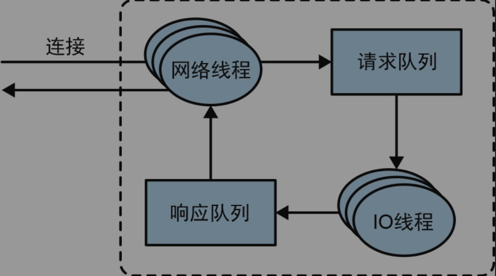

请求消息被放入请求队列后，IO 线程（也叫请求处理线程）会负责处理它们。下面是几种最常见的请求类型。

__生产请求__

生产者发送的请求，其中包含了客户端要写入broker的消息。

__获取请求__

消费者和跟随者副本发送的请求，用于从broker读取消息。

__管理请求__

管理客户端发送的请求，用于执行元数据操作，比如创建和删除主题。

生产请求和获取请求都必须发送给分区的首领。如果broker收到一个针对某个分区的写入请求，而这个分区的首领在另一个broker上，那么发送请求的客户端将收到“非分区首领”错误响应。如果针对某个分区的读取请求被发送到一个不包含这个分区首领的broker上，那么也会收到同样的错误。Kafka客户端负责把生产请求和获取请求发送到包含分区首领的broker上。

那么客户端怎么知道该向哪里发送请求呢？客户端使用了另一种请求类型，也就是元数据请求，请求中包含了客户端感兴趣的主题清单。这种请求的响应消息里指明了这些主题所包含的分区、每个分区都有哪些副本，以及哪个副本是首领。元数据请求可以被发送给任意一个broker，因为所有broker都缓存了这些元数据信息。一般情况下，客户端会把这些信息缓存起来，并直接向目标broker发送生产请求和获取请求。它们需要时不时地通过发送元数据请求来刷新缓存（刷新的时间间隔可以通过metadata.max.age.ms参数来配置）​，以便知道元数据是否发生了变化。

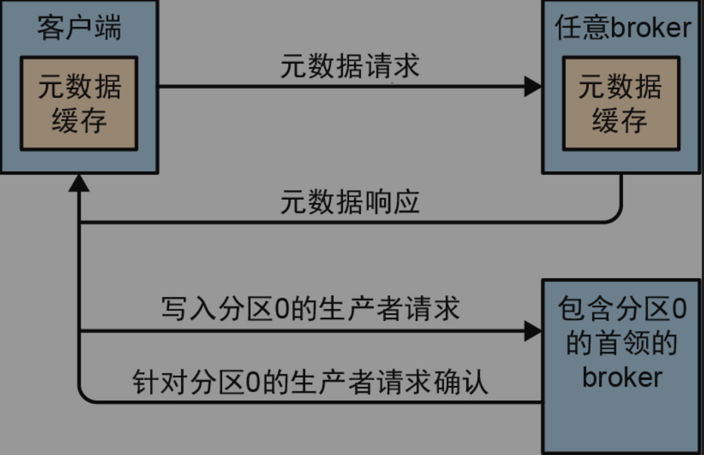

### 6.4.1　生产请求

首先，包含某个分区首领的broker在收到生产请求时会对请求做一些验证。

● 发送数据的用户是否有主题写入权限？


● 请求中指定的acks是否有效（只允许出现0、1或all）​？

● 如果acks=all，那么是否有足够多的同步副本保证消息已经被安全写入？

然后，消息将被写入本地磁盘。在Linux系统中，消息会被写入文件系统缓存，但不能保证何时会被冲刷到磁盘上。Kafka不会一直等待数据被持久化到磁盘上，它主要通过复制功能来保证消息的持久性。

一旦消息被写入分区的首领，broker就会检查acks配置参数——如果acks是0或1，那么broker就会立即返回响应；如果acks是all，则请求将被保存在一个叫作炼狱的缓冲区中，直到首领确认跟随者副本复制了消息，才将响应返回给客户端。

### 6.4.2　获取请求

broker处理获取请求的方式与处理生产请求的方式很相似。客户端发送请求，希望broker返回指定主题、分区和特定偏移量位置的消息，就好像在说：​“请把主题Test的分区0中偏移量从53开始的消息以及主题Test的分区3中偏移量从64开始的消息发给我。​”客户端还可以指定一个分区最多可以返回多少数据。这个限制非常重要，因为客户端需要为broker返回的数据分配足够的内存。如果没有这个限制，并且broker返回了大量的数据，则可能会耗尽客户端的内存。之前说过，请求需要发送给指定的分区首领，所以客户端需要通过查询元数据来确保请求被路由到正确的节点上。首领在收到请求时会先检查请求是否有效，比如，指定的偏移量在分区中是否存在？如果客户端请求的数据已被删除，或者请求的偏移量不存在，则broker会返回错误。如果请求的偏移量存在，那么broker将按照客户端指定的数量上限从分区中读取消息，再把消息返回给客户端。Kafka使用零复制技术向客户端发送消息，也就是说，Kafka会直接把消息从文件（或者更确切地说是Linux文件系统缓存）里发送到网络通道，不需要经过任何中间缓冲区。这是Kafka与其他大部分数据库系统不一样的地方，其他数据库在将数据发送给客户端之前会先把它们保存在本地缓存中。这项技术避免了字节复制，也不需要管理内存缓冲区，从而能够获得更好的性能。

除了可以设置broker返回数据的上限，客户端也可以设置broker返回数据的下限。如果把下限设置为10 KB，就好像是在告诉broker“等到有10 KB数据时再把它们返回给我”​。在主题消息流量不是很大的情况下，这样可以减少CPU和网络开销。具体操作如下：客户端发送一个请求，broker在等到有足够数据时才把它们返回给客户端，然后客户端再发起另一个请求，而不是让客户端每隔几毫秒就发送一次请求，可能每次都只能拿到很少的数据，甚至没有数据（参见图6-3）​。对比这两种情况，虽然它们最终读取的数据总量是一样的，但前者的来回传送次数更少，开销也更小。

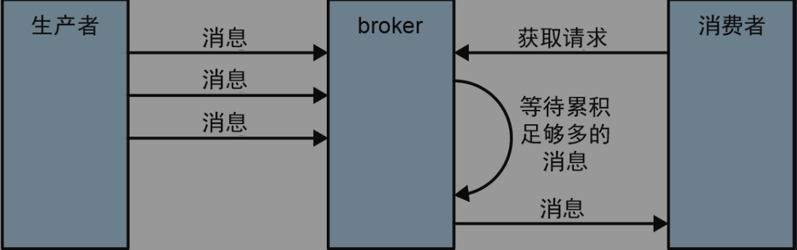

有意思的是，并不是所有保存在分区首领上的数据都可以被客户端读取。大部分客户端只能读取已经被写入所有同步副本 [ 跟随者副本除外（尽管它们也是消费者）​，否则复制功能将无法正常工作 ] 的消息。分区首领知道哪些消息已经被复制到哪些副本上，所以消息在还没有被写入所有同步副本之前是不会被发送给消费者的——尝试获取这些消息的请求会得到空响应，而不是错误。

之所以这样，是因为还没有被足够多分区副本复制的消息被认为是“不安全”的——如果首领发生崩溃，另一个副本成为新首领，那么这些消息就丢失了。

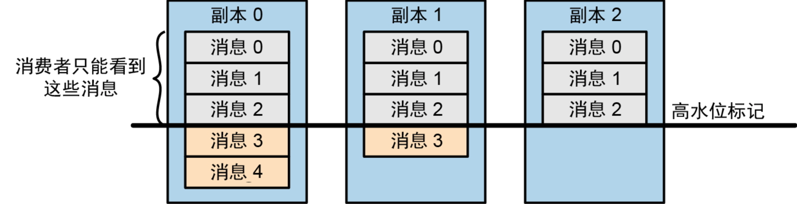

### 6.4.3　其他请求

## 6.5　物理存储

Kafka的基本存储单元是分区。分区既无法在多个broker间再细分，也无法在同一个broker的多个磁盘间再细分。所以，分区的大小受单个挂载点可用空间的限制。​

在配置Kafka时，管理员会指定一个用于保存分区数据的目录列表，也就是log.dirs参数（不要把它与存放错误日志的目录混淆了，日志目录是配置在log4j.properties文件中的）​。这个参数一般会包含Kafka将要使用的每一个挂载点的目录。

### 6.5.1　分层存储

之所以使用Kafka存储海量数据，要么是因为吞吐量高，要么是因为需要长时间保留数据，但以下几点不容忽视。

● 一个分区可以存储的数据量是有限的。因此，分区数量不仅由产品需求驱动，也受物理磁盘大小的限制。

● 磁盘和集群大小的选择取决于存储需求。但是，如果将延迟和吞吐量作为主要考虑因素，那么集群的规模通常比实际需要的要大，从而增加了成本。

● 在broker间移动分区（当扩展或缩小集群时）所需要的时间是由分区大小决定的。大分区会降低集群的弹性。如今，我们可以充分利用灵活的云部署，所以在进行架构设计时会偏向于追求更大的弹性。

Kafka集群配置了两个存储层：本地存储层和远程存储层。本地存储层和当前的Kafka存储层一样，使用broker的本地磁盘存储日志片段，远程存储层则使用HDFS、S3等专用存储系统存储日志片段。

Kafka用户可以单独为每一层配置保留策略。由于本地存储的成本通常远高于远程存储，因此本地存储的数据保留时间通常是几小时，甚至更短，而远程存储的保留时间则比较长，可以是几天，甚至几个月。

本地存储的延迟明显低于远程存储。对延迟敏感的应用程序通常从本地存储的分区尾部读取数据，因此可以受益于现有的Kafka存储机制，比如可以有效地利用页面缓存。在进行数据回填或故障恢复时，应用程序需要用到旧数据，所以需要从远程存储读取。

### 6.5.2　分区的分配

在创建主题时，Kafka首先要决定如何在broker间分配分区。假设你有6个broker，打算创建一个包含10个分区的主题，并且复制系数为3，那么总共会有30个分区副本，它们将被分配给6个broker。在进行分区分配时，要达到以下这些目标。

● 在broker间平均分布分区副本。对我们的例子来说，就是要保证每个broker可以分到5个副本。

● 确保每个分区的副本分布在不同的broker上。假设分区0的首领在broker 2上，那么可以把跟随者副本分别放在broker 3和broker 4上，但不能放在broker 2上，也不能将两个都放在broker 3上。

● 如果为broker指定了机架信息（Kafka 0.10.0及之后的版本才支持）​，那么尽可能把每个分区的副本分配给不同机架上的broker。这样做是为了保证一个机架的不可用不会导致整体分区不可用。

先选择分区首领，假设一共有6个broker（0~5），分区0的首领在broker4上，那么分区0的第一个副班将在broker4的后面broker5上，如果有多个副本的话以此类推下一个副本在broker0上。为了最大程度的保证Kafka的可用性，broker会分不同的机架存放。如果配置了机架信息，那么就不是按照数字顺序而是按照机架交替的方式来选择broker了。假设broker 0和broker 1被放置在一个机架上，broker 2和broker 3被放置在另一个机架上。我们不是按照从0到3的顺序来选择broker，而是按照0、2、1、3的顺序来选择，以保证相邻的broker总是位于不同的机架上

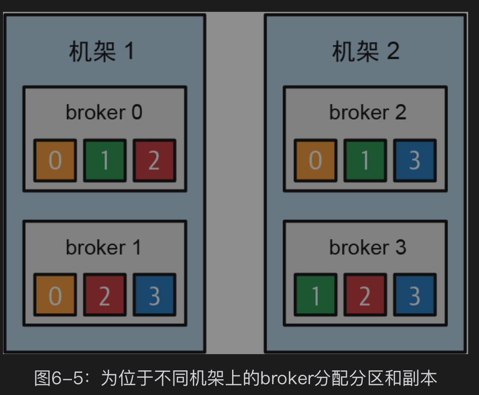

我们会为每个分区分配目录，规则很简单：计算每个目录里的分区数量，新分区总是会被放在分区数量最少的那个目录。也就是说，如果添加了一个新磁盘，那么所有新分区都会被放到这个磁盘。这是因为在达到均衡分配的状态之前，新磁盘的分区数量总是最少的。

需要注意的是，在将分区分配给broker时，我们不会考虑可用空间和工作负载，而在将分区分配给磁盘时会考虑分区数量，但不考虑分区大小。如果有些broker的磁盘空间比其他broker大（有可能是因为集群同时使用了旧服务器和新服务器）​、有些分区特别大，或者同一个broker上有大小不同的磁盘，那么在分配分区时就要小心一些。

### 6.5.3　文件管理

在一个大文件中查找和删除消息既费时又很容易出错，所以我们会把分区分成若干个片段。在默认情况下，每个片段包含1 GB或一周的数据，以较小的那个为准。在broker向分区写入数据时，如果触及任意一个上限，就关闭当前文件，并打开一个新文件。

当前正在写入数据的片段叫作活动片段。活动片段永远不会被删除，所以，如果你配置的保留时间是1天，但片段里包含了5天的数据，那么这些数据就会被保留5天，因为在片段被关闭之前，这些数据是不会被删除的。如果你要保留数据一周，并且每天使用一个新片段，那么每天就会有一个新片段被创建，同时最旧的一个片段会被删除，因此这个分区在大部分时间里会有7个片段。

broker会为分区的每一个打开的日志片段分配一个文件句柄，哪怕是非活动片段。这样就会打开很多文件句柄，因此必须根据实际情况对操作系统做一些调优。

### 6.5.4　文件格式

每个日志片段被保存在一个单独的数据文件中，文件中包含了消息和偏移量。保存在磁盘上的数据格式与生产者发送给服务器的消息格式以及服务器发送给消费者的消息格式是一样的。因为磁盘存储和网络传输采用了相同的格式，所以Kafka可以使用零复制技术向消费者发送消息，并避免对生产者压缩过的消息进行解压和再压缩。如果修改了消息格式，那么网络传输和磁盘保存的消息格式也需要修改，并且broker需要知道如何处理因升级导致文件中包含了两种格式的消息。

Kafka消息由有效负载和系统标头组成。有效负载包括一个可选的键、值和一些可选的用户标头，其中每个标头也是一个键–值对。

生产者都是以批次的方式发送消息。如果每次只发送一条消息，那么使用批次反而会增加开销。但如果每次发送两条或更多的消息，那么使用批次就可以节约空间，减少网络带宽和磁盘的使用。这也是为什么配置了linger.ms=10，Kafka会表现得更好的一个原因——要求的延迟越小，消息被放在同一个批次里发送的可能性就越高。因为Kafka会为每个分区创建一个单独的批次，所以写入的分区越少，生产者的效率就越高。需要注意的是，生产者可以在同一个生产请求中包含多个批次。如果生产者端使用了压缩（推荐这么做）​，那么更大的批次将意味着不管是通过网络传输还是磁盘保存都能获得更好的压缩比。

消息批次的标头包括以下信息。

● 一个魔数，表示消息格式的版本。

● 批次第一条消息的偏移量以及与最后一条消息的偏移量的差值——即使之后在压实批次时可能会删除一些消息，这些也会一直保留下来。在生产者创建并发送批次时，第一条消息的偏移量会被设置为0，第一个持久化这个批次的broker（分区的首领）会用实际偏移量替换它。

● 批次第一条消息的时间戳和最大时间戳。如果设置的时间戳类型是追加时间而不是创建时间，那么可以由broker来设置时间戳。

● 批次大小，以字节为单位。● 收到批次的broker首领的epoch（用于在首领选举后截短消息，KIP-101和KIP-279详细说明了用法）​。

● 用于验证批次完整性的校验和。

● 表示不同属性的16位(bit)：压缩类型、时间戳类型（时间戳可以在客户端或broker端设置）​，以及批次是作为事务的一部分还是作为控制批次。

● 生产者ID、生产者epoch和批次里的第一个序列——这些都用于实现精确一次性保证。

● 当然，还有组成批次的消息集合。正如你所看到的，批次标头包含了很多信息。记录本身也有系统标头（不要与用户设置的标头相混淆）​。每条记录包含以下信息。

● 记录大小，以字节为单位。

● 属性——目前没有记录级别的属性，所以这个标头没有被用到。


● 这条记录的偏移量与批次第一条消息的偏移量之间的差值。

● 这条记录的时间戳与批次第一条消息的时间戳之间的差值，以毫秒为单位。

● 有效载荷：键、值和用户设置的标头。

如果你想看到这些信息，那么可以使用Kafka的DumpLogSegment工具，该工具允许查看分区日志片段的内容。可以通过以下命令来运行这个工具。

```bash
bin/kafka-run-class.sh kafka.tools.DumpLogSegments
```

### 6.5.5　索引

消费者可以从Kafka任意可用的偏移量位置开始读取消息。假设消费者希望从偏移量100开始读取1 MB消息，那么broker就必须立即定位到偏移量100（可能是在分区的任意一个片段里）​，然后从这个位置开始读取消息。为了帮助broker更快定位到指定的偏移量，Kafka为每个分区维护了一个索引。该索引将偏移量与片段文件以及偏移量在文件中的位置做了映射。

### 6.5.6　压实

一般情况下，Kafka会根据设置的时间来保留数据，把超过时效的旧数据删除。但是，请试想一种场景，假设你用Kafka来保存客户的收货地址，那么保存客户的最新地址比保存客户上周甚至去年的地址更有意义，这样你就不用保留客户的旧地址了。另外一种场景是应用程序使用Kafka来保存它的当前状态，每次状态发生变化，就将新状态写入Kafka。当应用程序从故障中恢复时，它会从Kafka读取之前保存的消息，以便恢复到最近的状态。应用程序只关心发生崩溃前的那个状态，并不关心在运行过程中发生的所有状态变化。

Kafka通过改变主题的保留策略来满足这些应用场景。如果保留策略是delete，那么早于保留时间的旧事件将被删除；如果保留策略是compact（压实）​，那么只为每个键保留最新的值。很显然，只有当应用程序生成的事件里包含了键–值对时，设置compact才有意义。如果主题中包含了null键，那么这个策略就会失效。

主题的数据保留策略也可以被设置成delete.and.compact，也就是以上两种策略的组合。超过保留时间的消息将被删除，即使它们的键对应的值是最新的。组合策略可以防止压实主题变得太大，同时也可以满足业务需要在一段时间后删除数据的要求。

### 6.5.7　压实的工作原理

### 6.5.8　被删除的事件

要彻底把一个键从系统中删除，应用程序必须发送包含这个键且值为null的消息。压实线程在发现这条消息时，会先进行常规的压实操作，只保留值为null的消息。这条消息（被称为墓碑消息）会根据配置的参数保留一段时间。在此期间，消费者可以读取到这条消息，并且发现它的值已经被置空。消费者在将Kafka数据复制到关系数据库时，如果它看到这条墓碑消息，就知道应该要把相关的用户信息从数据库中删除。在超过保留期限之后，清理线程会移除墓碑消息，它们的键也将从Kafka分区中消失。这里的关键是要让消费者有足够的时间看到墓碑消息，因为如果消费者离线几小时，那么可能就错过了墓碑消息，也就不会去删除数据库中的相关数据了。

值得一提的是，Kafka的管理客户端提供了一个deleteRecords方法。这个方法可用于删除指定偏移量之前的所有记录，但它使用的是一种完全不同的机制。

### 6.5.9　何时会压实主题

就像delete策略不会删除当前的活动片段一样，compact策略也不会压实当前的活动片段，只有旧片段里的消息才会被压实。

在默认情况下，Kafka会在主题中有50%的数据包含脏记录的情况下进行压实。这样做的目的是避免压实太过频繁（因为压实会影响主题的读写性能）​，同时也能避免存在太多脏记录（因为它们会占用磁盘空间）​。让主题的50%的磁盘空间包含脏记录，然后压实一次，这看起来是个合理的折中，当然，管理员也可以调整这个百分比。

# 第7章　可靠的数据传递

正因为可靠性是系统层面的概念，所以它不只是某个个体的事情。Kafka管理员、Linux系统管理员、网络和存储管理员，以及应用程序开发者，所有人必须协同作战才能构建出一个可靠的系统。

## 7.1　可靠性保证

● Kafka可以保证分区中的消息是有序的。如果使用同一个生产者向同一个分区中写入消息，并且消息B在消息A之后写入，那么Kafka可以保证消息B的偏移量比消息A的偏移量大，而且消费者会先读取消息A再读取消息B。

● 一条消息只有在被写入分区所有的同步副本时才被认为是“已提交”的（但不一定要冲刷到磁盘上）​。生产者可以选择接收不同类型的确认，比如确认消息被完全提交，或者确认消息被写入首领副本，或者确认消息被发送到网络上。

● 只要还有一个副本是活动的，已提交的消息就不会丢失。

● 消费者只能读取已提交的消息。

## 7.2　复制

Kafka的复制机制和分区多副本架构是Kafka可靠性保证的核心。把消息写入多个副本可以保证Kafka在发生崩溃时仍然能够提供消息的持久性。

Kafka的复制机制和分区多副本架构是Kafka可靠性保证的核心。把消息写入多个副本可以保证Kafka在发生崩溃时仍然能够提供消息的持久性。

● 与ZooKeeper之间有一个活跃的会话，也就是说，它在过去的6秒（可配置）内向ZooKeeper发送过心跳。

● 在过去的10秒（可配置）内从首领那里复制过消息。

● 在过去的10秒内从首领那里复制过最新的消息。仅从首领那里复制消息是不够的，它还必须在每10秒（可配置）内复制一次最新的消息。

如果跟随者副本不能满足以上任何一点（比如与ZooKeeper断开连接，或者不再复制新消息，或者复制消息滞后了10秒以上）​，那么它就会被认为是不同步的。一个不同步的副本可以通过与ZooKeeper重新建立连接并从首领那里复制最新的消息重新变成同步副本。如果网络出现了临时问题，并快速得到了修复，那么重新变成同步副本就很快。但如果副本所在的broker发生了崩溃，那么这个过程就需要较长时间。

在旧版本的Kafka中，经常会有一个或多个副本在同步和不同步状态之间快速切换。这说明集群出问题了。一个相对常见的原因是设置了较大的请求最大值和JVM堆内存。我们需要调整这些参数，以防止长时间的垃圾回收停顿，因为停顿会导致broker暂时与ZooKeeper断开连接。不过，现在这个问题已经很少见了，特别是在Kafka 2.5.0及以上版本中。使用JVM 8及以上版本（支持G1垃圾回收器）有助于缓解这个问题，尽管仍然需要针对大消息做一些调优。Kafka复制协议在

## 7.3　broker配置

broker中有3个配置参数会影响Kafka的消息存储可靠性。与其他配置参数一样，它们既可以配置在broker级别，用于控制所有主题的行为，也可以配置在主题级别，用于控制个别主题的行为。

### 7.3.1　复制系数

主题级别的配置参数是 replication.factor。在broker级别，可以通过 default.replication.factor 来设置自动创建的主题的复制系数。

如果复制系数是N，那么在N–1个broker失效的情况下，客户端仍然能够从主题读取数据或向主题写入数据。所以，更高的复制系数会带来更高的可用性、可靠性和更少的灾难性事故。另外，复制系数N需要至少N个broker，也就是说我们会有N个数据副本，并且它们会占用N倍的磁盘空间。基本上，我们是在用硬件换取可用性。

基本上，我们是在用硬件换取可用性。那么该如何确定一个主题需要几个副本呢？这个时候需要考虑以下因素：可用性、持久性、吞吐量、端到端延迟、成本。副本数量越多，可用性、持久性、成本越高，反之吞吐量、端到端延迟越低。

副本的位置分布也很重要。Kafka可以确保分区的每个副本被放在不同的broker上。但是，在某些情况下，这样仍然不够安全。如果一个分区的所有副本所在的broker位于同一个机架上，那么一旦机架的交换机发生故障，不管设置了多大的复制系数，这个分区都不可用。为了避免机架级别的故障，建议把broker分布在多个不同的机架上，并通过broker.rack 参数配置每个broker所在的机架的名字。

### 7.3.2　不彻底的首领选举

unclean.leader.election.enable 只能在broker级别（实际上是在集群范围内）配置，它的默认值是 false。

unclean.leader.election.enable 只能在broker级别（实际上是在集群范围内）配置，它的默认值是 false。unclean.leader.election.enable 只能在broker级别（实际上是在集群范围内）配置，它的默认值是 false。这种情况会在以下两种场景中出现。

● 分区有3个副本，其中的两个跟随者副本不可用（比如有两个broker发生崩溃）​。这个时候，随着生产者继续向首领写入数据，所有消息都会得到确认并被提交（因为此时首领是唯一的同步副本）​。现在，假设首领也不可用了（又一个broker发生崩溃）​，这个时候，如果之前的一个跟随者重新启动，那么它就会成为分区的唯一不同步副本。

● 分区有3个副本，由于网络问题导致两个跟随者副本复制消息滞后，因此即使它们还在复制，但已经不同步了。作为唯一的同步副本，首领会继续接收消息。这个时候，如果首领变为不可用，则只剩下两个不同步的副本可以成为新首领。

那么这种情况将会面临两难的选择：

● 如果不允许不同步的副本被提升为新首领，那么分区在旧首领（最后一个同步副本）恢复之前是不可用的。有时候这种状态会持续数小时（比如更换内存芯片）​。

● 如果允许不同步的副本被提升为新首领，那么在这个副本变为不同步之后写入旧首领的数据将全部丢失，消费者读取的数据将会出现不一致。

在默认情况下，unclean.leader.election.enable 的值是false，也就是不允许不同步副本成为首领。这是最安全的选项，因为它可以保证数据不丢失

### 7.3.3　最少同步副本

min.insync.replicas 参数可以配置在主题级别和broker级别。

如果这个同步副本变为不可用，则必须在可用性和一致性之间做出选择，而这是一个两难的选择。根据Kafka对可靠性保证的定义，一条消息只有在被写入所有同步副本之后才被认为是已提交的，但如果这里的“所有”只包含一个同步副本，那么当这个副本变为不可用时，数据就有可能丢失。

如果想确保已提交的数据被写入不止一个副本，就要把最少同步副本设置得大一些。对于一个包含3个副本的主题，如果min.insync.replicas 被设置为2，那么至少需要有两个同步副本才能向分区写入数据。

如果3个副本都是同步的，那么一切正常进行。即使其中一个副本变为不可用，也不会有什么问题。但是，如果有两个副本变为不可用，那么broker就会停止接受生产者的请求。尝试发送数据的生产者会收到NotEnoughReplicasException 异常，不过消费者仍然可以继续读取已有的数据。实际上，如果使用这样的配置，那么当只剩下一个同步副本时，它就变成只读的了。这样做是为了避免在发生不彻底的选举时数据的写入和读取出现非预期的行为。要脱离这种只读状态，必须让两个不可用分区中的一个重新变为可用（比如重启broker）​，并等待它变为同步的。

### 7.3.4　保持副本同步

前面提到过，不同步副本会降低总体可靠性，所以要尽量避免出现这种情况。一个副本可能在两种情况下变得不同步：要么它与ZooKeeper断开连接，要么它从首领复制消息滞后。对于这两种情况，Kafka提供了两个broker端的配置参数。

zookeeper.session.timeout.ms 是允许broker不向ZooKeeper发送心跳的时间间隔。如果超过这个时间不发送心跳，则ZooKeeper会认为broker已经“死亡”​，并将其从集群中移除。在Kafka 2.5.0中，这个参数的默认值从6秒增加到了18秒，以提高Kafka集群在云端的稳定性，因为云环境的网络延迟更加多变。

如果一个副本未能在 replica.lag.time.max.ms 指定的时间内从首领复制数据或赶上首领，那么它将变成不同步副本。

### 7.3.5　持久化到磁盘

之前提到过，即使消息还没有被持久化到磁盘上，Kafka也可以向生产者发出确认，这取决于已接收到消息的副本的数量。Kafka会在重启之前和关闭日志片段（默认1 GB大小时关闭）时将消息冲刷到磁盘上，或者等到Linux系统页面缓存被填满时冲刷。其背后的想法是，拥有3台放置在不同机架或可用区域的机器，并在每台机器上放置一份数据副本比只将消息写入首领的磁盘更加安全，因为两个不同的机架或可用区域同时发生故障的可能性非常小。不过，也可以让broker更频繁地将消息持久化到磁盘上。配置参数 flush.messages 用于控制未同步到磁盘的最大消息数量，flash.ms 用于控制同步频率。在配置这些参数之前，最好先了解一下 fsync 是如何影响Kafka的吞吐量的以及如何尽量避开它的缺点。

## 7.4　在可靠的系统中使用生产者

即使我们会尽可能地把broker配置得很可靠，但如果没有对生产者进行可靠性方面的配置，则整个系统仍然存在丢失数据的风险。

● 我们为broker配置了3个副本，并禁用了不彻底的首领选举，这样应该可以保证已提交的消息不会丢失。不过，我们把生产者发送消息的acks 设置成了 1。生产者向首领发送了一条消息，虽然其被首领成功写入，但其他同步副本还没有收到这条消息。首领向生产者发送了一个响应，告诉它“消息写入成功”​，然后发生了崩溃，而此时其他副本还没有复制这条消息。另外两个副本此时仍然被认为是同步的（我们需要一小段时间才能判断一个副本是否变成了不同步的）​，并且其中的一个副本会成为新首领。因为消息还没有被写入这两个副本，所以就丢失了，但发送消息的客户端认为消息已经成功写入。从消费者的角度来看，系统仍然是一致的，因为它们看不到丢失的消息（副本没有收到这条消息，不算已提交）​，但从生产者的角度来看，这条消息丢失了。

● 我们为broker配置了3个副本，并禁用了不彻底的首领选举。我们接受了之前的教训，把生产者的 acks 设置成了 all。假设现在生产者向Kafka发送了一条消息，此时分区首领刚好发生崩溃，新首领正在选举当中，Kafka会向生产者返回“首领不可用”的响应。在这个时候，如果生产者未能正确处理这个异常，也没有重试发送消息，那么消息也有可能丢失。这不算是broker的可靠性问题，因为broker并没有收到这条消息；这也不是一致性问题，因为消费者也不会读取到这条消息。问题在于，如果生产者未能正确处理异常，就有可能丢失数据。

从上面的两个例子可以看出，开发人员需要注意两件事情。

● 根据可靠性需求配置恰当的 acks。

● 正确配置参数，并在代码里正确处理异常。

### 7.4.1　发送确认

### 7.4.2　配置生产者的重试参数

生产者需要处理的错误包括两个部分：一部分是由生产者自动处理的错误（比如网络异常、首领当前不可用等），另一部分是需要开发者手动处理的错误（比如broker配置错误、代码系统异常等）。

一般来说，如果你的目标是不丢失消息，那么就让生产者在遇到可重试错误时保持重试。正如第3章所建议的那样，最好的重试方式是使用默认的重试次数（整型最大值或无限）​，并把 delivery.timeout.ms 配置成我们愿意等待的时长，生产者会在这个时间间隔内一直尝试发送消息。

重试发送消息存在一定的风险，因为如果两条消息都成功写入，则会导致消息重复。通过重试和小心翼翼地处理异常，可以保证每一条消息都会被保存至少一次，但不能保证只保存一次。如果把enable.idempotence 参数设置为 true，那么生产者就会在消息里加入一些额外的信息，broker可以使用这些信息来跳过因重试导致的重复消息。

### 7.4.3　额外的错误处理

使用生产者内置的重试机制可以在不造成消息丢失的情况下轻松地处理大部分错误，但开发人员仍然需要处理以下这些其他类型的错误。

● 不可重试的broker错误，比如消息大小错误、身份验证错误等。

● 在将消息发送给broker之前发生的错误，比如序列化错误。

● 在生产者达到重试次数上限或重试消息占用的内存达到上限时发生的错误。

● 超时。

## 7.5　在可靠的系统中使用消费者

本章在开头部分提到过，只有已经被提交到Kafka的数据，也就是已经被写入所有同步副本的数据，对消费者是可用的。这保证了消费者读取到的数据是一致的。消费者唯一要做的是跟踪哪些消息是已经读取过的，哪些消息是还未读取的，这是消费者在读取消息时不丢失消息的关键。

在从分区读取数据时，消费者会先获取一批消息，检查批次的最后一个偏移量，然后从这个偏移量开始读取下一批消息。这样可以保证消费者总能以正确的顺序获取新数据，不会错过任何消息。

消费者会把读取的每一个分区的偏移量都保存起来，这样在重启或其他消费者接手之后就知道从哪里开始读取了。造成消费者丢失消息最主要的一种情况是它们提交了已读取消息的偏移量却未能全部处理完。在这种情况下，如果其他消费者接手了工作，那么那些没有被处理的消息就会被忽略，永远不会得到处理。这就是为什么我们非常重视何时以及如何提交偏移量。

### 7.5.1　消费者的可靠性配置

为了保证消费者行为的可靠性，需要注意以下4个非常重要的配置参数。

第一个是 group.id，如果两个消费者具有相同的群组ID，并订阅了同一个主题，那么每个消费者将分到主题分区的一个子集，也就是说它们只能读取到所有消息的一个子集（但整个群组可以读取到主题所有的消息）​。如果你希望一个消费者可以读取主题所有的消息，那么就需要为它设置唯一的 group.id。

第二个是 auto.offset.reset，这个参数指定了当没有偏移量（比如在消费者首次启动时）或请求的偏移量在broker上不存在时（第4章已经介绍过这种场景）消费者该作何处理。这个参数有两个值，一个是earliest，如果配置了这个值，那么消费者将从分区的开始位置读取数据，即使它没有有效的偏移量。这会导致消费者读取大量的重复数据，但可以保证最少的数据丢失。另一个值是 latest，如果配置了这个值，那么消费者将从分区的末尾位置读取数据。这样可以减少重复处理消息，但很有可能会错过一些消息。

第三个是 enable.auto.commit，你可以决定让消费者自动提交偏移量，也可以在代码里手动提交偏移量。自动提交的一个最大好处是可以少操心一些事情。如果是在消费者的消息轮询里处理数据，那么自动提交可以确保不会意外提交未处理的偏移量。自动提交的主要缺点是我们无法控制应用程序可能重复处理的消息的数量，比如消费者在还没有触发自动提交之前处理了一些消息，然后被关闭。如果应用程序的处理逻辑比较复杂（比如把消息交给另外一个后台线程去处理）​，那么就只能使用手动提交了，因为自动提交机制有可能会在还没有处理完消息时就提交偏移量。

第四个配置参数 auto.commit.interval.ms 与第三个参数有直接的联系。如果选择使用自动提交，那么可以通过这个参数来控制提交的频率，默认每5秒提交一次。一般来说，频繁提交会增加额外的开销，但也会降低重复处理消息的概率。

### 7.5.2　手动提交偏移量

如果想要更大的灵活性，选择了手动提交，那么就需要考虑正确性和性能方面的问题。

__1.总是在处理完消息后提交偏移量__

如果所有的处理逻辑都是在轮询里进行的，并且不需要维护轮询之间的状态（比如为了聚合数据）​，那么就很简单。我们可以使用自动提交，在轮询结束时提交偏移量，也可以在轮询里提交偏移量，并选择一个合适的提交频率，在额外的开销和重复消息量之间取得平衡。

__2.提交频率是性能和重复消息数量之间的权衡__

即使是在最简单的场景中（比如所有的处理逻辑都在轮询里进行，并且不需要维护轮询之间的状态）​，仍然可以选择在一个轮询里提交多次或多个轮询提交一次。提交偏移量需要额外的开销，这有点儿类似生产者配置了 acks=all，但同一个消费者群组提交的偏移量会被发送给同一个broker，这可能会导致broker超载。提交频率需要在性能需求和重复消息量之间取得平衡。处理一条消息就提交一次偏移量的方式只适用于吞吐量非常低的主题。

__3.在正确的时间点提交正确的偏移量__

在轮询过程中提交偏移量有一个缺点，就是有可能会意外提交已读取但未处理的消息的偏移量。一定要在处理完消息后再提交偏移量，这点很关键——提交已读取但未处理的消息的偏移量会导致消费者错过消息。

__4.再均衡__

在设计应用程序时，需要考虑到消费者会发生再均衡并需要处理好它们。第4章展示过几个示例，主要是关于如何在分区被撤销之前提交偏移

__5.消费者可能需要重试__

有时候，在调用了轮询方法之后，有些消息需要稍后再处理。假设我们要把Kafka的数据写到数据库，但此时数据库不可用，那么就需要稍后再重试。需要注意的是，消费者提交偏移量并不是对单条消息的“确认”​，这与传统的发布和订阅消息系统不一样。也就是说，如果记录 #30处理失败，但记录 #31处理成功，那么就不应该提交记录 #31的偏移量——如果提交了，就表示 #31以内的记录都已处理完毕，包括记录 #30在内，但这可能不是我们想要的结果。不过，可以采用以下两种模式来解决这个问题。

第一种模式，在遇到可重试错误时，提交最后一条处理成功的消息的偏移量，然后把还未处理好的消息保存到缓冲区（这样下一个轮询就不会把它们覆盖掉）​，并调用消费者的 pause() 方法，确保其他的轮询不会返回数据，之后继续处理缓冲区里的消息。

第二种模式，在遇到可重试错误时，把消息写到另一个重试主题，并继续处理其他消息。另一个消费者群组负责处理重试主题中的消息，或者让一个消费者同时订阅主主题和重试主题。这种模式有点儿像其他消息系统中的死信队列。

__6.消费者可能需要维护状态__

在一些应用程序中，需要维护多个轮询之间的状态。

## 7.6　验证系统可靠性

建议先对系统可靠性做3个层面的验证：验证配置、验证应用程序以及在生产环境中监控可靠性。下面来看看每一步都需要验证什么以及如何验证。

### 7.6.1　验证配置

可以抛开应用程序逻辑，单独验证broker和客户端的配置。之所以建议这么做，主要是因为以下两个原因。

● 有助于验证配置是否能够满足需求。

● 有助于了解系统的预期行为。

Kafka提供了两个重要的配置验证工具：org.apache.kafka.tools包下面的 VerifiableProducer 类和 VerifiableConsumer 类。可以在命令行中运行这两个工具，或把它们嵌入自动化测试框架中。VerifiableProducer 会生成一系列消息，消息里包含了一个从1到指定数字的数字。可以使用与真实的生产者相同的配置参数来配置VerifiableProducer，比如配置相同的 acks、retries、delivery.timeout.ms 和消息生成速率。在运行过程中，VerifiableProducer 会根据收到的确认响应将每条消息发送成功或失败的结果打印出来。反过来，VerifiableConsumer 会读取由VerifiableProducer 生成的消息，并按照读取顺序把它们打印出来。它也会把与偏移量和再均衡相关的信息打印出来。

要仔细考虑需要测试哪些场景，比如以下场景。

● 首领选举：如果停掉首领会发生什么事情？生产者和消费者需要多长时间来恢复状态？

● 控制器选举：重启控制器后系统需要多少时间来恢复状态？

● 滚动重启：可以滚动重启broker而不丢失消息吗？

● 不彻底的首领选举：如果依次停止一个分区的所有副本（确保每个副本都变为不同步的）​，然后启动一个不同步的broker会发生什么？要怎样才能恢复正常？这样做是可接受的吗？

### 7.6.2　验证应用程序

在确定broker和客户端的配置可以满足需求之后，接下来要验证应用程序是否能够提供我们想要的保证。应用程序的验证包括检查错误处理逻辑、偏移量提交的方式、再均衡监听器以及其他使用了Kafka客户端的地方。

● 客户端与服务器断开连接

● 客户端与服务器之间存在高延迟

● 磁盘被填满

● 磁盘被挂起（也就是所谓的“掉电”​）

● 首领选举

● 滚动重启broker

● 滚动重启消费者

● 滚动重启生产者

### 7.6.3　在生产环境中监控可靠性

Kafka的Java客户端提供了一些JMX指标，可用于监控客户端的状态和事件。对生产者来说，最重要的两个可靠性指标是消息的错误率和重试率（聚合过的）​。如果这两个指标上升，则说明系统出问题了。除此之外，还要监控生产者日志，注意那些被设为 WARN 级别的错误日志，以及包含“Got error produce response with correlation id 5689 ontopic-partition [topic-1,3], retrying (two attempts left). Error: ...”的日志。如果看到消息剩余的重试次数为0，则说明生产者已经没有多余的重试机会。

在消费者端，最重要的指标是消费者滞后指标。这个指标告诉我们消费 者正在处理的消息与最新提交到分区的消息偏移量之间有多少差距。理想情况下，这个指标的值是0，也就是说消费者读取的是最新的消息。但是，在实际当中，因为 poll() 方法会返回很多消息，消费者在读取下一批数据之前需要花一些时间来处理它们，所以这个指标会有些波动。关键在于要确保消费者最终会赶上去，而不是越落越远。

为了确保所有消息在合理的时间内被读取，应用程序需要记录生成消息的数量（一般用每秒多少条消息来表示）​。消费者需要记录单位时间内已读取消息的数量以及消息生成时间与读取时间之间的时间差（根据消息的时间戳来判断）​。然后，我们需要一个系统将生产者和消费者记录的消息数量收集起来（确保没有丢失消息）​，确保二者之间的时间差在合理的范围内。

除了监控客户端和端到端数据流，broker还提供了一些指标，用于说明broker发送给客户端的错误响应率。建议收集kafka.server:type=BrokerTopicMetrics,name=FailedProduceRequestsPerSec 和kafka.server:type=BrokerTopicMetrics,name=FailedFetchRequestsPerSec 这两个指标。一些错误响应会时不时地出现，如果我们关闭了一个broker，另一个broker成了新首领，那么生产者可能会收到 NOT_LEADER_FOR_PARTITION 错误，并在继续发送消息之前请求更新的元数据。

## 第8章　精确一次性语义

在处理聚合事件的流式处理应用程序中，事情就没那么简单了。在检查读取消息、计算平均值并生成结果的应用程序时，我们通常无法检测出平均值是不正确的，因为有可能在计算平均值时把一个事件处理了两次。对于这种情况，需要提供更强的保证，这种保证就是精确一次性处理语义。

Kafka的精确一次性语义由两个关键特性组成：幂等生产者（避免因重试导致的消息重复）和事务语义（保证流式处理应用程序中的精确一次性处理）​。下面先来介绍既简单又常用的幂等生产者。

## 8.1　幂等生产者

如果为生产者配置了至少一次性语义而不是幂等性语义，则意味着在发生了不确定性事件的情况下，生产者将重试发送消息，这样可以保证消息至少有一次是送达的，但可能会因为重试而出现重复。

一个最典型的场景是分区首领收到生产者发送的一条消息，这条消息被跟随者成功复制，然后，首领所在的broker在向生产者发送响应之前崩溃了。生产者没有收到回应，在一段时间之后将重新发送消息。消息被发送给了新首领，而新首领已经有了上一次写入的消息副本，结果导致消息重复。Kafka的幂等生产者可以自动检测并解决消息重复问题。

### 8.1.1　幂等生产者的工作原理

如果启用了幂等生产者，那么每条消息都将包含生产者ID(PID)和序列号。我们将它们与目标主题和分区组合在一起，用于唯一标识一条消息。broker会用这些唯一标识符跟踪写入每个分区的最后5条消息。为了减少每个分区需要跟踪的序列号数量，生产者需要将max.inflight.requests设置成5或更小的值（默认值是5）​。

如果broker收到一个非常大的序列号该怎么办？如果broker期望消息2后面跟着消息3，但收到了消息27，那么这个时候该怎么办？在这种情况下，broker将返回“乱序”错误。如果使用了不带事务的幂等生产者，则这个错误可能会被忽略。

虽然生产者在遇到“乱序”异常后将继续正常运行，但这个错误通常说明生产者和broker之间出现了消息丢失。

研究幂等生产者在故障条件下的行为会非常有趣。可以考虑以下两种情况：生产者重启和broker故障。

__1.生产者重启__

当一个生产者发生故障时，我们通常会创建新生产者来代替它——可能是手动重启机器或使用像Kubernetes这样提供了自动故障恢复功能的复杂框架。关键的问题在于，如果启用了幂等生产者，那么生产者在重启时就会连接broker并生成生产者ID。生产者在每次初始化时都会产生一个新ID（假设没有启用事务）​。这意味着如果一个生产者发生故障，取代它的生产者发送了一条旧生产者已经发送过的消息，那么broker将无法检测到重复，因为这两条消息有不同的生产者ID和序列号，将被视为两条不同的消息。

__2.broker故障__

当一个broker发生故障时，控制器将为首领副本位于这个broker上的分区选举新首领。假设我们有一个生产者，它向主题A的分区0生成消息，分区0的首领副本在broker 5上，跟随者副本在broker 3上。如果broker5发生故障，那么broker 3就会成为新首领。生产者通过元数据协议发现broker 3是新首领，并开始向它生成消息。但broker3如何知道哪些序列号已经生成过了？每次生成新消息时，首领都会用最后5个序列号更新内存中的生产者状态。每次从首领复制新消息时，跟随者副本都会更新自己的内存。当跟随者成为新首领时，它的内存中已经有了最新的序列号，并且可以继续验证新生成的消息，不会有任何问题或延迟。

### 8.1.2　幂等生产者的局限性

幂等生产者只能防止由生产者内部重试逻辑引起的消息重复。对于使用同一条消息调用两次producer.send()就会导致消息重复的情况，即使使用幂等生产者也无法避免。这是因为生产者无法知道这两条消息实际上是一样的。通常建议使用生产者内置的重试机制，而不是在应用程序中捕获异常并自行进行重试。使用幂等生产者是在进行重试时避免消息重复的最简单的方法。

应用程序有多个实例或一个实例有多个生产者的情况非常常见。如果两个生产者尝试发送同样的消息，则幂等生产者将无法检测到消息重复。

### 8.1.3　如何使用幂等生产者

幂等生产者使用起来非常简单，只需在生产者配置中加入enable.idempotence=true。如果生产者已经配置了acks=all，那么在性能上就不会有任何差异。在启用了幂等生产者之后，会发生下面这些变化。

● 为了获取生产者ID，生产者在启动时会调用一个额外的API。

● 每个消息批次里的第一条消息都将包含生产者ID和序列号（批次里其他消息的序列号基于第一条消息的序列号递增）​。这些新字段给每个消息批次增加了96位（生产者ID是长整型，序列号是整型）​，这对大多数工作负载来说几乎算不上是额外的开销。

● broker将会验证来自每一个生产者实例的序列号，并保证没有重复消息。

● 每个分区的消息顺序都将得到保证，即使max.in.flight.requests.per.connection被设置为大于1的值（5是默认值，这也是幂等生产者可以支持的最大值）​。

## 8.2　事务

本章开头提到，为保证Streams应用程序的正确性，Kafka中加入了事务机制。为了让流式处理应用程序生成正确的结果，要保证每个输入的消息都被精确处理一次，即使是在发生故障的情况下。Kafka的事务机制可以保证流式处理应用程序生成准确的结果，这样开发人员就可以在对准确性要求较高的场景中使用流式处理了。

Kafka的事务机制是专门为流式处理应用程序而添加的。因此，它非常适用于流式处理应用程序的基础模式，即“消费–处理–生产”​。事务可以保证流式处理的精确一次性语义——在更新完应用程序内部状态并将结果成功写入输出主题之后，对每个输入消息的处理就算完成了。

### 8.2.1　事务的应用场景

一些流式处理应用程序对准确性要求较高，特别是如果处理过程包含了聚合或连接操作，那么事务对它们来说就会非常有用。如果流式处理应用程序只进行简单的转换和过滤，那么就不需要更新内部状态，即使出现了重复消息，也可以很容易地将它们过滤掉。但是，如果流式处理应用程序对几条消息进行了聚合，一些输入消息被统计了不止一次，那么就很难知道结果是不是错误的。如果不重新处理输入消息，则不可能修正结果。

### 8.2.2　事务可以解决哪些问题

假设有一个简单的流式处理应用程序：它从源主题读取消息，然后可能会对消息做一些处理，再将结果写入另一个主题。我们想要确保处理的每一条消息的结果只被写入一次。那么，哪些地方有可能出错呢？事实证明，很多地方有可能出错。下面来看看其中的两种情况。

__1.应用程序崩溃导致的重复处理__

在从源集群读取并处理了消息之后，应用程序必须做两件事：一是将结果写入输出主题，二是提交已处理的消息的偏移量。假设这两个动作就按照这个顺序发生。如果应用程序在发送结果之后发生崩溃，但偏移量还没有提交，该怎么办？

__2.“僵尸”应用程序导致的重复处理__

如果应用程序从Kafka读取了一个消息批次，但还没有开始处理它们就被挂起或与Kafka断开了连接，那么这个时候会发生什么？就像前面的场景一样，在停止发送心跳一段时间之后，应用程序将被认为已经“死亡”​，它的分区将被重新分配给消费者群组里的其他消费者。新消费者将重新读取这个消息批次，对其进行处理，并将结果写入输出主题，然后继续。这个时候，之前的应用程序实例（被挂起的那个）可能又恢复过来了：继续处理它最近读取的消息批次，并将结果写入输出主题。所有这些都可以在它向Kafka轮询更多消息或发送心跳，然后发现它被认为已经“死亡”​，并且现在有另外一个实例拥有这些分区之前完成。

### 8.2.3　事务是如何保证精确一次性的

继续以流式处理应用程序为例。它会从一个主题读取数据，对数据进行处理，再将结果写入另一个主题。精确一次处理意味着消费、处理和生产都是原子操作，要么提交偏移量和生成结果这两个操作都成功，要么都不成功。我们要确保不会出现只有部分操作执行成功的情况（提交了

我们知道，提交偏移量和生成结果都涉及向分区写入数据，结果会被写入输出主题，偏移量会被写入consumer_offsets主题。如果可以打开一个事务，向这两个主题写入消息，如果两个写入操作都成功就提交事务，如果不成功就中止，并进行重试，那么就会实现我们所追求的精确一次性语义。

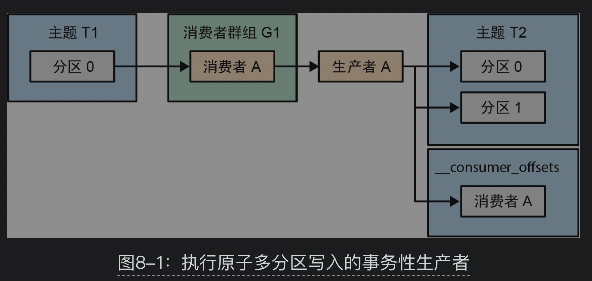

我们通过设置isolation.level参数来控制消费者如何读取以事务方式写入的消息。如果设置为read_committed，那么调用consumer.poll()将返回属于已成功提交的事务或以非事务方式写入的消息，它不会返回属于已中止或执行中的事务的消息。默认的隔离级别是read_uncommitted，它将返回所有记录，包括属于执行中或已中止的事务的记录。配置成read_committed并不能保证应用程序可以读取到特定事务的所有消息。也可以只订阅属于某个事务的部分主题，这样就可以只读取部分消息。此外，应用程序无法知道事务何时开始或结束，或者哪些消息是哪个事务的一部分。

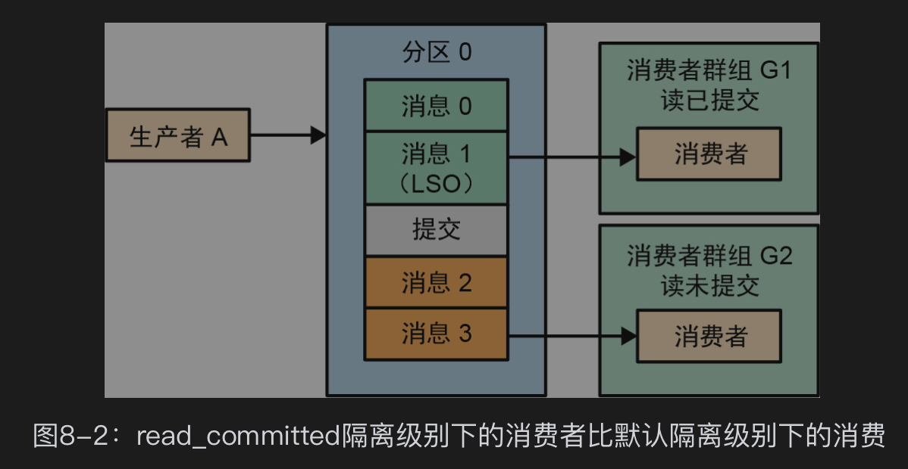

### 8.2.4　事务不能解决哪些问题

__1.在流式处理中执行外部操作__

假设流式处理应用程序在处理数据时需要向用户发送电子邮件。在应用程序中启用精确一次性语义并不能保证邮件只发送一次，这个保证只适用于将记录写入Kafka。使用序列号去重，或者使用标记中止或取消事务在Kafka中是有效的，但它不会撤销已发送的电子邮件。在流式处理应用程序中执行的任何带有外部效果的操作都是如此：调用REST API、写入文件，等等。

__2.从Kafka中读取数据并写入数据库__

在这种情况下，应用程序会将数据写入外部数据库，而不是Kafka。这里没有生产者参与，我们用数据库驱动器（如JDBC）将记录写入数据库，消费者会将偏移量提交给Kafka。没有任何一种机制允许将外部数据库写入操作与向Kafka提交偏移量的操作放在同一个事务中。

__3.从一个数据库读取数据写入Kafka，再从Kafka将数据写入另一个数据库__

我们倾向于认为可以构建出这样的应用程序：从一个数据库读取数据写入Kafka，再从Kafka将数据写入另一个数据库，并仍然能够保持源数据库的事务。不幸的是，Kafka并不支持这种端到端的事务保证。除了很难保证在同一个事务中提交记录和偏移量，还有另外一个难点：Kafka的read_committed隔离级别太弱了，根本无法保留数据库的事务。

__4.将数据从一个集群复制到另一个集群__

__5.发布和订阅模式__

前面讨论的精确一次性保证是“消费–处理–生产”的模式，而发布和订阅也是一个非常常见的模式。事务为发布和订阅模式提供了一些保证：配置了read_committed隔离级别的消费者将看不到已中止事务的消息，但这种保证并不是精确一次性的。消费者可以多次处理一条消息，具体取决于它们的偏移量提交逻辑。对于发布和订阅模式，Kafka提供的保证与JMS事务类似，消费者需要配置成read_committed隔离级别，以保证未提交的事务对消费者是不可见的。JMS broker对所有消费者隐藏了未提交的事务。

### 8.2.5　如何使用事务

事务既是一个broker特性，也是Kafka协议的一部分，所以有多种客户端支持事务。

使用事务的最常见也最推荐的方式是在Streams中启用精确一次性保证。无须直接管理事务，Streams会自动提供我们需要的保证。事务最初就是为这个场景而设计的，所以在Streams中启用事务是最简单也最有可能符合我们预期的方式。

要在Streams应用程序中启用精确一次性保证，只需要将processing.guarantee设置为exactly_once或exactly_once_beta。

如果想在不使用Streams的情况下获得精确一次性保证，该怎么办？这个时候，可以直接使用事务API。下面的代码片段演示了如何使用事务API。

```java
Properties producerProps = new Properties();
producerProps.put(ProducerConfig.BOOTSTRAP_SERVERS_CONFIG, "localhost:9092");
producerProps.put(ProducerConfig.CLIENT_ID_CONFIG, "DemoProducer");
producerProps.put(ProducerConfig.TRANSACTIONAL_ID_CONFIG, transactionalId); ➊

producer = new KafkaProducer<>(producerProps);

Properties consumerProps = new Properties();
consumerProps.put(ConsumerConfig.BOOTSTRAP_SERVERS_CONFIG, "localhost:9092");
consumerProps.put(ConsumerConfig.GROUP_ID_CONFIG, groupId);
props.put(ConsumerConfig.ENABLE_AUTO_COMMIT_CONFIG, "false"); ➋
consumerProps.put(ConsumerConfig.ISOLATION_LEVEL_CONFIG, "read_committed"); ➌

consumer = new KafkaConsumer<>(consumerProps);

producer.initTransactions(); ➍

consumer.subscribe(Collections.singleton(inputTopic)); ➎

while (true) {
  try {
    ConsumerRecords<Integer, String> records =
      consumer.poll(Duration.ofMillis(200));
    if (records.count() > 0) {
      producer.beginTransaction(); ➏
      for (ConsumerRecord<Integer, String> record : records) {
        ProducerRecord<Integer, String> customizedRecord = transform(record); ➐
        producer.send(customizedRecord);
      }
      Map<TopicPartition, OffsetAndMetadata> offsets = consumerOffsets();
      producer.sendOffsetsToTransaction(offsets, consumer.groupMetadata());➑
      producer.commitTransaction(); ➒
    }
  } catch (ProducerFencedException|InvalidProducerEpochException e) { ➓
    throw new KafkaException(String.format(
    "The transactional.id %s is used by another process", transactionalId));
  } catch (KafkaException e) {
    producer.abortTransaction(); ⓫
    resetToLastCommittedPositions(consumer);
  }}
```

### 8.2.7　事务的工作原理

## 8.3　事务的性能

# 第9章　构建数据管道

在使用Kafka构建数据管道时，通常有两种应用场景：第一种，把Kafka作为数据管道的两个端点之一，例如，把Kafka中的数据移动到S3，或者把MongoDB中的数据移动到Kafka ；第二种，把Kafka作为数据管道两个端点的中间媒介，例如，为了把Twitter中的数据移动到ElasticSearch，需要先把它们移动到Kafka，然后再从Kafka中移动到ElasticSearch。

Kafka为数据管道带来的主要价值在于，它可以作为数据管道各个数据阶段之间的大型缓冲区，有效解耦数据的生产者和消费者，让同一个数据源的数据可以被多个具有不同可用性需求的系统和应用程序使用。

我们要讨论的是如何在更大的场景中使用Kafka，这些场景至少包含了两个端点（可能会更多）​，并且这些端点都不是Kafka。建议那些面临数据集成问题的人要从大局考虑问题，而不是只关注眼前的这些端点。过度聚焦短期问题会导致后期过高的复杂性和维护成本。

## 9.1　构建数据管道时需要考虑的问题

### 9.1.1　及时性

有些系统希望每天一次性接收大量数据，有些系统则希望在数据生成几毫秒之后就能获取它们。大部分数据管道介于这两者之间。

Kafka在这里扮演了一个大型缓冲区的角色，解开了生产者和消费者之间的时间敏感性耦合。生产者实时写入数据，消费者进行批处理，反之亦然。应用回压策略也因此变得更加容易。Kafka本身就针对生产者使用了回压策略（必要时延后向生产者发送确认）​，因为读取速度完全是由消费者决定的。

### 9.1.2　可靠性

我们要避免单点故障，并能够自动从各种故障中快速恢复。数据通常经由数据管道到达业务系统，哪怕出现几秒的故障，也会造成灾难性的影响，对那些要求毫秒级及时性的系统来说尤为如此。数据传递保证是可靠性的另一个重要考量因素。有些系统允许数据丢失，但在大多数情况下，它们要求至少一次传递，也就是要求源系统的每一个事件都必须到达目的地，只是有时候重试操作可能造成重复传递。

### 9.1.3　高吞吐量和动态吞吐量

为了满足现代数据系统的需求，数据管道需要支持非常高的吞吐量。更重要的是，在某些情况下，数据管道还要能够应对突发的吞吐量增长。如果将Kafka作为生产者和消费者之间的缓冲区，那么消费者吞吐量和生产者吞吐量就不会耦合在一起。没有必要实现复杂的回压机制，因为如果生产者吞吐量超过了消费者吞吐量，则可以把数据积压在Kafka中，等待消费者追赶上来。Kafka支持单独增加额外的消费者或生产者，我们可以在数据管道的任何一端进行动态伸缩，以便满足不断变化的需求。

Kafka是高吞吐量的分布式系统，一个一般规模的集群每秒可以处理数百兆数据。

Kafka支持多种类型的压缩算法，在吞吐量增加时，Kafka用户和管理员可以通过压缩来控制对网络和存储资源的使用。

### 9.1.4　数据格式

数据管道需要协调各种数据格式和数据类型，这是其在构建时需要考虑的一个非常重要的方面。数据类型取决于不同的数据库和存储系统。你可以通过Avro将XML或关系数据加载到Kafka中，然后将它们转成JSON写入ElasticSearch，或者转成Parquet写入HDFS，或者转成CSV写入S3。

### 9.1.5　转换

9.1.5　转换

数据转换比其他方面的需求更具争议性。构建数据管道有两种方式，即ETL和ELT。ETL表示提取–转换–加载(extract-transform-load)，当数据流经数据管道时，数据管道负责修改它们。这种方式为我们节省了时间和存储空间，因为不需要经历保存数据、修改数据、再保存数据这样的过程。不过，这种好处也要视情况而定。有时候，这种方式会给我们带来实实在在的好处，但有时候也可能给数据管道带来不适当的计算和存储负担。这种方式最主要的不足在于，在数据管道中进行数据转换会对数据管道下游的应用程序造成一些限制，特别是当下游应用程序希望对数据做进一步处理的时候

ELT表示提取–加载–转换(extract-load-transform)。在这种模式下，数据管道只做少量的转换（主要是数据类型转换）​，确保到达数据池的数据尽可能与数据源保持相似。在这种数据管道架构中，目标系统会收集“原始数据”​，并完成所有的处理任务。

### 9.1.6　安全性

安全性是人们一直关心的问题。对于数据管道的安全性，我们主要关心以下几个方面。

● 谁有权限访问写入Kafka的数据？

● 能否保证流经数据管道的数据是经过加密的？这是跨数据中心数据管道通常要考虑的一个关键问题。

● 谁有权限修改数据管道？

● 如果数据管道需要从一个不受信任的系统读取或写入数据，那么是否有适当的身份验证机制？

● PII（个人识别信息）的存储、访问和使用是否符合法律和监管的要求？

### 9.1.7　故障处理

因为Kafka可以长时间保留数据，所以如果有必要，那么可以在适当的时候回过头来重新处理出错的数据。如果目标系统错过了一些消息，那么可以重放保存在Kafka中的事件。

### 9.1.8　耦合性和灵活性

数据管道最重要的作用之一是解耦数据源和数据池。数据管道会在很多情况下出现耦合。

__临时数据管道__

有些公司会为每一对相互连接的应用程序建立单独的数据管道。例如，它们使用Logstash将日志导入ElasticSearch，使用Flume将日志导入HDFS，使用GoldenGate将Oracle的数据导入HDFS，使用Informatica将MySQL的数据或XML导入Oracle，等等。它们将数据管道与特定的端点耦合起来，并创建了大量的集成点，这需要额外的部署、维护和监控。当有新的系统加入，它们需要构建额外的数据管道，从而增加了采用新技术的成本，也遏制了创新。

__元数据丢失__

如果数据管道没有保留模式元数据，并且不允许模式发生变更，那么最终会导致生产者和消费者之间发生紧密的耦合。没有了模式，生产者和消费者就需要额外的信息来解析数据。假设数据从Oracle流向HDFS，如果DBA在Oracle中添加了一个字段，但没有保留模式信息，那么每一个从HDFS读取数据的应用程序都会出错，开发人员需要修改所有的应用程序才能解决问题。如果数据管道支持模式变更，那么各个应用程序就可以随意修改自己的代码，无须担心对整个系统造成破坏。

__末端处理__

之前在讨论数据转换时就已提到，数据管道难免要对数据做一些处理工作。毕竟，我们是在不同的系统之间移动数据，所以肯定会遇到不同的数据格式，需要支持不同的应用场景。不过，如果数据管道过多地处理数据，则会将下游系统与在构建数据管道时所做的决策联系在一起，比如如何保留字段、如何聚合数据，等等。如果下游系统发生变化，那么数据管道就要做出相应的修改，这种方式不仅不灵活，还低效且不安全。更为灵活的方式是尽量保留原始数据的完整性，让下游系统自己决定如何处理和聚合数据。

## 9.2　何时使用Connect　API或客户端API

在向Kafka写入数据或从Kafka读取数据时，要么使用传统的生产者和消费者客户端，就像第3章和第4章所描述的那样，要么使用即将在后续章节中介绍的Connect API和连接器。

我们知道，Kafka客户端是内嵌到应用程序中的，应用程序用它向Kafka写入数据或从Kafka读取数据。如果可以修改与Kafka相连接的应用程序的代码，或者想要将数据推送到Kafka或从Kafka读取数据，那么就可以使用Kafka客户端。如果要将Kafka连接到数据存储系统，而这些系统不是你开发的，你无法或者不想修改它们的代码，那么可以使用Connect。Connect可用于从外部数据存储系统读取数据，或者将数据推送到外部存储系统。要使用Connect，首先要有数据存储系统连接器，现在有很多可用的连接器。在实际使用时，Connect用户只需提供配置文件即可。

如果要连接的数据存储系统没有相应的连接器，则可以考虑使用客户端API或Connect API开发一个。建议首选Connect，因为它不仅提供了像配置管理、偏移量存储、并行处理、错误处理这样的开箱即用的特性，而且支持多种数据类型和标准的REST管理API。Connect是Kafka生态系统的一个标准组件，它为你处理了大部分细节，让你可以专注于处理与外部存储系统之间的数据传输。

## 9.3　KafkaConnect

Connect是Kafka的一部分，它为Kafka和外部数据存储系统之间的数据移动提供了一种可靠且可伸缩的方式。它提供了一组API和一个运行时，我们可以用它们开发和运行连接器插件。Connect会执行这些插件，并用它们移动数据。Connect会以 worker集群的方式运行。我们会在worker节点上安装连接器插件，然后用REST API来管理和配置连接器。

数据源的连接器任务负责从源系统读取数据，并把数据对象提供给worker。数据池的连接器任务负责从worker获取数据，并把它们写入目标系统。Connect会使用转换器在Kafka中存储不同格式的数据。

### 9.3.1　运行Connect

Connect随Kafka一起发布，所以无须单独安装。如果你打算在生产环境中用Connect来移动大量数据或运行多个连接器，那么最好把Connect部署在单独的服务器上。你可以在所有的服务器上安装Kafka，只启动部分服务器上的broker，然后启动剩余服务器上的Connect。启动worker与启动broker差不多，只需在调用启动脚本时传入一个属性配置文件即可。

```shell
bin/connect-distributed.sh config/connect-distributed.properties
```

worker有以下几个重要的配置参数。

__bootstrap.servers__

这个参数列出了将要与Connect协同工作的broker服务器，连接器会向这些broker写入数据或从它们那里读取数据。无须为这个参数提供所有broker的地址，不过建议至少指定3个。

__group.id__

具有相同组ID的worker属于同一个Connect集群。集群的连接器和它的任务可以运行在任意一个工作节点上。

__plugin.path__

Connect采用了一种可插拔的架构，支持添加连接器、转换器、转换和密钥提供程序。为此，Connect必须能够找到和加载这些插件。

__key.converter和value.converter__

Connect可以处理多种数据格式。这两个参数分别指定了消息的键和值所使用的转换器。默认使用的是Kafka提供的JSONConverter，当然也可以配置成Confluent模式注册表提供的AvroConverter、ProtobufConverter或JscoSchemaConverter。

__rest.host.name和rest.port__

一般通过Connect的REST API来配置和监控连接器。可以为REST API指定特定的端口。

在启动worker集群之后，可以通过REST API来验证它们是否运行正常。

```shell
$ curl http://localhost:8083/
{"version":"3.0.0-
SNAPSHOT","commit":"fae0784ce32a448a","kafka_cluster_id":"pfkYIGZQSXm8RylvACQHdg"}%
```

还可以检查已经安装好的连接器插件。

```shell
$ curl http://localhost:8083/connector-plugins

[
  {
    "class": "org.apache.kafka.connect.file.FileStreamSinkConnector",
    "type": "sink",
    "version": "3.0.0-SNAPSHOT"
  },
  {
    "class": "org.apache.kafka.connect.file.FileStreamSourceConnector",
    "type": "source",
    "version": "3.0.0-SNAPSHOT"
  },
  {
    "class": "org.apache.kafka.connect.mirror.MirrorCheckpointConnector",
    "type": "source",
    "version": "1"
  },
  {
    "class": "org.apache.kafka.connect.mirror.MirrorHeartbeatConnector",
    "type": "source",
    "version": "1"
  },
  {
    "class": "org.apache.kafka.connect.mirror.MirrorSourceConnector",
    "type": "source",
    "version": "1"
  }
]
```

### 9.3.2　连接器示例：文件数据源和文件数据池

为方便起见，直接让它读取Kafka的配置文件，也就是说把Kafka配置文件中的内容发送到一个主题上。

```shell
echo '{"name":"load-kafka-config", "config":{"connector.class":
"FileStreamSource","file":"config/server.properties","topic":
"kafka-config-topic"}}' | curl -X POST -d @- http://localhost:8083/connectors
-H "Content-Type: application/json"

{
  "name": "load-kafka-config",
  "config": {
    "connector.class": "FileStreamSource",
    "file": "config/server.properties",
    "topic": "kafka-config-topic",
    "name": "load-kafka-config"
  },
  "tasks": [
    {
      "connector": "load-kafka-config",
      "task": 0
    }
  ],
  "type": "source"
}
```

接下来通过Kafka的控制台消费者来验证配置文件的内容是否已经被加载到主题上。

```shell
gwen$ bin/kafka-console-consumer.sh --bootstrap-server=localhost:9092
--topic kafka-config-topic --from-beginning
```

```shell
{"schema":{"type":"string","optional":false},"payload":"# Licensed to the
Apache Software Foundation (ASF) under one or more"}

<省略的部分>
{"schema":{"type":"string","optional":false},"payload":"#############################
Server Basics
#############################"}
{"schema":{"type":"string","optional":false},"payload":""}
{"schema":{"type":"string","optional":false},"payload":"# The id of the broker.
This must be set to a unique integer for each broker."}
{"schema":{"type":"string","optional":false},"payload":"broker.id=0"}
{"schema":{"type":"string","optional":false},"payload":""}

<省略的部分>
```

如果要删除一个连接器，那么可以运行下面的命令。

```shell
curl -X DELETE http://localhost:8083/connectors/dump-kafka-config
```

### 9.3.3　连接器示例：从MySQL到ElasticSearch

这次，将一张MySQL表的数据导入Kafka主题，然后再将它们加载到ElasticSearch中。

下一步要确保有可用的连接器。可以通过以下几种方式获取。1.使用Confluent Hub客户端下载和安装。2.从Confluent Hub页面下载。​（或者从其他提供了你需要的连接器的网站下载。​）3.从源代码构建。要从源代码构建，需要做以下事情。

另外，因为要连接到MySQL数据库，所以需要下载并安装MySQL的JDBC驱动程序。受许可协议的限制，连接器本身不带有驱动程序。可以

我们使用的JDBC连接器通过JDBC和SQL来扫描数据库表以查找新记录。它使用时间戳字段或递增的主键来检测新记录。这种方式相对低效，有时候也不准确。所有的关系数据库都将事务日志（也称为重做日志、binlog或提前预写日志）作为其实现的一部分，它们中的大部分允许外部系统直接读取它们的事务日志。这种方式更准确、更高效，也就是所谓的变更数据捕获。大多数现代ETL系统会将变更数据捕获作为数据源。Debezium项目为各种数据库提供了一系列高质量的开源变更捕获连接器。如果你正计划将关系数据库中的数据流转到Kafka，那么强烈建议使用Debezium提供的变更捕获连接器（如果有你的数据库对应的连接器的话）​。另外，Debezium项目的文档是我们见过的最好的文档之一——除了连接器，它还涵盖与变更数据捕获相关的设计模式和应用场景，特别是它们在微服务架构当中的应用。

类似的解决方案还有Flink等。

把数据从MySQL中移动到Kafka就算完成了。接下来我们要把数据从Kafka中写到ElasticSearch。

任何人都可以基于公开的Connector API创建自己的连接器。如果你要集成的数据存储系统没有相应的连接器，就自己开发一个。你也可以把自己开发的连接器放到Confluent Hub上，让更多的人知道并使用。

### 9.3.4　单一消息转换

将数据从MySQL复制到Kafka，再从Kafka复制到ElasticSearch，这个过程很有用，不过ETL管道通常还需要一个转换步骤。在Kafka生态系统中，我们将转换分为单一消息转换(single message transformation,SMT)和流式处理。前者是无状态的，后者是有状态的。SMT可以在Connect中完成，也就是在复制消息时对消息进行转换，通常不需要编写额外的代码。对于更复杂的转换，比如涉及连接或聚合操作，则需要使用有状态的Kafka Streams框架。后面的章节将介绍Kafka Streams。

Kafka支持以下这些SMT。

__Cast__

改变一个字段的数据类型。

MaskField

将一个字段的内容替换成null。这在移除敏感信息或个人识别数据时非常有用。

__Filter__

丢弃或包含符合指定条件的记录。内置的条件包括匹配主题名称、匹配特定的标头、消息是否为墓碑消息（值为null）​。

__Flatten__

将嵌套的数据结构扁平化，也就是将所有字段的名字连接成路径的形式。

__HeaderFrom__

将消息里的字段移动或复制到标头里。

__InsertHeader__

在每一条消息的标头里加入一个固定的字符串。

__InsertField__

在消息里添加一个字段，字段的值既可以来自元数据（如偏移量）​，也可以是一个固定的值。

__RegexRouter__

使用正则表达式和替换字符串改变目标主题。

__ReplaceField__

移除或重命名消息里的字段。

__TimestampConverter__

修改一个字段的时间格式，比如将Unix Epoch转成字符串。

__TimestampRouter__

根据消息的时间戳来改变主题。这在数据池连接器中很有用，当我们希望基于消息的时间戳将它们复制到特定的分区表中时，主题将被用于查找目标系统的相关数据集。

### 9.3.5　深入理解Connect

__1.连接器和任务__

连接器插件实现了Connector API，其中包含两部分内容。

__连接器__

连接器主要负责处理以下3件事情。

● 确定需要运行多少个任务。

● 确定如何根据任务拆分数据复制工作。

● 从worker获取任务配置信息并传给任务。例如，JDBC连接器会连接到数据库，统计需要复制的数据表，并确定需要多少个任务，然后在配置参数tasks.max和实际的数据表数量之间选择数值较小的那个作为任务数。在确定了任务数之后，连接器会为每一个任务生成一个配置，配置信息里包含了连接器的配置项（如connection.url）和这个任务需要复制的数据表。taskConfigs()方法会返回一个map（包含每一个任务的配置信息）列表。worker负责启动任务并将配置信息传给它们。每一个任务负责复制配置信息里指定的数据表。需要注意的是，当你通过REST API启动连接器时，它可能会在任意节点上启动，随后它启动的任务也会在这个节点上执行。

__任务__

任务负责将数据移入或移出Kafka。在初始化任务时，worker会为其分配上下文信息。源系统的上下文中包含了一个对象，任务可以将源系统记录的偏移量保存在这个对象里（例如，文件连接器的偏移量就是文件中的一个位置，JDBC连接器的偏移量可以是表中的一个时间戳）​。目标系统的上下文提供了一些方法，连接器可以用它们控制从Kafka接收到的数据，比如应用回压策略、进行错误重试，或者通过将偏移量保存到外部系统来实现精确一次传递。任务在初始化之后会按照连接器指定的配置（包含在一个Properties对象里）开始工作。在任务开始之后，源系统任务将对外部系统进行轮询并返回一些记录，然后由worker发送给Kafka，数据池任务则通过worker接收来自Kafka的记录，然后将它们写入外部系统。

__2.worker__

worker是执行连接器和任务的“容器”​。它们负责处理用于定义连接器及其配置的HTTP请求、将连接器的配置保存到内部Kafka主题上、启动连接器和任务，并把配置信息传给任务。如果一个worker停止工作或发生崩溃，那么集群中的其他worker就会感知到（根据Kafka消费者协议的心跳机制来判断）​，并会将发生崩溃的worker的连接器和任务重新分配给其他worker。

可以这样理解：连接器和任务负责“移动数据”​，worker则负责处理REST API请求、配置管理、可靠性、高可用性、伸缩性和负载均衡。

__3.转换器和Connect的数据模型__

Connect提供了一组数据API，包括数据对象和用于描述数据的模式。例如，JDBC连接器会从数据库读取一个字段，并基于这个字段的数据类型创建一个Connect Schema对象。然后，连接器会基于模式创建一个包含了所有数据库字段的Struct。我们保存了每一个字段的名字和它们的值。其他源连接器所做的事情都很相似：从源系统读取记录，为每条记录生成Schema和Value。目标连接器正好相反，它们用Schema解析Value，并把值写入目标系统。

用户在配置worker或连接器时可以使用合适的转换器。目前可用的转换器有原始类型转换器、字节数组转换器、字符串转换器、Avro转换器、JSON转换器、JSON模式转换器和Protobuf转换器。JSON转换器既可以在转换结果中带上模式，也可以不带，这样就可以支持结构化和半结构化的数据。连接器会通过数据API将数据返回给worker，然后worker会使用指定的转换器将数据转换成Avro对象、JSON对象或字符串，转换后的数据会被写入Kafka。

__4.偏移量管理__

偏移量管理是worker为连接器提供的便捷服务之一（除了可以通过RESTAPI进行部署和配置管理之外）​。连接器需要知道哪些数据是已经处理过的，它们可以通过Kafka提供的API来维护已处理的消息的偏移量。

对源连接器来说，连接器返回给worker的记录里包含了一个逻辑分区和 一个逻辑偏移量。它们并非Kafka的分区和偏移量，而是源系统的分区和偏移量。例如，对文件源来说，分区可以是一个文件，偏移量可以是文件中的一个行号或字符号。对JDBC源来说，分区可以是一个数据库表，偏移量可以是表中一条记录的ID或时间戳。在设计源连接器时，需要着重考虑如何对源系统的数据进行分区以及如何跟踪偏移量，这将影响连接器的并行能力，也决定了是否能够实现至少一次传递或精确一次传递。

## 9.4　Connect之外的选择

### 9.4.1　其他数据存储系统的数据摄入框架

如果架构里包含了Kafka，并且需要连接大量的源系统和目标系统，那么建议使用Connect API。如果你的系统是以Hadoop或ElasticSearch为中心，Kafka只是数据的来源之一，那么使用Flume或Logstash会更合适。

### 9.4.2　基于图形界面的ETL工具

建议把Kafka看成能够处理数据集成（通过Connect）​、应用集成（通过 生产者和消费者）和流式处理的平台。Kafka可以作为ETL工具的一个可行替代品。

### 9.4.3　流式处理框架

大部分流式处理框架具备从Kafka读取数据并将数据写入外部系统的能力。如果目标系统支持，并且你已经打算使用流式框架处理来自Kafka的数据，那么就可以使用同样的框架进行数据集成。这样就可以省掉一个处理步骤（无须把处理过的数据保存到Kafka，只需读取数据，再把它们写入其他系统）​，只是在发生数据丢失或出现损坏数据时，诊断问题会变得更难一些。

# 第10章　跨集群数据镜像

因为“复制”一词已被用来描述在同一集群的不同节点之间移动数据，所以可以把集群间的数据复制叫作镜像(mirroring)。Kafka内置的跨集群镜像工具叫作MirrorMaker。

## 10.1　跨集群镜像的应用场景

__区域集群和中心集群__

有很多情况会涉及跨数据中心访问数据，例如，一家公司根据供需情况修改商品价格就是一个典型的应用场景。这家公司在每个城市都有一个数据中心，用于收集每个城市的供需信息，然后根据整体的供需情况调整商品价格。这些信息会被镜像到中心集群，然后业务分析员会基于中心集群中的数据生成整个公司的收益报告。

__高可用(HA)和灾备(DR)__

__监管与合规__

为了符合不同国家的法律和监管要求，一家公司在不同国家的运营可能需要不同的配置和策略。例如，一些数据可能需要被保存在具有严格访问控制的独立集群中，一些数据则可以被复制到具有宽松访问权限的其他集群。

__云迁移__

现如今，很多公司会将它们的业务同时部署在本地数据中心和云端。为了实现冗余，应用程序通常会运行在云供应商的多个服务区域，或使用多个云供应商提供的云服务。

__聚合边缘集群的数据__

一些行业，包括零售、电信、运输和医疗保健等，它们会收集小型设备生成的数据。这些设备使用的是受限的网络连接。大量的边缘集群会将收集到的数据聚合到一个高可用的聚合集群中。

## 10.2　多集群架构

### 10.2.1　跨数据中心通信的一些现实情况

__高延迟__

Kafka集群之间的通信延迟会随着集群间距离的增长和网络跳转次数的增加而增加。

__有限的带宽__

单个数据中心的广域网带宽远比我们想象的要低得多，而且可用的带宽时刻在发生变化。另外，高延迟让带宽的充分利用变得更加困难。

__高成本__

不管是在本地还是在云端运行Kafka，集群之间的通信都需要更高的成本。部分原因是带宽有限，而增加带宽需要支付更高的费用。另外，这与供应商制定的在数据中心、可用区域和云平台之间传输数据的收费策略也有关系。

Kafka服务器和客户端的设计、开发、测试以及调优都以单个数据中心为基础。假设服务器和客户端之间的延迟很低、带宽很高，在设定默认超时时间和缓冲区大小时也是基于这个前提。因此，不建议将Kafka集群的一部分服务器安装在一个数据中心里，另一部分安装在另一个数据中心里（不过稍后将介绍一些例外情况）​。

在发生网络分区时，消费者无法从Kafka读取数据，但数据仍然驻留在Kafka中，当通信恢复正常时，消费者就可以继续读取数据。因此，网络分区不会造成数据丢失。不过，因为带宽有限，如果一个数据中心里的多个应用程序需要从另一个数据中心的Kafka服务器读取数据，那么我们倾向于在每一个数据中心里安装一个Kafka集群，并在这些集群间复制数据，而不是让应用程序直接通过广域网访问另一个数据中心里的数据。

在讨论跨数据中心通信的调优策略之前，需要先了解以下架构原则。

● 每个数据中心至少要有一个集群。

● 每两个数据中心之间的数据复制要做到每个事件仅复制一次（除非出现错误需要重试）​。

● 如果有可能，那么尽量从远程数据中心读取数据，而不是向远程数据中心写入数据。

### 10.2.2　星型架构

这种架构适用于一个中心Kafka集群对应多个本地Kafka集群的情况，如图10-1所示。

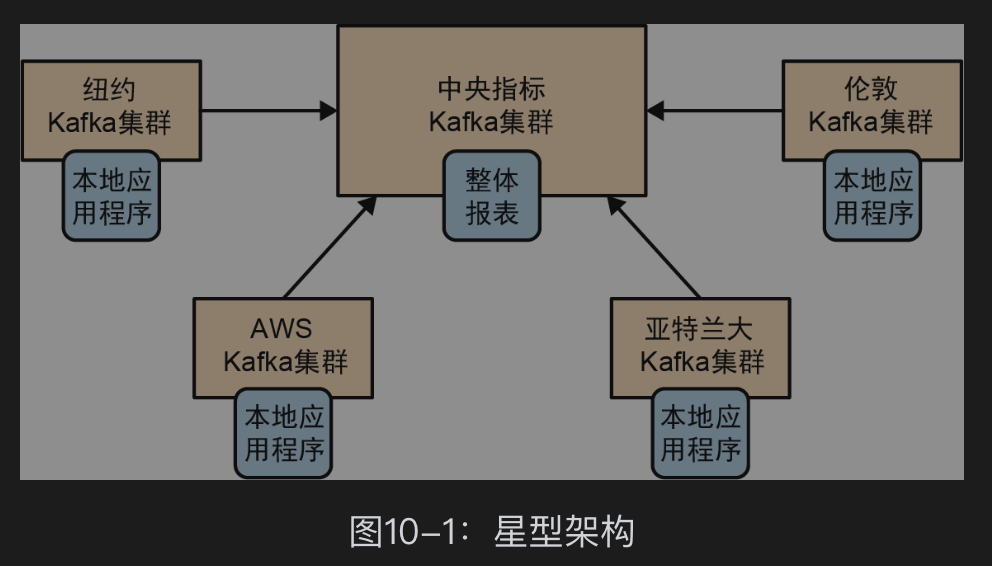

这种架构的简化变种是只包含两个集群：一个首领和一个跟随者，如图10-2所示。

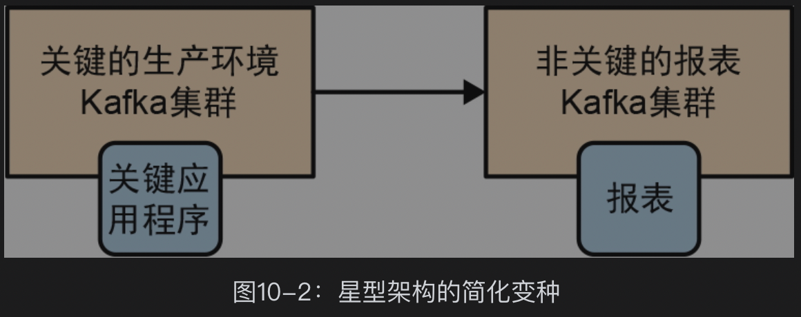

当数据分散在多个数据中心而消费者需要访问全部数据时，可以使用这种架构。如果每个数据中心的应用程序只访问自己所在数据中心的数据，那么也可以使用这种架构。但它不允许从每个数据中心访问整个数据集。

这种架构的好处在于，数据只会生成到本地的数据中心，并且每个数据中心的数据只会被镜像到中央数据中心一次。只读取单个数据中心数据的应用程序可以被部署在本地数据中心里，需要读取全部数据的应用程序则可以被部署在中央数据中心里。因为数据复制是单向的，并且消费者总是从同一个集群读取数据，所以这种架构易于部署、配置和监控。

### 10.2.3　双活架构

当有两个或多个数据中心需要共享部分或全部数据，并且每个数据中心都可以生成和读取数据时，可以使用双活架构，如图10-3所示。

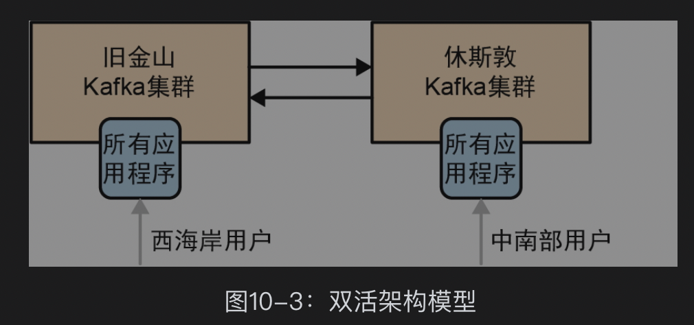

这种架构的主要好处在于，它可以为就近用户提供速度更快的服务，具有性能方面的优势，而且不会因为数据可用性问题（在星型架构中就有这种问题）做出功能方面的牺牲。还有一个好处是冗余和弹性。因为每个数据中心都具备完整的功能，所以一旦一个数据中心发生故障，则可以把用户重定向到另一个数据中心。这种故障转移只涉及网络重定向，是一种最简单也最透明的故障转移方案。这种架构的主要问题在于，如何在多个数据中心进行异步读写时避免冲突。比如，在镜像数据时如何确保同一条消息不会被无止境地来回镜像？更重要的是，保证跨数据中心的数据一致性会变得更加困难。以下是可能遇到的问题。

● 如果用户向一个数据中心发送数据，并从另一个数据中心读取数据，那么在用户读取数据之前，他发送的数据有可能还没有被镜像到那个数据中心。对用户来说，这就好比把一本书加到购物车里，但是当他点开购物车时，书不在里面。因此，在使用这种架构时，开发人员经常会将用户“黏”在同一个数据中心里，确保用户在大多数情况下使用的是同一个集群（除非他们从远程连接到另一个集群或那个数据中心不可用）​。

● 一个用户在一个数据中心订购了图书A，另一个数据中心几乎在同一时间收到了这个用户订购图书B的订单，在经过数据镜像之后，两个数据中心都有了这两个事件，也可以说两个数据中心都出现了两个冲突事件。应用程序需要知道如何处理这种情况。是否应该从中挑选一个作为“正确”的事件呢？如果是，那么就需要在两个数据中心之间定义好规则，让应用程序知道哪个事件才是正确的。或者，可以把两个事件都当成正确的事件，将两本书都发给用户，然后设立专门的部门来处理退货问题？亚马逊曾经用这种方式来处理冲突，但对券商来说，这种方案是行不通的。如何最小化和处理冲突要视具体情况而定。总而言之，如果使用了这种架构，则必然会遇到冲突，因此要想办法解决它们。

如果能够很好地处理多个数据中心在进行异步读写时发生冲突的问题，那么强烈建议使用这种架构。这种架构是我们所知道的最具伸缩性、弹性、灵活性和成本优势的解决方案。所以，它值得我们投入精力去寻找。

另外，还要避免循环镜像，相同的事件不能无止境地在两个数据中心之间来回镜像。对于每一个“逻辑主题”​，可以在每个数据中心里分别为它创建一个单独的主题，并确保不要从远程数据中心复制同名的主题。例如，对于逻辑主题users，我们在一个数据中心里为其创建SF.users主题，在另一个数据中心里为其创建NYC.users主题。镜像进程会将SF的SF.users镜像到NYC，将NYC的NYC.users镜像到SF。这样一来，每一个事件只会被镜像一次。不过，在经过镜像之后，每个数据中心里都会有SF.users和NYC.users这两个主题，也就是说，每个数据中心将拥有所有的用户数据。消费者如果要读取所有用户的数据，就需要以 *.users的方式订阅主题。也可以把这种方式理解为数据中心的命名空间，比如在这个例子中，NYC和SF就是命名空间。一些镜像工具，比如MirrorMaker，就是基于类似的命名空间机制来防止循环镜像。

### 10.2.4　主备架构

有时候，我们使用多个集群只是为了达到灾备的目的。你可能在同一个数据中心安装了两个集群，平常只使用其中一个，第二个集群（几乎）包含了与第一个集群相同的数据，当第一个集群不可用时，就可以使用第二个集群。这是一种合规性需求，业务不一定会将其纳入规划范畴，但还是有必要为其做好充分的准备。

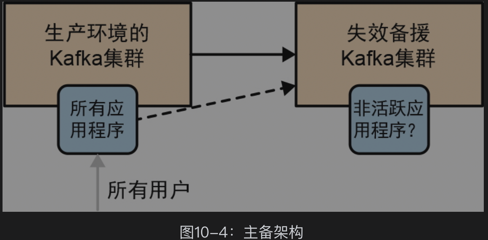

这种架构的好处是易于实现，而且可以被应用于任何一种场景中。你只需要安装第二个集群，并使用镜像进程将第一个集群的数据完全镜像到第二个集群中，不需要操心如何访问数据、如何处理冲突，也不需要担心它会带来额外的架构复杂性。

这种架构的不足在于，它浪费了一个集群。Kafka集群的故障转移比我们想象的要难得多。目前，要实现完全不丢失数据或无重复数据的Kafka集群故障转移是不可能的，更为常见的情况是既丢失数据，又出现重复数据。我们只能尽量减少这些问题的发生，但无法完全避免。

不管选择哪一种故障转移方案，SRE团队都必须定期进行验证。今天能够正常运行的计划，在系统升级之后可能就无法正常运行了，或者现有的工具将无法满足新场景的需求。每季度进行一次故障转移验证是最低限度的要求，一个高效的SRE团队会更频繁地进行故障转移验证。

__1.灾难恢复计划__

一个是恢复时间目标(recovery time objective, RTO)，它表示灾难发生后恢复所有服务需要的最长时间。另一个是恢复点目标(recovery point objective, RPO)，它表示灾难发生后可能发生数据丢失的最长时间。RTO越低，就越要避免采用人工操作流程，因为只有自动化故障转移才能实现非常低的RTO。低RPO需要低延迟的实时镜像，如果要求RPO为零，则需要进行同步复制。

__2.没有故障转移计划导致的数据丢失和不一致性__

如果你的Kafka集群每秒处理100万条消息，主集群和灾备集群之间有5毫秒的延迟，那么在最好的情况下，灾备集群每秒会落后5000条消息。所以，如果没有故障转移计划，那么就要承担潜在的数据丢失风险。如果有故障转移计划，则可以先停止主集群，等待镜像进程将剩余数据镜像完毕，然后再切换到灾备集群，这样可以避免数据丢失。

如果发生了非计划内的故障转移，则可能会丢失数千条消息。需要注意的是，目前镜像解决方案还不支持事务，也就是说，如果多个主题（比如保存销售数据的主题和保存产品数据的主题）之间有相关性，那么在故障转移过程中，有些数据可能可以及时到达灾备集群，有些则不能。在切换到灾备集群之后，应用程序需要知道如何处理没有相关销售信息的产品数据。

__3.故障转移之后的起始偏移量__

- 偏移量自动重置: Kafka消费者有一个配置参数，用于指定在没有前一个提交偏移量的情况下该作何处理。消费者要么从分区的起始位置开始读取数据，要么从分区的末尾开始读取。如果你的灾备计划里没有镜像偏移量，那么就需要从上述两个选项中选择一个。要么从头开始读取数据，并处理大量的重复数据，要么直接跳到末尾，放弃一些数据（希望不会太多）​。如果重复处理数据或者丢失一些数据不是大问题，那么这种方案就是目前为止最为简单的。一般来说，在故障转移之后直接从主题末尾开始读取数据的方式更为常见。

- 复制偏移量主题: 如果你使用的是0.9.0及以上版本的Kafka消费者，那么它会把偏移量提交到一个叫作 __consumer_offsets的主题上。如果你将这个主题镜像到了灾备集群，那么当消费者开始读取灾备集群时，就可以获取到原先的偏移量，并从这个位置开始处理数据。这看起来很简单，但仍然有很多需要注意的地方。第一，我们并不能保证主集群中的偏移量与灾备集群中的偏移量是完全匹配的。假设主集群中的数据只保留3天，但你在主题创建好一星期之后才开始镜像数据。主集群中第一个可用偏移量可能是57 000 000（前4天的旧数据已经被删除了）​，而灾备集群中的第一个偏移量是0。当消费者尝试从57 000 003位置（因为这是它要读取的下一条消息）开始读取数据时，就会失败。第二，就算在主题创建之后立即镜像数据，并且主集群和灾备集群的偏移量都从0开始，当生产者需要重试发送消息时仍然会造成偏移量偏离。第三，就算偏移量被完美地保留下来，因为主集群和灾备集群之间存在延迟以及目前的镜像方案不支持事务，消费者提交的偏移量仍有可能在记录之前或者之后到达。在发生故障转移之后，消费者可能会找不到与偏移量匹配的记录，或者灾备集群中的偏移量会比主集群中的偏移量小.在这些情况下，需要接受一定程度的数据重复。当灾备集群中的偏移量比主集群中的小，或者因生产者进行重试而导致灾备集群中的偏移量比主集群中的大时，都会造成数据重复

- 基于时间的故障转移:从Kafka 0.10.0开始，每条消息里都包含了一个时间戳——消息发送给Kafka的时间。从Kafka 0.10.1.0开始，broker提供了一个索引和可根据时间戳查找偏移量的API。如果发生了故障转移，而你知道故障是从凌晨4:05开始的，那么就可以让消费者从4:03的位置开始处理数据。虽然这两分钟时间差内会存在一些重复数据，但这种方式仍然比其他方案要好得多，而且也很容易向其他人解释：​“我们将从凌晨4:03的位置开始处理数据”要比“我们从一个不知道是不是最新的位置开始处理数据”要好得多。所以，这是一种更好的折中。一种方式是在应用程序中完成这件事情。我们为用户提供一个配置参数，用于指定从什么时间点开始处理数据。如果用户指定了时间，那么应用程序就可以通过新API获取指定时间戳对应的偏移量，然后从这个位置开始处理数据。如果应用程序一开始就是这么设计的，那么使用这种方案就再好不过了。但如果不是呢？Kafka提供了kafka-consumer-groups工具，我们可以用它基于一些参数来重置偏移量，包括在Kafka 0.11.0中引入的基于时间戳的偏移量重置。在使用这个工具时，需要先停止消费者群组，等工具运行完毕之后再立即启动。例如，下面的命令会将某个消费者群组订阅的所有主题的偏移量都重置到指定的时间。

```shell
bin/kafka-consumer-groups.sh --bootstrap-server localhost:9092 --resetoffsets
--all-topics --group my-group --to-datetime
2021-03-31T04:03:00.000 --execute
```

- 偏移量映射: 镜像偏移量主题的一个最大问题在于主集群和灾备集群的偏移量会发生偏离。在过去，一些组织会选择使用外部数据存储（如ApacheCassandra）来保存集群之间的偏移量映射关系。每当一个事件被发送 到灾备集群时，镜像工具会将两个集群的偏移量都发送到外部存储。现在的镜像解决方案（包括MirrorMaker）会使用Kafka主题来保存偏移量映射关系。当两个集群的偏移量差值发生变化时，就更新映射关系。如果主集群的偏移量495被映射到灾备集群的500，就在外部存储上记录(495,500)，或者把这个映射写到映射主题上。如果之后因为消息重复导致差值发生变化，偏移量596被映射为600，就记录新的映射(569,600)。没有必要保留495和596之间的所有偏移量映射，我们假设差值都是一样的，所以主集群的偏移量550会被映射到灾备集群的555。如果发生了故障转移，就使用主集群与灾备集群的偏移量映射，而不是时间戳（通常会有点儿不准确）与偏移量的映射。我们会通过之前介绍的两种技术手段之一强制消费者使用映射中的偏移量。

__4.故障转移之后__

假设故障转移进行得很顺利，灾备集群也运行得很正常，现在需要对主集群做一些改动，把它变成灾备集群。

● 怎么知道该从哪里开始镜像呢？我们需要解决与镜像应用程序消费者所面临问题同样的问题。而且不要忘了，所有的解决方案都有可能导致数据丢失或重复，或两者兼有。

● 另外，正如之前所讨论的那样，旧主集群中可能有一些数据没有被镜像到新主集群中，如果这个时候开始镜像新主集群的数据，那么历史遗留数据会继续留在旧主集群中，导致两个集群的数据不一致。

因此，如果要保证数据的一致性和顺序，最简单的解决方案是清理旧主集群，删掉所有数据和偏移量，然后从新主集群中把数据镜像回来。这样可以获得与新主集群一致的数据状态。

__5.关于集群发现__

在设计灾备集群时，需要考虑的一个很重要的问题是在发生故障转移之后，应用程序如何与灾备集群通信。如果把主集群的主机名硬编码在生产者和消费者的配置文件中，就会很麻烦。为简单起见，大多数组织使用了DNS，并将其指向主集群，一旦发生紧急情况，则可以将其指向灾备集群。这些服务发现工具（DNS或其他）不需要包含所有broker的信息，只要Kafka客户端能够连接到其中一个broker，就可以获取整个集群的元数据，并发现集群中的其他broker。一般来说，提供3个broker的信息就可以了。不管使用哪种服务发现工具，在大多数情况下需要重启消费者，这样才能找到新的偏移量，并继续读取数据。对于为降低RTO而使用自动故障转移的场景，需要将故障转移处理逻辑放在客户端应用程序中。

### 10.2.5　延展集群

在主备架构中，当Kafka主集群发生失效时，可以将应用程序重定向到另一个集群，以保证业务的正常运行。而当整个数据中心发生故障时，延展集群(stretch cluster)可以保证Kafka集群仍然可用。延展集群是指跨多个数据中心的Kafka集群。

首先，延展集群并非多个集群，而是单个集群，因此不需要使用镜像进程。延展集群使用Kafka内置的复制机制来保持broker副本的同步。这里可以使用同步复制。生产者通常会在消息成功写入Kafka之后收到确认。在延展集群中，也可以配置类似的参数，在消息被写入两个数据中心的broker之后发送确认。这还包括使用机架信息确保每个分区在其他数据中心都有相应的副本，并配置min.insync.replicas和acks=all，以确保每次写入消息时都可以收到来自至少两个数据中心的确认。从Kafka 2.4.0开始，消费者可以基于机架信息从最近的副本获取数据。broker会检查自己的机架信息与消费者的机架信息，以便找到最新的本地副本，如果本地副本不可用，就从首领副本读取。从本地数据中心的跟随者副本读取数据可以提高吞吐量、降低延迟和成本，因为跨数据中心的流量减少了。

同步复制是这种架构的最大优势。有些类型的业务要求灾备站点与主站点保持100%的同步。这是一种合规性需求，适用于公司内的任何一种数据存储，包括Kafka。这种架构还有一个优势，即两个数据中心及集群内的所有broker都发挥了作用，不会浪费资源。

这种架构的不足之处是它所能应对的灾难类型是有限的。它只能应对数据中心故障，但无法应对应用程序或者Kafka故障。运维复杂性是它的另一个不足之处，它所需要的物理基础设施并不是所有公司都能承担得起的。

之所以是3个数据中心，主要是因为ZooKeeper要求集群的节点个数是奇数，并且只有当大多数节点可用时，整个集群才可用。如果只有两个数据中心，并且ZooKeeper的节点是奇数个，那么其中一个数据中心将包含大多数节点，这就意味着如果这个数据中心不可用，那么ZooKeeper和Kafka也不可用。如果有3个数据中心，那么在分配节点时，可以做到每个数据中心都不会包含大多数节点。如果其中一个数据中心不可用，那么其他两个数据中心里还有大多数节点，此时ZooKeeper和Kafka仍然可用。

一种比较流行的延展集群模型是2.5数据中心架构，即两个数据中心里都安装了Kafka和ZooKeeper，然后再在另外“半”个数据中心里安装一个ZooKeeper节点，当其中一个数据中心发生故障时，它可以提供仲裁。

## 10.3　MirrorMaker

Kafka提供了一个叫作MirrorMaker的工具，用于在两个数据中心之间镜像数据。


# 第11章　保护Kafka

# 第12章　管理Kafka

管理Kafka集群意味着需要使用额外的工具对主题、配置等做出修改。Kafka提供了一些命令行工具，以用于对集群做出变更。这些工具使用Java类实现，Kafka提供了一些脚本来调用它们。不过，这些工具只提供了基本的功能，无法完成复杂的操作，难以被用于管理大规模的集群。本章只介绍Kafka项目提供的基础工具。Kafka社区也开发了很多高级工具，虽然不属于Kafka核心项目，但是可以在Kafka网站上找到它们。

## 12.1　主题操作

可以用kafka-topics.sh执行大部分与主题相关的操作。可以用它创建、修改、删除和查看主题。

本章假设所有工具都位于 /usr/local/kafka/bin/ 目录。本节示例中的命令都假设这个目录为当前工作目录，或者这个目录已经被添加到 $PATH环境变量中。

## 12.1.1　创建新主题

--topic想要创建的主题的名字。

--replication-factor主题的副本数量。

--partitions主题的分区数量。

主题的名字可以包含字母数字字符、下划线、破折号和点号，但不建议使用点号。Kafka的内部指标会将点号转成下划线。另外，避免使用双下划线作为主题名字的前缀。根据约定，Kafka内部主题的名字以双下划线开头。

创建一个新主题非常简单，只需像下面这样运行kafka-topics.sh。

```shell
# kafka-topics.sh --bootstrap-server <connection-string>:<port> --create --
topic <string>
--replication-factor <integer> --partitions <integer>
#
```

```shell
# kafka-topics.sh --bootstrap-server localhost:9092 --create
--topic my-topic --replication-factor 2 --partitions 8
Created topic "my-topic".
#
```

在自动化脚本中调用kafka-topics.sh时，可以指定 --if-not-exists选项，这样即使要创建的主题已经存在也不会抛出异常。虽然Kafka为 --alter命令提供了 --if-exists参数，但不建议使用它。这是因为如果指定了这个选项，并且要修改的主题不存在，那么--alter命令就不会返回任何错误，从而掩盖了本应创建这个不存在的主题的错误。

### 12.1.2　列出集群中的所有主题

可以用 --list命令列出集群中的所有主题。每个主题占用一行输出，主题之间没有特定的顺序

```shell
# kafka-topics.sh --bootstrap-server localhost:9092 --list
__consumer_offsets
my-topic
other-topic
#
```
### 12.1.3　列出主题详情

还可以获取一个或多个主题的详细信息。详细信息里包含了分区数量、主题的覆盖配置以及每个分区的副本清单。也可以指定 --topic参数，只列出指定主题的详细信息。

ISR是In-Sync Replicas（同步副本集）的缩写。ISR 指的是与 Leader 副本保持同步的 Follower 副本集合。只有处于 ISR 中的副本才有资格在 Leader 故障时被选举为新的 Leader，从而保证数据的一致性和高可用性。

```shell
# kafka-topics.sh --boostrap-server localhost:9092 --describe --topic my-topic
Topic: my-topic PartitionCount: 8       ReplicationFactor: 2    Configs: seg
ment.bytes=1073741824
        Topic: my-topic Partition: 0    Leader: 1       Replicas: 1,0   Isr: 1,0
        Topic: my-topic Partition: 1    Leader: 0       Replicas: 0,1   Isr: 0,1
        Topic: my-topic Partition: 2    Leader: 1       Replicas: 1,0   Isr: 1,0
        Topic: my-topic Partition: 3    Leader: 0       Replicas: 0,1   Isr: 0,1
        Topic: my-topic Partition: 4    Leader: 1       Replicas: 1,0   Isr: 1,0
        Topic: my-topic Partition: 5    Leader: 0       Replicas: 0,1   Isr: 0,1
        Topic: my-topic Partition: 6    Leader: 1       Replicas: 1,0   Isr: 1,0
        Topic: my-topic Partition: 7    Leader: 0       Replicas: 0,1   Isr: 0,1
#
```

__--topics-with-overrides__

这个参数只会列出配置参数与集群默认值不同的主题。

__--exclude-internal__

这是之前提到的参数，它可以将所有名字以双下划线开头的主题排除。下面的参数可用于找出有问题的分区。

__--under-replicated-partitions__

这个参数可以找出一个或多个副本与首领不同步的分区。这并不一定是坏事，因为集群维护、部署和再均衡都会导致分区副本不同步，但还是要注意一下。

__--at-min-isr-partitions__

这个参数可以找出副本数量（包括首领在内）与配置的最少同步副本(ISR)数完全匹配的分区。这些主题对生产者客户端或消费者客户端来说仍然可用，但已无冗余，有会变得不可用的风险。

__--under-min-isr-partitions__

这个参数可以找出ISR数低于配置的最小值的分区。这些分区实际上处于只读模式，不能向其写入数据。

__--unavailable-partitions__

这个参数可以找出所有没有首领的分区。这种情况很严重，说明分区已离线，对生产者客户端或消费者客户端来说已经是不可用的。

下面是一个找出具有最少ISR数的主题的例子。在这个例子中，主题的最少ISR数为1，复制系数(RF)为2。主机0在线，主机1停机维护。

```shell
# kafka-topics.sh --bootstrap-server localhost:9092 --describe --at-min-isrpartitions
        Topic: my-topic Partition: 0    Leader: 0       Replicas: 0,1   Isr: 0
        Topic: my-topic Partition: 1    Leader: 0       Replicas: 0,1   Isr: 0
        Topic: my-topic Partition: 2    Leader: 0       Replicas: 0,1   Isr: 0
        Topic: my-topic Partition: 3    Leader: 0       Replicas: 0,1   Isr: 0
        Topic: my-topic Partition: 4    Leader: 0       Replicas: 0,1   Isr: 0
        Topic: my-topic Partition: 5    Leader: 0       Replicas: 0,1   Isr: 0
        Topic: my-topic Partition: 6    Leader: 0       Replicas: 0,1   Isr: 0
        Topic: my-topic Partition: 7    Leader: 0       Replicas: 0,1   Isr: 0
#
```

### 12.1.4　增加分区

有时候需要增加主题的分区数量。分区是主题进行伸缩和复制的基础，增加分区通常是为了通过降低单个分区的吞吐量来扩展主题容量。如果要在单个消费者群组内运行更多的消费者，则分区数量也需要相应增加，因为一个分区只能被同一个群组里的一个消费者读取。

下面的例子会先使用 --alter命令将“my-topic”主题的分区数量增加到16，然后再验证是否修改成功。

```shell
# kafka-topics.sh --bootstrap-server localhost:9092
--alter --topic my-topic --partitions 16

# kafka-topics.sh --bootstrap-server localhost:9092 --describe --topic my-topic
Topic: my-topic PartitionCount: 16      ReplicationFactor: 2    Configs: seg
ment.bytes=1073741824
        Topic: my-topic Partition: 0    Leader: 1       Replicas: 1,0   Isr: 1,0
        Topic: my-topic Partition: 1    Leader: 0       Replicas: 0,1   Isr: 0,1
        Topic: my-topic Partition: 2    Leader: 1       Replicas: 1,0   Isr: 1,0
        Topic: my-topic Partition: 3    Leader: 0       Replicas: 0,1   Isr: 0,1
        Topic: my-topic Partition: 4    Leader: 1       Replicas: 1,0   Isr: 1,0
        Topic: my-topic Partition: 5    Leader: 0       Replicas: 0,1   Isr: 0,1
        Topic: my-topic Partition: 6    Leader: 1       Replicas: 1,0   Isr: 1,0
        Topic: my-topic Partition: 7    Leader: 0       Replicas: 0,1   Isr: 0,1
        Topic: my-topic Partition: 8    Leader: 1       Replicas: 1,0   Isr: 1,0
        Topic: my-topic Partition: 9    Leader: 0       Replicas: 0,1   Isr: 0,1
        Topic: my-topic Partition: 10   Leader: 1       Replicas: 1,0   Isr: 1,0
        Topic: my-topic Partition: 11   Leader: 0       Replicas: 0,1   Isr: 0,1
        Topic: my-topic Partition: 12   Leader: 1       Replicas: 1,0   Isr: 1,0
        Topic: my-topic Partition: 13   Leader: 0       Replicas: 0,1   Isr: 0,1
        Topic: my-topic Partition: 14   Leader: 1       Replicas: 1,0   Isr: 1,0
        Topic: my-topic Partition: 15   Leader: 0       Replicas: 0,1   Isr: 0,1
#
```
从消费者角度来看，为包含键的主题添加分区是很困难的。这是因为如果改变了分区数量，那么键与分区之间的映射也会发生变化。因此，对于包含键的主题，建议一开始就设置好分区数量，避免后续对其进行调整。

### 12.1.5　减少分区

我们不可能减少主题的分区数量。如果删除了主题的一个分区，那么这个分区里的数据也会被删除，导致客户端看到的数据不一致。此外，将数据重新分布到其余的分区中是非常困难的，即使能够做到，也无法保证消息的顺序。如果要减少分区数量，则建议删除整个主题并重新创建，或者（如果不能删除的话）创建一个新主题（比如叫作“my-topic-v2”​）​，并将所有流量重定向到新主题。

### 12.1.6　删除主题

即使一个主题里没有任何消息，仍然会占用集群资源（比如磁盘空间、文件句柄和内存）​。控制器中也有一些垃圾元数据，这些垃圾元数据在大型集群中会影响集群性能。如果一个主题不再被使用，那么可以将其删除，以便释放出被占用的资源。要删除主题，broker的delete.topic.enable参数必须被设置为true，如果设置为false，那么删除主题的请求将被忽略，也就无法删除主题。

删除主题是异步操作，也就是说，要删除的主题将被打上删除标记，但可能不会立即被删除，具体取决于数据量和清理策略。控制器会尽快通知broker有挂起的删除操作（在现有的控制器任务完成之后）​，然后broker会让主题的元数据失效，并从磁盘上删除相应的文件。由于控制器删除主题的方式受到了限制，建议不要一次性删除多个主题，而且在开始删除其他主题之前要给当前的删除操作留有足够的时间。

删除一个主题也就删除了主题的所有数据。这是一个不可逆操作，所以在删除时要十分小心。

下面的例子会使用 --delete命令删除“my-topic”主题。

```shell
# kafka-topics.sh --bootstrap-server localhost:9092
--delete --topic my-topic

Note: This will have no impact if delete.topic.enable is not set
to true.
#
```
## 12.2　消费者群组

消费者群组用于协调消费者从多个主题或单个主题的多个分区读取消息。可以用kafka-consumer-groups.sh来管理和查看消费者群组信息，比如列出所有消费者群组、查看特定的消费者群组、删除多个或特定的消费者群组以及重置消费者群组偏移量。

### 12.2.1　列出并描述消费者群组信息

要列出消费者群组，需要指定 --bootstrap-server参数和 --list参数。使用kafka-consumer-groups.sh创建的临时消费者将以console-consumer-<generated_id>的格式列出来。

```shell
# kafka-consumer-groups.sh --bootstrap-server localhost:9092 --list
console-consumer-95554
console-consumer-9581
my-consumer
#
```

如果用 --describe代替 --list，并用 --group指定特定的群组，就可以获取这个群组的详细信息。它会列出消费者群组读取的所有主题和分区的信息以及每个分区的偏移量信息。表12-1对列出的信息字段做了详细说明。

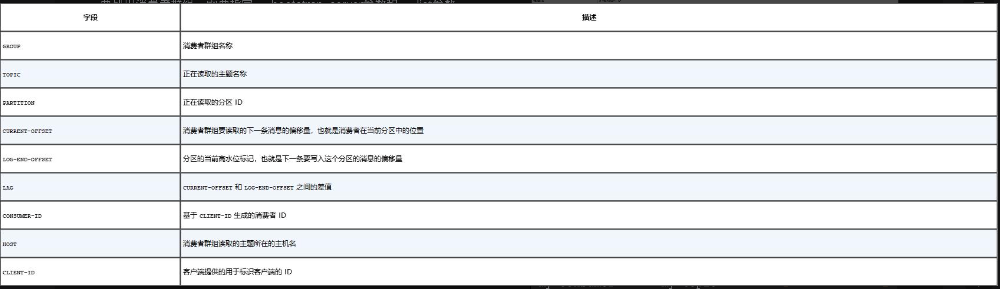

下面是获取临时消费者群组“my-consumer”的详细信息。

```shell
# kafka-consumer-groups.sh --bootstrap-server localhost:9092
--describe --group my-consumer
GROUP          TOPIC          PARTITION  CURRENT-OFFSET  LOG-END-OFFSET
LAG        CONSUMER-ID
HOST                           CLIENT-ID
my-consumer     my-topic       0          2               4
2          consumer-1-029af89c-873c-4751-a720-cefd41a669d6   /
127.0.0.1 consumer-1
my-consumer     my-topic       1          2               3
1          consumer-1-029af89c-873c-4751-a720-cefd41a669d6   /
127.0.0.1 consumer-1
my-consumer     my-topic       2          2               3
1          consumer-2-42c1abd4-e3b2-425d-a8bb-e1ea49b29bb2   /
127.0.0.1 consumer-2
#
```

### 12.2.2　删除消费者群组

可以用 --delete命令来删除消费者群组。它将删除整个群组，包括所有已保存的偏移量。在删除群组之前，必须将群组里所有的消费者都关闭。如果你试图删除一个非空的群组，那么它将抛出“群组不为空”异常。也可以用这个命令删除单个主题的偏移量，只是需要额外提供 --topic参数，并指定要删除的偏移量。下面是删除消费者群组“my-consumer”的示例。

```shell
# kafka-consumer-groups.sh --bootstrap-server localhost:9092 --delete --group
my-consumer
Deletion of requested consumer groups ('my-consumer') was successful.
#
```

### 12.2.3　偏移量管理

除了显示和删除消费者群组的偏移量，还可以批量获取和保存消费者群组的偏移量，这在重置消费者偏移量时非常有用。当消费者因为某些原因需要重新读取消息或因为无法正常处理某些消息（比如格式错误的消息）需要跳过这些消息时就可以进行偏移量重置。

__1.导出偏移量__

要将消费者群组的偏移量导出到CSV文件，可以使用 --reset-offsets参数和 --dry-run参数。这样就可以将当前的偏移量导出到文件，并在需要的时候用于导入或回滚偏移量。导出的CSV文件格式如下所示。<topic-name>,<partition-number>,<offset>如果没有指定 --dry-run参数，那么偏移量将被重置，所以在执行这个命令时要十分小心。

下面的例子会将消费者群组“my-consumer”读取的“my-topic”主题的偏移量导出到一个叫作offsets.csv的文件中。

```shell
# kafka-consumer-groups.sh --bootstrap-server localhost:9092
--export --group my-consumer --topic my-topic
--reset-offsets --to-current --dry-run > offsets.csv
# cat offsets.csv
my-topic,0,8905
my-topic,1,8915
my-topic,2,9845
my-topic,3,8072
my-topic,4,8008
my-topic,5,8319
my-topic,6,8102
my-topic,7,12739
#
```

__2.导入偏移量__

与导出偏移量刚好相反，导入偏移量会用之前导出的文件来重置消费者群组的偏移量。一般情况下，我们会先导出消费者群组的当前偏移量，并将导出的文件复制一份（作为备份）​，然后将文件中的偏移量修改成想要的值。

在导入偏移量之前，必须先关闭所有的消费者。如果消费者群组处于活跃状态，那么当消费者正要写入偏移量时，不仅不会读取到导入的偏移量，反而有可能将它们覆盖掉。

在下面的例子中导入上一个例子中导出的offsets.csv文件，以此来重置消费者群组“my-consumer”的偏移量。

```shell
# kafka-consumer-groups.sh --bootstrap-server localhost:9092
--reset-offsets --group my-consumer
--from-file offsets.csv --execute
  TOPIC                          PARTITION  NEW-OFFSET
  my-topic                        0          8905
  my-topic                        1          8915
  my-topic                        2          9845
  my-topic                        3          8072
  my-topic                        4          8008
  my-topic                        5          8319
  my-topic                        6          8102
  my-topic                        7          12739
#
```

## 12.3　动态配置变更

主题、客户端、broker等都有大量的配置参数可以在运行时动态更新，无须关闭或重新部署集群。可以使用kafka-config.sh来修改这些配置参数。目前，可以进行动态变更的配置参数主要有4种类型：主题、broker、用户和客户端。最好确保你使用的工具版本与Kafka版本相匹配。为了便于自动化管理动态配置参数，可以通过 --add-config-file参数来指定包含了你想要配置的参数的文件。

### 12.3.1　覆盖主题的默认配置

可以通过动态配置覆盖个别主题的默认值，以满足不同应用场景的需求。表12-2列出了可以被动态修改的主题配置参数。


修改主题配置的命令格式如下。

```shell
kafka-configs.sh --bootstrap-server localhost:9092
--alter --entity-type topics --entity-name <topic-name>
--add-config <key>=<value>[,<key>=<value>...]
```

下面的例子将主题“my-topic”的数据保留时间设置为1小时（3 600 000毫秒）​。

```shell
# kafka-configs.sh --bootstrap-server localhost:9092
--alter --entity-type topics --entity-name my-topic
--add-config retention.ms=3600000
Updated config for topic: "my-topic".
#
```

### 12.3.2　覆盖客户端和用户的默认配置

对Kafka客户端和用户配置来说，只有少数参数可以覆盖，而且基本上都与配额有关。常见的两个需要修改的参数是生产者的生产速率和消费者的消费速率，以字节 / 秒为单位。表12-3列出了可以被修改的客户端和用户的配置参数。

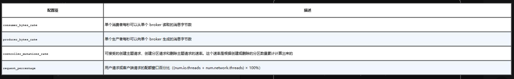

下面的例子在一个配置步骤中同时修改了用户的控制器突变率和客户端的控制器突变率。

```shell
# kafka-configs.sh --bootstrap-server localhost:9092
--alter --add-config "controller_mutations_rate=10"
--entity-type clients --entity-name <client ID>
--entity-type users --entity-name <user ID>
#
```

### 12.3.3　覆盖broker的默认配置

broker和集群级别的配置主要被放在静态的集群配置文件中，但仍然有大量的参数可以在运行时修改，也就是说修改这些参数无须重新部署Kafka。我们可以用kafka-config.sh修改80多个broker配置参数，不过本书不打算在这里一一罗列出来。可以通过 --help命令或在开源文档中找到它们，下面是其中几个比较重要的。

__min.insync.replicas__

当生产者的acks被设置为all或 -1时，用于确认消息写入成功所需的最少ISR数。

__unclean.leader.election.enable__

允许一个副本被选举为首领，即使可能会导致数据丢失。当允许丢失一些数据，或者在发生不可恢复的数据丢失后需要快速恢复Kafka集群时，可以短暂启用这个功能。

__max.connections__

broker允许的最大连接数。还可以用max.connections.per.ip和max.connections.per.ip.override进行更细粒度的节流。

### 12.3.4　查看被覆盖的配置

可以用kafka-config.sh列出所有被覆盖的配置，这样就可以知道主题、broker或客户端中都有哪些参数被覆盖。与其他工具类似，这是通过 --describe命令实现的。

下面的例子列出了主题“my-topic”中所有被覆盖的配置。可以看到，被覆盖的只有“数据保留时间”这个参数。

```shell
# kafka-configs.sh --bootstrap-server localhost:9092
--describe --entity-type topics --entity-name my-topic
Configs for topics:my-topic are
retention.ms=3600000
#
```

### 12.3.5　移除被覆盖的配置

也可以移除动态配置，将其恢复到集群的默认配置。可以用 --alter命令和 --delete-config参数来移除被覆盖的配置。例如，移除主题“my-topic”的retention.ms覆盖配置。

```shell
# kafka-configs.sh --bootstrap-server localhost:9092
--alter --entity-type topics --entity-name my-topic
--delete-config retention.ms
Updated config for topic: "my-topic".
#
```

## 12.4　生产和消费

在使用Kafka时，为了验证应用程序的逻辑，经常需要手动生成或消费一些示例消息。Kafka为此提供了两个工具，即kafka-console-consumer.sh和kafka-console-producer.sh。

### 12.4.1　控制台生产者

可以用kafka-console-producer.sh向Kafka主题写入消息。在默认情况下，一行输入就是一条消息，消息的键和值以Tab字符分隔（如果没有出现Tab字符，那么键就是null）​。与控制台消费者一样，生产者使用默认的序列化器(DefaultEncoder)生成原始字节。控制台生产者要求至少提供两个参数，以便知道要连接到哪个Kafka集群，以及向哪个主题生成数据。第一个是我们经常使用的 --bootstrap-server连接串。在生成数据结束后，需要发送一个文件结束符(EOF)来关闭客户端。对于大多数常见的终端，可以使用Control-D组合键来发送EOF。在下面的例子中，我们向主题“my-topic”生成了4条消息。

```shell
# kafka-console-producer.sh --bootstrap-server localhost:9092 --topic my-topic
>Message 1
>Test Message 2
>Test Message 3
>Message 4
>^D
#
```

__1.生产者配置参数__

也可以将普通生产者的配置参数传给控制台生产者。传递参数有两种方式，使用哪一种取决于需要传多少个参数以及个人偏好。第一种方式是通过 --producer.config <config-file>指定生产者配置文件，其中<config-file>是包含了配置参数的文件的完整路径。第二种方式是在命令行直接指定参数，格式为 --producer-property <key>=<value>，其中<key>是参数名，<value>是参数值。这在配置生产者的一些参数 [ 比如消息批次的相关参数（linger.ms或batch.size）​] 时非常有用。

控制台生产者有很多命令行参数，我们可以通过 --producer-property来指定它们。以下是其中一些有用的参数。

__--batch-size__

指定在采用非同步发送方式时单个批次发送的消息数量。

__--timeout__

指定生产者在采用异步发送模式时等待批次填满消息的最长时间，以避免其在低吞吐量的情况下等待太长时间。

__--compression-codec <string>__

指定生成消息所使用的压缩类型，可以是none、gzip、snappy、zstd或lz4，默认值是gzip。

__--sync__

指定以同步的方式发送消息。也就是说，在发送下一条消息之前需要等待当前消息被确认。

__2.文本行读取器配置参数__

kafka.tools.ConsoleProducer$LineMessageReader类负责读取标准输入，并基于读取到的内容创建要发送给Kafka的消息。它也有一些非常有用的配置参数，我们可以通过 --property把这些配置参数传给控制台生产者。

__ignore.error__

如果设置为false，那么在parse.key被设置为true而标准输入中没有包含键分隔符时就会抛出异常。默认值为true。

__parse.key__

如果设置为false，那么生成的消息的键就为空。默认值为true。

__key.separator__

消息的键和值之间的分隔符。默认使用Tab字符。

### 12.4.2　控制台消费者

kafka-console-consumer.sh为我们提供了另外一种从Kafka集群的一个或多个主题读取消息的方式。它读取的消息会被打印在标准输出中，并用换行符分隔。在默认情况下，它将输出消息的原始字节，没有键，也不进行格式化（使用DefaultFormatter）​。与生产者类似，它也有一些必选的配置参数：集群连接串、要读取的主题以及要读取的消息的位置。

和其他命令一样，可以通过 --bootstrap-server来指定集群连接串，不过要读取的主题的名字可以通过以下两个参数来指定。

__--topic__

这个参数会直接指定要读取的主题的名字。

__--whitelist__

这个参数是一个正则表达式，其匹配所有要读取的主题（要记得转义正则表达式，以免命令行解析错误）​。

下面的例子读取的是集群中所有前缀与my匹配的主题（在这个例子中只有一个匹配的主题“my-topic”​）​。

```shell
# kafka-console-consumer.sh --bootstrap-server localhost:9092
--whitelist 'my.*' --from-beginning
Message 1
Test Message 2
Test Message 3
Message 4
^C
#
```

__1.消费者配置参数__

除了这些基本的命令行参数，也可以将普通消费者的配置参数传给控制台消费者。与kafka-console-producer.sh类似，传递参数有两种方式，使用哪一种取决于需要传多少个参数以及个人偏好。第一种方式是通过 --consumer.config <config-file>指定消费者配置文件，其中<config-file>是包含了配置参数的文件的完整路径。第二种方式是在命令行中直接指定参数，格式为 --consumer-property =，其中<key>是参数名，<value>是参数值。

__--formatter <classname>__

指定用于解码消息的消息格式化器的类名，默认是kafka.tools.DefaultMessageFormatter。

__--from-beginning__

指定从最旧的偏移量开始读取数据。如果不指定这个参数，就从最新的偏移量开始读取。

__--max-messages <int>__

指定在退出之前最多读取多少条消息。

__--partition <int>__

只读取指定ID的分区。

__--offset__

如果提供的是整数，就从指定位置开始读取数据。其他有效的值为earliest（将从起始位置开始读取）和latest（将从最近的位置开始读取）​。

__--skip-message-on-error__

如果在处理消息时出现错误就跳过消息，而不是一直挂起，这在调试问题时会非常有用。

__2.消息格式化器配置参数__

除了默认的消息格式化器，还有另外3种可用的格式化器。kafka.tools.LoggingMessageFormatter将消息输出到日志而不是标准输出。对应的日志级别为INFO，打印内容包含消息的时间戳、键和值。kafka.tools.ChecksumMessageFormatter只打印消息的校验和。kafka.tools.NoOpMessageFormatter读取但不打印消息。下面的例子会使用kafka.tools.ChecksumMessageFormatter格式化器来读取之前的消息。

```shell
# kafka-console-consumer.sh --bootstrap-server localhost:9092
--whitelist 'my.*' --from-beginning
--formatter kafka.tools.ChecksumMessageFormatter
checksum:0
checksum:0
checksum:0
checksum:0
#
```

__3.读取偏移量主题__

有时候，需要查看集群的消费者群组提交了哪些偏移量。例如，你可能想知道某个消费者群组是否在提交偏移量，或者在以怎样的频率提交偏移量。这可以通过使用控制台消费者读取consumer_offsets这个特殊的内部主题来实现。所有的消费者偏移量都会被写入这个主题。要解码这个主题中的消息，必须使用kafka.coordinator.group.GroupmetadataMan ager$OffsetsMessageFormatter这个格式化器。下面的例子会从最早的偏移量位置开始读取consumer_offsets主题。

```shell
# kafka-console-consumer.sh --bootstrap-server localhost:9092
--topic __consumer_offsets --from-beginning --max-messages 1
--formatter "kafka.coordinator.group.GroupMetadataManager\$OffsetsMessageFormat
ter"
--consumer-property exclude.internal.topics=false
[my-group-name,my-topic,0]::[OffsetMetadata[1,NO_METADATA]
CommitTime 1623034799990 ExpirationTime 1623639599990]
Processed a total of 1 messages
#
```

## 12.5　分区管理

Kafka提供了一些用于管理分区的脚本，其中一个用于重新选举首领，另一个用于将分区分配给broker。有了这两个工具，就可以通过手动的方式让消息流量均衡地分布在集群的broker上。

### 12.5.1　首选首领选举

为了保证可靠性，分区可以有多个副本。在任意时刻，这些副本当中只能有一个可以成为分区首领，所有的写入操作和读取操作都发生在分区首领所在的broker上。为了保证负载均衡地分布在整个Kafka集群中，需要保持不同分区的首领均衡地分布在broker上。

Kafka会将分区副本清单中的第一个ISR定义为首选首领。当broker停止运行或与集群中的其他broker断开连接时，分区领导权将被转移给另一个ISR，原始副本就自动丧失了分区领导权。如果不启用自动首领均衡，那么在进行跨集群部署后可能会出现非常低效的均衡。因此，建议启用

如果发现Kafka集群变得不均衡了，则可以考虑进行首选首领选举，这是一个轻量级的首领选举过程，一般来说不会造成负面影响。集群控制器会为分区选择理想的首领。客户端可以自动跟踪首领变更，如果领导权发生了变更，则它们会转移到新首领所在的broker。这个过程可以用kafka-leader-election.sh来手动触发。

例如，可以使用下面的命令为集群中的所有主题启动一个首选首领选举。

```shell
# kafka-leader-election.sh --bootstrap-server localhost:9092
--election-type PREFERRED --all-topic-partitions
#
```

也可以为特定的分区或主题启动选举，直接用 --topic参数指定主题名，用 --partition参数指定分区。还可以指定一个清单，其中包含了多个参与选举的分区，这个清单包含在一个名为partitions.json的JSON文件中。

```json
{
    "partitions": [
        {
            "partition": 1,
            "topic": "my-topic"
        },
        {
            "partition": 2,
            "topic": "foo"
        }
    ]
}
```

在这个例子中，我们将通过partitions.json文件指定的分区清单启动一个首选首领选举。

```shell
# kafka-leader-election.sh --bootstrap-server localhost:9092
--election-type PREFERRED --path-to-json-file partitions.json
#
```

有了这个JSON文件，就可以用它生成移动清单，以便在后面的步骤中将topics.json中的主题移动到broker 5和broker 6上。

```shell
# kafka-reassign-partitions.sh --bootstrap-server localhost:9092
--topics-to-move-json-file topics.json
--broker-list 5,6 --generate
  {"version":1,
  "partitions":[{"topic":"foo1","partition":2,"replicas":[1,2]},
                {"topic":"foo1","partition":0,"replicas":[3,4]},
                {"topic":"foo2","partition":2,"replicas":[1,2]},
                {"topic":"foo2","partition":0,"replicas":[3,4]},
                {"topic":"foo1","partition":1,"replicas":[2,3]},
                {"topic":"foo2","partition":1,"replicas":[2,3]}]
  }

  Proposed partition reassignment configuration

  {"version":1,
  "partitions":[{"topic":"foo1","partition":2,"replicas":[5,6]},
                {"topic":"foo1","partition":0,"replicas":[5,6]},
                {"topic":"foo2","partition":2,"replicas":[5,6]},
                {"topic":"foo2","partition":0,"replicas":[5,6]},
                {"topic":"foo1","partition":1,"replicas":[5,6]},
                {"topic":"foo2","partition":1,"replicas":[5,6]}]
  }
#
```

可以分别将两个JSON片段保存成两个JSON文件，一个叫作revert-reassignment.json，另一个叫作expand-cluster-reassignment.json。如果因为某些原因需要回滚，则可以用第一个文件将分区移回原来的位置。第二个文件用于在下一步执行分区调整。这一步只是生成建议，还没有执行任何操作.

```shell
# kafka-reassign-partitions.sh --bootstrap-server localhost:9092
--reassignment-json-file expand-cluster-reassignment.json
--execute
  Current partition replica assignment

  {"version":1,
  "partitions":[{"topic":"foo1","partition":2,"replicas":[1,2]},
                {"topic":"foo1","partition":0,"replicas":[3,4]},
                {"topic":"foo2","partition":2,"replicas":[1,2]},
                {"topic":"foo2","partition":0,"replicas":[3,4]},
                {"topic":"foo1","partition":1,"replicas":[2,3]},
                {"topic":"foo2","partition":1,"replicas":[2,3]}]
  }

  Save this to use as the --reassignment-json-file option during rollback
  Successfully started reassignment of partitions
  {"version":1,
  "partitions":[{"topic":"foo1","partition":2,"replicas":[5,6]},
                {"topic":"foo1","partition":0,"replicas":[5,6]},
                {"topic":"foo2","partition":2,"replicas":[5,6]},
                {"topic":"foo2","partition":0,"replicas":[5,6]},
                {"topic":"foo1","partition":1,"replicas":[5,6]},
                {"topic":"foo2","partition":1,"replicas":[5,6]}]
  }
#
```

这样就开始将指定的分区副本重新分配给新broker了。输出结果与之前生成的建议一样。集群控制器会将新副本添加到每个分区的副本清单中，这些主题的复制系数会临时变大。然后，新副本将从当前首领复制已有的消息。根据磁盘上分区的大小，当数据通过网络复制到新副本时，可能需要花费一些时间。复制完成之后，控制器会将旧副本从副本清单中移除，让复制系数恢复到原来的大小。


下面是这个工具的一些有用的参数。

__--additional__

如果已经有进行中的重分配过程，就加入其中，这样就不会出现中断，也不需要等待已有的重分配完毕之后再启动一个新的批次。

__--disable-rack-aware__

有时候，因为启用了机架感知，可能无法实现想要的重分配状态。如果有必要，那么可以用这个参数禁用机架感知。

__--throttle__

这个参数以字节 / 秒为单位。分区重分配对集群性能有很大的影响，因为它们会导致内存缓存页的一致性发生变化，并占用额外的网络带宽和磁盘IO。对分区移动流量进行节流可以有效缓解这个问题。这个参数可以与 

__--additional__

结合使用，以便对进行中的可能导致上述问题的重分配过程进行节流。

__--disable-rack-aware__

有时候，因为启用了机架感知，可能无法实现想要的重分配状态。如果有必要，那么可以用这个参数禁用机架感知。

__--throttle__

这个参数以字节 / 秒为单位。分区重分配对集群性能有很大的影响，因为它们会导致内存缓存页的一致性发生变化，并占用额外的网络带宽和磁盘IO。对分区移动流量进行节流可以有效缓解这个问题。这个参数可以与 --additional结合使用，以便对进行中的可能导致上述问题的重分配过程进行节流。

如果要移除一个broker的多个分区（将这个broker从集群中删除）​，那么最好可以先移除这个broker所有的分区首领。这可以通过手动的方式实现，但要用之前介绍的工具来完成这个操作有点儿困难。一些开源工具（如Cruise Control）提供了broker“降级”等功能，它们可以安全地将broker的领导权转移出去。这可能是最简单的方法。如果不能使用这些工具，那么就重启broker。在broker被关闭的过程中，位于这个broker上的所有分区首领都将被转移到其他broker上。这样可以显著提高副本重分配的性能，并减少对集群的影响，因为复制流量被其他broker分摊掉了。但是，如果启用了自动首领重分配，则broker在重启后有可能会重新获得领导权。所以，在重启期间最好临时禁用这个功能。

也可以用这个工具来验证重分配的完成情况。它可以显示哪些重分配正在进行当中、哪些已经完成，以及（如果出错的话）哪些已经失败。下面是通过 --verify参数基于expand-cluster-reassignment.json文件对之前的分区重分配进行验证的例子。

```shell
# kafka-reassign-partitions.sh --bootstrap-server localhost:9092
--reassignment-json-file expand-cluster-reassignment.json
--verify
Status of partition reassignment:
  Reassignment of partition [foo1,0] completed successfully
  Reassignment of partition [foo1,1] is in progress
  Reassignment of partition [foo1,2] is in progress
  Reassignment of partition [foo2,0] completed successfully
  Reassignment of partition [foo2,1] completed successfully
  Reassignment of partition [foo2,2] completed successfully
#
```

__1.修改复制系数__

也可以用kafka-reassign-partitions.sh来增加或减少一个分区的RF(RF 是 Replication Factor（副本因子）的缩写，表示一个分区的副本数量，)。如果在创建分区时没有选择合适的RF，那么当你在扩展集群时想要增加冗余或为了节约成本想要减少冗余，就需要修改RF。一个很明显的例子是，如果集群的默认RF被修改了，但已有主题的RF不会自动随之发生变化，那么这个时候就可以用这个工具增加已有分区的RF。

假设你想将之前示例中“foo1”主题的RF从2增加到3，那么可以创建一个类似于之前用于执行分区调整的JSON文件，然后再向副本集中加入额外的broker ID。例如，可以创建一个叫作increase-foo1-RF.json的JSON文件，并将broker 4添加到已有的broker 5和broker 6集合中。

```shell
{
  {"version":1,
  "partitions":[{"topic":"foo1","partition":1,"replicas":[5,6,4]},
                {"topic":"foo1","partition":2,"replicas":[5,6,4]},
                {"topic":"foo1","partition":3,"replicas":[5,6,4]},
  }
}
```

然后，使用之前的命令执行这个文件。在执行完成之后，可以用 --verify参数或kafka-topics.sh脚本列出主题信息，以此来验证RF是否已经修改成功。

```shell
# kafka-topics.sh --bootstrap-server localhost:9092 --topic foo1 --describe
  Topic:foo1    PartitionCount:3        ReplicationFactor:3     Configs:
    Topic: foo1 Partition: 0    Leader: 5       Replicas: 5,6,4 Isr: 5,6,4
    Topic: foo1 Partition: 1    Leader: 5       Replicas: 5,6,4 Isr: 5,6,4
    Topic: foo1 Partition: 2    Leader: 5       Replicas: 5,6,4 Isr: 5,6,4
#
```

__2.取消分区重分配__

kafka-reassign-partitions.sh脚本（对AdminClient进行了包装）现在支持 --cancel选项，我们可以用它来取消集群中正在进行的重分配过程。如果指定了 --cancel选项，那么副本集将会被恢复到重分配之前的状态。如果正在从已经失效或过载的broker中移除副本，则取消分区重分配有可能会导致集群处于非预期的状态，也不能保证恢复后的副本集的顺序与之前相同。

### 12.5.3　转储日志片段

有时候，你可能需要查看消息的内容，比如主题中出现了已损坏的“毒药”消息，而用户无法处理它们。可以用kafka-dump-log.sh来解码分区的日志片段，这样就可以在不读取和解码消息的情况下查看消息的内容。这个工具以日志片段文件列表（以逗号分隔）作为参数，可以输出消息的摘要信息或详细内容。

在下面的例子中，我们对只包含4条消息的“my-topic”主题进行了日志转储。首先，简单地解码日志片段文件00000000000000000000.log，并获取每条消息的基本元数据信息，但不打印消息内容。Kafka的数据目录是 /tmp/kafka-logs。因此，可以在 /tmp/kafka-logs/<topic-name>-<partition> 目录下找到转储文件，对这个例子来说就是/tmp/kafka-logs/my-topic-0/。

```shell
# kafka-dump-log.sh --files /tmp/kafka-logs/my-topic-0/00000000000000000000.log
Dumping /tmp/kafka-logs/my-topic-0/00000000000000000000.log
Starting offset: 0
baseOffset: 0 lastOffset: 0 count: 1 baseSequence: -1 lastSequence: -1
  producerId: -1 producerEpoch: -1 partitionLeaderEpoch: 0
  isTransactional: false isControl: false position: 0
  CreateTime: 1623034799990 size: 77 magic: 2
  compresscodec: NONE crc: 1773642166 isvalid: true
baseOffset: 1 lastOffset: 1 count: 1 baseSequence: -1 lastSequence: -1
  producerId: -1 producerEpoch: -1 partitionLeaderEpoch: 0
  isTransactional: false isControl: false position: 77
  CreateTime: 1623034803631 size: 82 magic: 2
  compresscodec: NONE crc: 1638234280 isvalid: true
baseOffset: 2 lastOffset: 2 count: 1 baseSequence: -1 lastSequence: -1
  producerId: -1 producerEpoch: -1 partitionLeaderEpoch: 0
  isTransactional: false isControl: false position: 159
  CreateTime: 1623034808233 size: 82 magic: 2
  compresscodec: NONE crc: 4143814684 isvalid: true
baseOffset: 3 lastOffset: 3 count: 1 baseSequence: -1 lastSequence: -1
  producerId: -1 producerEpoch: -1 partitionLeaderEpoch: 0
  isTransactional: false isControl: false position: 241
  CreateTime: 1623034811837 size: 77 magic: 2
  compresscodec: NONE crc: 3096928182 isvalid: true
#
```

在下一个例子中，我们提供了 --print-data-log参数，这样就可以打印出消息的内容和其他更多的信息。

```shell
# kafka-dump-log.sh --files /tmp/kafka-logs/my-topic-0/00000000000000000000.log
--print-data-log
Dumping /tmp/kafka-logs/my-topic-0/00000000000000000000.log
Starting offset: 0
baseOffset: 0 lastOffset: 0 count: 1 baseSequence: -1 lastSequence: -1
  producerId: -1 producerEpoch: -1 partitionLeaderEpoch: 0
  isTransactional: false  isControl: false position: 0
  CreateTime: 1623034799990 size: 77 magic: 2
  compresscodec: NONE crc: 1773642166 isvalid: true
| offset: 0 CreateTime: 1623034799990 keysize: -1 valuesize: 9
    sequence: -1 headerKeys: [] payload: Message 1
baseOffset: 1 lastOffset: 1 count: 1 baseSequence: -1 lastSequence: -1
  producerId: -1 producerEpoch: -1 partitionLeaderEpoch: 0
  isTransactional: false isControl: false position: 77
  CreateTime: 1623034803631 size: 82 magic: 2
  compresscodec: NONE crc: 1638234280 isvalid: true
| offset: 1 CreateTime: 1623034803631 keysize: -1 valuesize: 14
    sequence: -1 headerKeys: [] payload: Test Message 2
baseOffset: 2 lastOffset: 2 count: 1 baseSequence: -1 lastSequence: -1
  producerId: -1 producerEpoch: -1 partitionLeaderEpoch: 0
  isTransactional: false isControl: false position: 159
  CreateTime: 1623034808233 size: 82 magic: 2
  compresscodec: NONE crc: 4143814684 isvalid: true
| offset: 2 CreateTime: 1623034808233 keysize: -1 valuesize: 14
    sequence: -1 headerKeys: [] payload: Test Message 3
baseOffset: 3 lastOffset: 3 count: 1 baseSequence: -1 lastSequence: -1
  producerId: -1 producerEpoch: -1 partitionLeaderEpoch: 0
  isTransactional: false isControl: false position: 241
  CreateTime: 1623034811837 size: 77 magic: 2
  compresscodec: NONE crc: 3096928182 isvalid: true
| offset: 3 CreateTime: 1623034811837 keysize: -1 valuesize: 9
    sequence: -1 headerKeys: [] payload: Message 4
#
```

这个工具还提供了其他一些有用的参数，比如验证日志片段的索引文件。索引用于查找日志片段中的消息，如果索引出现损坏，则会导致读取错误。如果broker在启动时处于“不干净”的状态（之前被非正常关闭）​，就会对索引文件进行验证。也可以手动进行索引验证。验证索引有两种方式，使用哪一种取决于你想验证到什么程度。如果指定了 --index-sanity-check，就会只检查索引是否处于可用状态；如果指定了--verify-index-only，则会检查不匹配的索引，但不会打印出所有的索引条目。还有一个有用的选项是 --value-decoder-class，可以用它指定用于反序列化消息的解码器。

### 12.5.4　副本验证

分区复制的原理与普通的消费者客户端类似：跟随者broker会定期将上一个偏移量到当前偏移量之间的数据复制到磁盘上。如果复制过程停止，那么在重启之后将从上一个检查点继续复制。这个时候，如果之前复制的日志片段被删除，那么跟随者将不会填补这个缺口。可以用kafka-replica-verification.sh来验证集群分区副本的一致性。它会从指定分区的副本读取消息，检查所有副本是否包含了相同的消息，并打印出指定分区的最大延迟。这个过程会一直重复，直到被取消。要使用这个工具，必须提供broker的连接串（如果有多个broker地址，就用逗号隔开）​。在默认情况下，它会验证所有的主题。还可以用正则表达式匹配想要验证的主题

例如，下面的例子会对broker 1和broker 2（包含“my-topic”主题的分区0）上以my开头的主题的副本进行验证。

```shell
# kafka-replica-verification.sh --broker-list kafka.host1.domain.com:
9092,kafka.host2.domain.com:9092
--topic-white-list 'my.*'

2021-06-07 03:28:21,829: verification process is started.
2021-06-07 03:28:51,949: max lag is 0 for partition my-topic-0 at offset 4
among 1 partitions
2021-06-07 03:29:22,039: max lag is 0 for partition my-topic-0 at offset 4
among 1 partitions
...
#
```

## 12.6　其他工具

__客户端AC__

Lkafka-acls.sh是一个命令行工具，可用于设置Kafka客户端ACL，包括所有的授权器属性、拒绝或允许策略的设置、集群或主题级别的限制、ZooKeeper TLS文件配置等。

__轻量级MirrorMaker__

一个轻量级的kafka-mirror-maker.sh脚本，可用于镜像数据。有关数据镜像的更多内容可以参考第10章。

__测试工具__

还有其他几个可用于测试或升级Kafka的脚本。当从一个Kafka版本升级到另一个版本时，可以用kafka-broker-api-versions.sh来识别不同版本的可用API元素和检查兼容性问题。生产者和消费者也有对应的性能测试脚本。还有几个脚本可用于管理ZooKeeper。trogdor.sh是一个测试框架，主要用于运行基准测试和为系统制造测试工作负载。

## 12.7　不安全的操作

### 12.7.1　移动集群控制器

每个Kafka集群都有一个被指定为控制器的broker。控制器有一个特殊的线程，除了处理普通的任务，它还负责监督集群操作。正常情况下，控制器选举是通过自动监听ZooKeeper临时节点来完成的。当一个控制器被关闭或变为不可用时，其他broker会尽快尝试让自己成为新控制器，因为一旦控制器被关闭，ZooKeeper临时节点就会被删除。有时候，在对问题集群或broker进行故障诊断时，需要在不关闭主机的情况下强制将控制器角色转移给另一个broker。例如，当控制器遇到异常或其他问题时，虽然还在运行，但功能已经变得不正常。在这些情况下转移控制器通常不会有很高的风险，但这不是一个普通的操作，所以不应该经常这么做。如果要强制转移控制器，则需要手动删除 /admin/controller下的ZooKeeper节点，让当前控制器退出，而集群会随机选择一个新的控制器。目前，Kafka还不支持直接将指定的broker作为控制器.

### 12.7.2　移除待删除的主题

在尝试删除一个主题时，broker会请求ZooKeeper创建一个删除节点。当每一个副本都完成删除并进行了确认时，ZooKeeper节点将被移除。在正常情况下，集群可以非常快地执行完这个过程。但是，有时候也会出问题。以下是删除请求可能被卡住的场景。

1.请求者无法知道集群是否启用了主题删除功能，而要删除的主题所在的集群可能刚好禁用了主题删除功能。2.请求删除一个非常大的主题，但在处理这个请求之前，一个或多个副本集因发生硬件故障而离线，控制器无法对删除操作做出确认，也就无法完成删除操作。要解决这个问题，需要先删除 /admin/delete_topic/<topic> 节点。删除主题的ZooKeeper节点（不是 /admin/delete_topic父节点）等于删除了挂起的请求。如果控制器中有缓存的请求，它就会重新排队，所以在删除主题的节点后要立即强制转移控制器，确保控制器中没有缓存的请求。

### 12.7.3　手动删除主题

如果集群禁用了主题删除功能，或者需要通过非正式的途径删除某些主题，那么可以进行手动删除。但是，这需要完全关闭集群中所有的broker，只要集群中有一个运行中的broker，就无法执行这个操作。

在集群还在运行的时候修改ZooKeeper中的元数据是很危险的，这会造成集群不稳定。所以，在集群还在运行的时候不要删除或修改ZooKeeper中的元数据。

1.关闭集群中所有的broker。2.删除ZooKeeper中的 /brokers/topics/ 路径，注意要先删除路径下的子节点。3.删除每一个broker的日志目录下的分区目录，这些目录的名字可能是<topic>-<int>，其中 <int> 是分区的ID。4.重启所有的broker。

# 第13章　监控Kafka

## 13.1　指标基础

### 13.1.1　指标来自哪里

Kafka提供的所有指标都可以通过Java管理扩展(Java managementextension, JMX)接口访问。要在外部监控系统中使用这些指标，最简单的方法是将监控系统中负责收集指标的代理连接到Kafka上。代理可以是运行在监控系统中的一个独立进程，并用Nagios XI check_jmx插件或jmxtrans连接到Kafka的JMX接口上。你也可以直接在Kafka中运行一个JMX代理，然后通过HTTP连接（比如Jolokia或MX4J）获取指标。

JMX端口是broker配置信息的一部分，保存在ZooKeeper中，如果监 控系统要直接连到Kafka的JMX端口，那么可以先从ZooKeeper获取端口信息。/brokers/ids/<ID> 节点包含了broker的配置信息（JSON格式）​，其中就有hostname和jmx_port。不过需要注意的是，出于安全方面的考虑，Kafka默认禁用了远程JMX。如果要启用它，则必须保护好端口。这是因为JMX不仅可以作为查看应用程序状态的窗口，它还允许执行代码。强烈建议使用嵌入应用程序中的JMX指标代理。

并不是所有的指标都来自Kafka。我们能够获取到的指标通常可以分为5类，表13-1列出了这5种类别。

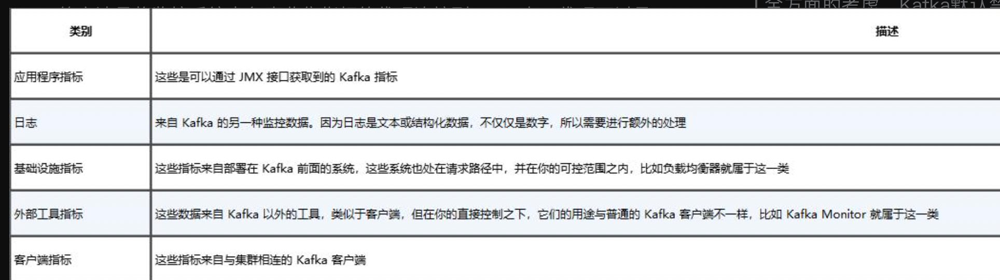

### 13.1.2　需要哪些指标

__1.告警还是调试__

你需要问自己的第一个问题是，当Kafka出现问题时，你的主要目的是收到告警还是调试问题。答案通常是二者兼而有之。不管怎样，如果你知道哪些指标可用于告警、哪些指标可用于调试问题，那么在收集完之后就可以区别对待它们。

用于告警的指标在短时间内（通常不会比对问题做出响应所需的时间长很多）非常有用。你可以以小时或天为单位，将这些指标发送给能够对已知问题做出响应的自动化工具，或者如果没有自动化工具，则可以发送给运维人员。这些指标要尽量保持客观，因为不会影响客户端的问题远没有会影响客户的问题那么重要。

用于调试问题的数据需要保留较长的时间，因为你可能会频繁诊断已经存在一段时间的问题或对比较复杂的问题进行更深入的探究。这些数据在被收集到之后需要保留几天或几周。它们通常比较客观，或者是来自Kafka应用程序本身。需要注意的是，并不一定要将这些数据收集到监控系统中。如果主要目的是调试问题，那么在调试问题时能够获取它们就可以了。不需要持续不断地收集数以万计的指标，从而让监控系统不堪重负。

__2.自动化工具还是人工介入__

另一个需要考虑的问题是，指标的使用者是谁。如果指标被用在自动化系统中，那么它们就应该非常具体。我们可以收集大量的指标，并且每个指标都只描述一些小细节，这没有问题，因为这就是计算机存在的原因：处理大量的数据。指标越具体，就越容易对其进行自动化，因为越具体就越没有太多的解释空间。如果指标是给人类看的，那么太多的指标会让人类不堪重负。在基于指标定义告警时，这一点尤为重要。人们很容易陷入“告警疲劳”​，因为告警太多，很难知道问题究竟有多严重。我们也很难为每个指标定义合理的阈值并持续更新它们。如果告警过多或经常误报，我们就会怀疑告警是否正确地反映了应用程序的状态。

### 13.1.3　应用程序健康检测

● 使用外部进程来报告broker的运行状态（健康检测）​。

● 在broker停止发送指标时发出告警（有时也叫作过时指标）​。

如果监控的是broker，那么可以直接连接到它的外部端口（也就是客户端连接broker所使用的端口）​，看看是否可以获得响应；如果监控的是Kafka客户端，则会比较复杂，我们需要检查客户端进程是否处于运行状态或通过内部方法确定应用程序的健康状况。

## 13.2　服务级别目标

对基础设施服务（如Kafka）来说，服务级别目标(service levelobjective, SLO)是一个非常重要的监控领域。服务供应商可以基于这些指标向客户宣称他们能够获得怎样的基础设施服务级别。客户希望将基础设施服务视为一个不透明的系统：他们不想也不需要了解它的内部原理，只需要了解他们正在使用的接口，并且知道这些接口会完成需要它们完成的事情。

###  13.2.1　服务级别定义

服务级别指标(service level indicator, SLI)是一种用于描述服务可靠性的指标。因为它与用户体验紧密相关，所以通常来说越客观越好。

服务级别目标(SLO)也叫作服务级别阈值(service level threshold,SLT)，它将SLI与目标值组合在一起。服务级别目标的一种常见表示方法是使用数字9（99.9%就是3个9）​，尽管这不是必需的。

服务级别协议(service level agreement, SLA)是服务供应商和客户之间的一种契约。它通常会包含几个SLO，以及如何度量和报告它们、客户如何向服务供应商寻求支持、服务供应商如果不按照SLA执行将受到怎样的惩罚。

我们经常听到人们谈论SLA，但他们并不知道自己谈论的其实是SLO。虽然那些为付费客户提供服务的供应商可能与客户之间存在SLA，但运营工程师很少会负责服务性能以外的事情。此外，那些只有内部用户（也就是将Kafka作为大型服务的内部数据基础设施）的供应商与内部用户之间通常不存在SLA。但这并不影响你设定SLO，因为这样可以减少用户对Kafka的行为做出假设。

### 13.2.2　哪些指标是好的SLI

通常，需要使用外部工具或系统来收集适用于SLI的指标。SLO可以用来描述你服务的用户的满意度，我们无法主观地得出这些指标。客户并不关心你是否认为你的服务运行正常，他们的体验才是关键。也就是说，基础设施指标没什么问题，外部工具指标也不错，但客户端指标可能是大多数SLI的最佳指标。


### 13.2.3　将SLO用于告警

SLO应该为你提供主要的告警。因为SLO是从客户的角度描述问题，而这些问题应该是你首先要关注的。一般来说，如果一个问题不会对你的客户造成影响，就不会重要到要在夜里把你叫醒的程度。

问题在于，我们很难直接将SLO作为告警。SLO的时间范围通常较长（比如一周）​，因为我们希望提供给高层或客户的SLO是可重复查看的。此外，在发出SLO告警时，可能已经太迟了，因为你已经在SLO之外采取了行动。

假设你的Kafka集群每周会收到100万个请求，其中一个SLO要求99.9%的请求必须在10毫秒内发送第一个响应字节。也就是说，在一周内，你可能会有多达1000个响应速度较慢的请求，但一切都还算正常。通常，你每小时会看到一个这样的请求，一周大约有168个。你有一个表示SLO燃烧率的指标：在每周有100万个请求的情况下，一个请求的燃烧率为0.1%/ 小时。

周二上午10点，这个指标变了，现在显示燃烧率是0.4%/ 小时。虽然有点儿不妙，但仍然不是问题，因为在当周可能不会违反SLO。你开了一个工单诊断问题，然后又回到了其他更重要的事情上。周三下午2点，燃烧率跳到了2%/ 小时，系统向你发起告警。你知道，按照这样的速度，将会在周五午餐时间违反SLO。于是，你放下手头的工作，开始诊断问题。大约4小时后，燃烧率回落到了0.4%/ 小时，并在当周接下来的几天里一直保持在这个水平。通过观察燃烧率，你避免了违反当周的SLO。

## 13.3　broker的指标

### 13.3.1　诊断集群问题

● 单个broker的问题

● 集群过载

● 控制器的问题

如果问题不在操作系统或硬件层面，那么很可能是Kafka集群负载不均衡导致的。尽管Kafka尽量保持集群数据能够均匀地分布在所有的broker上，但并不能保证访问这些数据的客户端是均匀分布的。Kafka也无法检测出诸如热分区之类的问题。强烈建议使用外部工具来保持集群均衡，比如Cruise Control，它会持续监控集群，并在集群不均衡时对分区进行再均衡。它还提供了很多其他的管理功能，比如添加和删除broker。

集群过载也是一个很容易检测的问题。如果集群是均衡的，并且多个broker的请求延迟一直在增加或者请求处理器空闲率较低，那么说明集群broker处理流量的能力达到了极限。你可能会发现一个客户端改变了它的请求模式，正在给你的集群制造麻烦。但即使发生了这种情况，你可能也无法对客户端做些什么。你能做的要么是降低集群负载，要么是增加broker。

### 13.3.2　非同步分区的艺术

在监控Kafka时，非同步分区是最为常见的监控指标。这个指标会告诉我们首领broker有多少个分区处于非同步状态。这个指标可以反映Kafka的很多内部问题，从broker发生崩溃到资源的过度消耗。因为这个指标可以说明很多问题，所以当它的值大于零时，就要想办法采取相应的行动。

表13-3列出了非同步分区指标的详细信息。

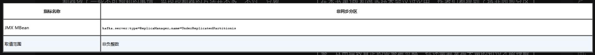

在本书第1版和很多技术会议讨论中，作者们都提到了将非同步分区(URP)指标作为主要的告警指标，因为它可以说明很多问题。这种做法存在大量问题，因为在大部分良性的情况下，URP指标也会是非零值。也就是说，当有人操作Kafka集群时，你可能会收到错误的告警，从而导致真正的告警被忽略。你还需要掌握大量的知识才能理解这个指标要告诉你的是什么信息。因此，本书不再建议将URP用在告警中。应该使用基于SLO的告警来检测未知的问题。
【在当下的市场环境下，用户对于系统的要求越来越高，在本书中URP不作为告警指标，但是在实际应用中应该酌情考虑】。

如果集群中多个broker的非同步分区数量一直很稳定（保持不变）​，则说明集群中的某个broker已经离线了。整个集群的非同步分区数量等于离线broker的分区数量，而离线broker不会生成任何指标。在这种情况下，需要检查这个broker出了什么问题，并解决问题。通常可能是硬件问题，也可能是操作系统问题或Java的问题。

如果非同步分区的数量是波动的，或者虽然很稳定但没有broker离线，那么说明集群出现了性能问题。这类问题繁复多样，难以诊断，不过还是可以通过一些步骤来缩小问题的范围。第一步，先确认问题是与单个broker有关还是与整个集群有关。有时候这个也难有定论。如果非同步分区属于单个broker（如下面的例子所示）​，那么这个broker就是问题的根源，因为错误显示其他broker无法从它那里复制消息。如果多个broker出现了非同步分区，那么有可能是集群的问题，但也有可能是单个broker的问题。这时候有可能是因为一个broker无法从其他broker那里复制数据。要找出这个broker，可以列出集群的所有非同步分区，并检查哪个broker出现在所有的非同步分区中。可以用kafka-topics.sh（第12章已经详细介绍过）获取非同步分区清单。

```shell
# kafka-topics.sh --bootstrap-server kafka1.example.com:9092/kafka-cluster-
--describe --under-replicated
    Topic: topicOne   Partition: 5    Leader: 1    Replicas: 1,2 Isr: 1
    Topic: topicOne   Partition: 6    Leader: 3    Replicas: 2,3 Isr: 3
    Topic: topicTwo   Partition: 3    Leader: 4    Replicas: 2,4 Isr: 4
    Topic: topicTwo   Partition: 7    Leader: 5    Replicas: 5,2 Isr: 5
    Topic: topicSix   Partition: 1    Leader: 3    Replicas: 2,3 Isr: 3
    Topic: topicSix   Partition: 2    Leader: 1    Replicas: 1,2 Isr: 1
    Topic: topicSix   Partition: 5    Leader: 6    Replicas: 2,6 Isr: 6
    Topic: topicSix   Partition: 7    Leader: 7    Replicas: 7,2 Isr: 7
    Topic: topicNine  Partition: 1    Leader: 1    Replicas: 1,2 Isr: 1
    Topic: topicNine  Partition: 3    Leader: 3    Replicas: 2,3 Isr: 3
    Topic: topicNine  Partition: 4    Leader: 3    Replicas: 3,2 Isr: 3
    Topic: topicNine  Partition: 7    Leader: 3    Replicas: 2,3 Isr: 3
    Topic: topicNine  Partition: 0    Leader: 3    Replicas: 2,3 Isr: 3
    Topic: topicNine  Partition: 5    Leader: 6    Replicas: 6,2 Isr: 6
#
```

在上面的示例中，broker 2出现在了所有的副本里，这说明这个broker在复制消息时出了问题，所以要将注意力放在这个broker上。如果没有发现这样的broker，那么问题有可能出在集群级别。

__1.集群级别的问题__

集群一般会出现以下两类问题。

● 负载不均衡

● 资源过度消耗

虽然分区或首领的不均衡问题解决起来有点儿麻烦，但定位问题是很容易的。为了定位这个问题，需要用到broker的以下几个指标。

● 分区数量

● 首领分区数量

● 所有主题的消息流入速率

● 所有主题的字节流入速率

● 所有主题的字节流出速率

在一个均衡的集群中，这些指标的数值在整个集群范围内是均衡的，如表13-4所示。

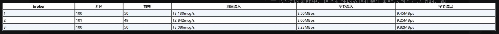

可以看出，所有的broker处理的流量几乎是相等的。假设在运行了首选副本选举之后，这些指标出现了很大的偏差，而这说明集群的流量出现了不均衡。要解决这个问题，需要将负载较重的broker分区移动到负载较轻的broker上，这可以使用第12章中介绍的kafka-reassign-partitions.sh来实现。

broker本身无法自动实现整个集群的分区重分配。Kafka集群的流量均衡是一个十分费劲的过程，需要手动检查一大堆指标，然后再进行副本重分配。一些组织开发了自动化工具来协助完成这个任务。例如，LinkedIn发布了一个叫作kafka-assigner的工具，该工具可以在LinkedIn的GitHub代码仓库kafka-tools中找到。一些供应商提供的Kafka服务也包含了这一功能。

Kafka集群的另一个性能问题是请求数量超过了broker的处理能力。有很多潜在的瓶颈会拖慢整个集群：CPU、磁盘IO和网络吞吐量是其中最为常见的。磁盘使用率不在其列，因为broker会一直运行，直到磁盘被填满然后“挂掉”​。为了诊断这类问题，可以监控以下这些操作系统级别的指标。

● CPU使用

● 网络输入吞吐量

● 网络输出吞吐量

● 磁盘平均等待时间

● 磁盘使用百分比

上述任何一种资源出现过度消耗都会表现为分区不同步。需要注意的是，broker的复制过程与其他Kafka客户端做的事情是一样的。如果集群的数据复制出了问题，那么集群的用户在发送或读取消息时也会有问题。所以，有必要为这些指标定义一个基线，并设定相应的阈值，以便在容量告急之前就能定位到正在发生的问题。随着集群流量的增长，也有必要对这些指标的走势进行持续观察。在这些指标中，​“所有主题的字节流入速率”是查看集群资源使用情况的一个最好的指标。

__2.主机级别的问题__

如果性能问题不是出现在集群级别，而是出现在一两个broker中，就要检查一下broker所在的主机，看看是什么导致它与集群中的其他broker不一样。主机级别的问题可以分为以下几类。

● 硬件故障

● 网络

● 进程冲突

● 本地配置不一致

磁盘故障是导致Kafka性能衰退的一个比较常见的硬件问题。Kafka使用磁盘来存储消息，生产者的性能与磁盘的写入速度有直接的关系。这里出现的任何偏差都会表现为生产者和消费者的性能问题，消费者的性能问题会导致分区不同步。因此，应该持续地监控磁盘，并在出现问题时马上进行修复。

在网络方面，局部故障也会造成很大的问题。有些问题是硬件引起的，比如糟糕的光缆或连接器。有些问题是配置不当造成的，比如修改了服务器或上游网络硬件的网络连接速度或双工设置。网络配置问题还有可能在操作系统中出现，比如网络缓冲区太小，或者太多的网络连接占用了大量的系统内存。在这方面，网络接口报告的错误数量是一个最为关键的指标。如果这个数字一直在增长，则说明出现了亟待解决的硬件问题。

如果硬件没有问题，那么就需要注意系统中的其他应用程序，因为它们也在消耗硬件资源，而且有可能给broker造成压力。它们可能是没有被正确安装的软件，或者是一个运行有问题的进程，比如监控代理。这个时候，可以用操作系统提供的工具（如top）来识别那些过度消耗CPU或内存的进程。

### 13.3.3　broker指标

__1.活跃控制器数量__

活跃控制器数量指标可以告诉我们一个broker是否就是当前的集群控制器。指标的值可以是0或者1，如果是1，那么表示这个broker就是当前的控制器。在任何时候，集群都应该只有一个控制器。如果出现了两个控制器，则说明有一个本该退出的控制器线程被阻塞了。这会导致一些管理操作（比如移动分区）无法正常执行。要解决这个问题，需要重启这两个broker。当集群中出现两个控制器时，可能无法通过正常的方式安全重启broker，所以要强制关闭它们。表13-5列出了活跃控制器数量指标的详细信息。


如果集群中没有控制器，就无法对状态变化（比如创建主题或分区或者broker故障）做出正确的响应。这个时候，要仔细检查为什么控制器线程出现了异常。例如，ZooKeeper集群的网络分区就会导致这个问题。在解决了这些底层问题之后，最好重启所有的broker，以便重置控制器线程的状态。

__2.控制器队列大小__

控制器队列大小指标会告诉我们控制器当前有多少个等待处理的请求，它的值可以是0或正整数。因为新请求不断在涌入，管理操作（比如创建分区、移动分区和首领变更）也不断在发生，所以这个指标的值会频繁波动。这个指标会出现可预料的峰值，但如果持续增长，或保持在一个较高的位置不下降，则说明控制器可能被卡住了。这可能导致管理任务无法被正常执行。要解决这个问题，需要关闭当前的控制器，并将控制器角色交给另一个broker。但是，当控制器被卡住时，我们无法通过正常的方式关闭它。表13-6列出了控制器队列大小指标的详细信息。

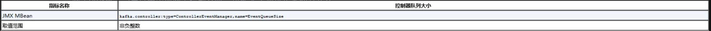

__3.请求处理器空闲率__

Kafka使用两个线程池来处理客户端请求：网络线程和请求处理线程（也叫 IO线程）​。网络线程负责通过网络读入数据和写出数据。这里不涉及太多的处理工作，所以不用太过担心这些线程会被耗尽。请求处理线程负责处理来自客户端的请求，包括从磁盘读取消息和向磁盘写入消息。因此，broker负载的增长对这个线程池有很大的影响。表13-7列出了请求处理器空闲率指标的详细信息。

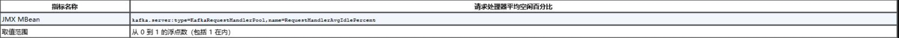

请求处理器平均空闲百分比这个指标的数值越低，说明broker的负载越高。经验表明，如果空闲百分比低于20%，那么说明存在潜在的问题；如果低于10%，则说明出现了性能问题。除了集群的规模太小，还有其他两个方面的原因会导致这个线程池被重度使用。一个原因是线程池里没有足够的线程。一般来说，请求处理线程的数量应该等于系统的处理器核数（包括多线程处理器）​。

另一个常见的原因是线程做了不该做的事。在Kafka 0.10之前，请求处理线程负责解压缩消息批次、验证消息、分配偏移量，并在写入磁盘之前重新压缩消息。更糟糕的是，压缩方法使用了同步锁。

__4.主题流入字节__

主题流入字节速率使用字节 / 秒来表示，用于度量broker从生产者客户端接收到的消息流量。可以基于这个指标决定何时对集群进行扩展或开展其他与流量增长相关的工作。这个指标也可用于评估一个broker是否比集群中的其他broker接收了更多的流量，如果出现了这种情况，则需要对分区进行再均衡。

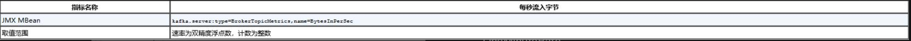

因为这是我们介绍的第一个速率指标，所以有必要对它的属性进行简短的描述。所有的速率指标都有7个属性，使用哪些属性取决于你想获得哪方面的信息。有些属性是离散的事件计数，有些是基于时间段的事件平均数。务必在合适的地方使用合适的指标，否则你将得到一个错误的broker视图。

- EventType：速率属性的度量单位，在这里是“字节”​。

- RateUnit：速率的时间段，在这里是“秒”​。这两个属性表明，速率是通过字节 / 秒来表示的，不管它的值是基于多长时间段计算出来的平均值。速率还有其他4个不同粒度的属性。

- OneMinuteRate：前1分钟的平均值。

- FiveMinuteRate：前5分钟的平均值。

- FifteenMinuteRate：前15分钟的平均值。

- MeanRate从broker：启动到现在的平均值。

除了速率属性，速率指标还有一个Count属性，它在broker启动之后就一直保持增长。Count表示从broker启动以来接收的流量的字节总数。将这个属性用在一个支持计数指标的监控系统中，就可以获得完整的度量视图（我们看到的不仅仅是平均速率）​。

__5.主题流出字节__

主题流出字节速率是另一个与流量增长有关的指标，与流入字节速率类似。流出字节速率也就是消费者从broker读取消息的速率。流出速率的扩展方式与流入速率不一样。这是因为Kafka支持多消费者客户端。很多Kafka集群的流出速率可以达到流入速率的6倍！这就是为什么要单独对流出速率进行观察和分析。表13-9列出了这个指标的详细信息。

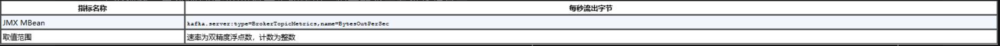

流出速率也包含了副本的流量。也就是说，如果所有主题的复制系数都是2，那么在没有消费者客户端的情况下，流出速率等于流入速率。如果有一个消费者客户端读取了集群所有的消息，那么流出速率就是流入速率的两倍。如果不知道这一点，那么光是看这些指标你可能会感到疑惑。

__6.主题流入消息__

而消息速率则使用每秒生成消息条数（不考虑消息的大小）来表示流量。这也是一个很有用的生产者流量增长指标。它还可以与字节速率结合在一起使用，用于计算消息的平均大小。与字节速率一样，这个指标也能反映出集群流量是否均衡。表13-10列出了这个指标的详细信息。

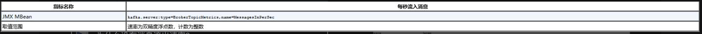

经常会有人问，为什么没有broker的消息流出指标？这是因为在消息被读取时，broker会将整个消息批次发送给消费者，并不会展开计算每个批次包含了多少条消息。所以，broker也就不知道发送了多少条消息。broker提供了一个每秒获取请求次数指标，不过它是一种请求速率，不是消息计数。

__7.分区数量__

broker的分区数量就是分配给broker的分区总数，一般不会经常发生变化。它包括broker的每一个分区副本，不管是首领副本还是跟随者副本。如果一个集群启用了自动创建主题的功能，那么监控这个指标就会很有趣，因为主题的创建不受集群管理员的控制。

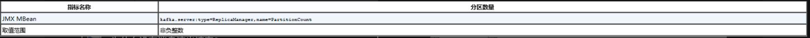

__8.首领数量__

首领数量指标表示一个broker的首领分区数量。与broker的其他指标一样，这个指标也应该在整个集群的broker之间保持均衡。我们需要定期检查这个指标，并适时地发出告警，因为即使在副本的数量和大小看起来都很均衡的时候，它仍然能够显示出集群的不均衡。broker有可能会因为各种原因释放掉一个分区的领导权（比如ZooKeeper会话过期），但在会话恢复之后并不会自动收回领导权（除非启用了自动首领再均衡）​。在这些情况下，这个指标会显示较少的首领分区数，或通常为零。这时候需要进行一次首选副本选举，重新均衡集群的首领。表13-12列出了这个指标的详细信息。


可以将这个指标与分区数量指标结合在一起，计算出以该broker作为首领的分区的百分比。一个均衡的集群，如果它的复制系数是2，那么所有的broker都应该差不多是50%分区的首领。如果复制系数是3，则这个百分比应该降到33%。

__9.离线分区数量__

与非同步分区数量一样，离线分区数量也是一个关键的监控指标（参见表13-13）​。只有集群控制器会提供这个指标（其他broker提供的值为零）​，它会告诉我们集群中有多少个分区是没有首领的。以下两个原因会导致分区没有首领。

● 包含这个分区副本的所有broker都关闭了。

● 由于消息数量不匹配，没有同步副本能够获得领导权（并禁用了不彻底首领选举）​。

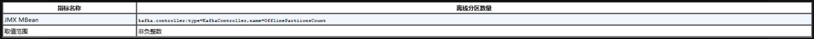

在生产环境中，离线分区会影响生产者客户端，导致消息丢失或应用程序回压。这属于“站点停机”问题，需要立即解决。

__10.　请求指标__

第6章介绍过Kafka协议，它有多种请求，每种请求都有相应的指标。截至Kafka 2.5.0，表13-14中的请求类型都有相应的指标。


每一种请求类型都有8个指标，它们分别提供了不同处理阶段的细节。例如，Fetch请求有如表13-15所示的指标。

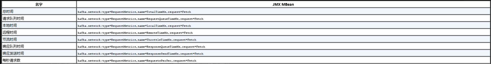

与速率指标类似，7个时间指标分别提供了一组百分比属性和一个离散的计数属性。这些指标都是从broker启动之后累计计算得出的。broker运行的时间越长，这些指标就越稳定。它们所代表的含义如下。

- 总时间:表示broker花在处理请求（从收到请求到将响应返回给请求者）上的时间。

- 请求队列时间:表示请求停留在队列里（从收到请求到开始处理请求）的时间。

- 本地时间:表示首领分区花在处理请求上的时间，包括把消息写入磁盘（但不一定要冲刷）​。

- 远程时间:表示在请求处理完毕之前，用于等待跟随者的时间。

- 节流时间:表示暂停返回响应的时间，这样做是为了降低请求者的速率，把客户端限定在配额范围内。

- 响应队列时间:表示响应被发送给请求者之前停留在队列里的时间。

- 响应发送时间:表示实际用于发送响应的时间。每个指标的属性如下。

    - Count从broker启动到目前为止已处理的请求数量。
    
    - Min:所有请求的最小值。
    
    - Max:所有请求的最大值。
    
    - Mean: 所有请求的平均值。
    
    - StdDev:整体请求时间标准偏差。
    
    - Percentiles:50thPercentile、75thPercentile、95thPercentile、98thPercentile、99thPercentile、999thPercentile。

### 13.3.4　主题的指标和分区的指标

除了用于描述broker一般行为的指标，还有很多主题级别的指标和分区级别的指标。在较大的集群中，这样的指标很多，一般来说不太可能将它们全部收集到一个指标系统中，但在调试与客户端相关的问题时，它们会很有用。例如，主题指标可用于识别造成集群流量大量增长的主题。我们需要提供这些指标，并将它们提供给Kafka生产者和消费者。不管你是否能够定期收集这些指标，都有必要知道它们的用处。

表13-16所列的指标将使用主题名称TOPICNAME和分区0作为示例。在实际当中，要把主题名称和分区ID替换成真实的主题名称和分区ID。

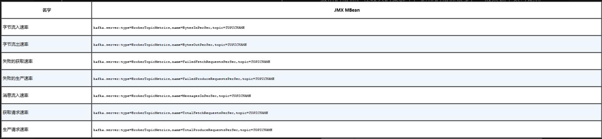

__1.个体主题指标__

个体主题指标与前面介绍的broker指标非常相似。事实上，它们之间唯一的区别在于，个体主题指标指定了特定的主题名称，也就是说，这些指标属于某个特定的主题。因为个体主题指标的数量可能非常巨大（取决于集群主题的数量）​，所以我们极有可能不会监控它们或为它们设置告警。它们通常会被提供给客户端，客户端将用它们来评估和调试自己对Kafka的使用。

__2.个体分区指标__

个体分区指标不如个体主题指标有用。另外，它们的数量更加庞大，因为几百个主题可能包含数千个分区。不过，在某些情况下，它们还是有一定用处的，特别是用于表示分区当前在磁盘上保留的数据量（参见表13-17）的分区大小指标。如果把它们组合在一起，则可以知道主题保留了多少数据。如果同一主题的两个分区大小存在差异，则说明消息分布不均衡。日志片段数量指标表示分区保存在磁盘上的日志片段文件的数量。它可以与分区大小指标结合起来使用，用于跟踪磁盘资源的使用情况。


日志结束偏移量和日志起始偏移量这两个指标分别表示消息在分区中的最大偏移量和最小偏移量。然而，需要注意的是，不能用这两个指标来推算分区包含的消息数量，因为在压实日志时，具有相同键的新消息会覆盖掉旧消息，从而导致偏移量“丢失”​。

### 13.3.5　Java虚拟机监控

__1.垃圾回收__

在JVM方面，最需要监控的是垃圾回收(GC)状态。需要监控哪些MBean取决于你使用的Java运行时(JRE)和垃圾回收器配置。如果你使用的是Oracle Java 1.8和G1垃圾回收器，那么需要监控的MBean如表13-18所示。


，我们需要收集CollectionCount和CollectionTime这两个属性。CollectionCount表示从JVM启动开始算起的垃圾回收次数，CollectionTime表示从JVM启动开始算起的垃圾回收时间（以毫秒为单位）​。因为这些属性都是计数值，所以它们可以告诉我们单位时间内发生垃圾回收的绝对次数和时间。还可以用它们计算出平均每次垃圾回收花费的时间，尽管这在日常运维中没有多大用处。

这些指标还有一个LastGcInfo属性。这是由5个属性组成的组合值，为我们提供了最后一次垃圾回收的信息。5个属性中最重要的一个属性是duration（以毫秒为单位）​，表示最后一次垃圾回收花费了多长时间。其他几个属性（GcThreadCount、id、startTime和endTime）虽然也会提供一些信息，但用处不大。不过需要注意的是，我们无法通过这些属性查看到每一次垃圾回收的信息，因为年轻代垃圾回收发生得非常频繁。

__2.Java操作系统监控__

JVM通过java.lang:type=OperatingSystem这个MBean提供了有关操作系统的一些信息，但这些信息很有限，并不能告诉我们操作系统的所有情况。有两个比较有用但在操作系统层面难以收集到的属性是MaxFileDescriptorCount和OpenFileDescriptorCount。MaxFileDescriptorCount告诉我们JVM最多能打开多少个文件描述符(FD)，OpenFileDescriptorCount告诉我们目前已经打开了多少个文件描述符。每个日志片段和网络连接都需要一个文件描述符，所以它们的数量增长得很快。如果网络连接不能被正常关闭，那么broker很快就会把文件描述符耗尽。

### 13.3.6　操作系统监控

我们需要收集的信息包括CPU的使用情况、内存的使用情况、磁盘的使用情况、磁盘IO和网络的使用情况。

按照使用类型收集到的CPU使用百分比信息也很有用。根据收集方法和操作系统的不同，我们可以得到如下这些CPU百分比细分（使用了缩写）中的一部分或全部。

- us:用户空间使用的时间。

- sy:内核空间使用的时间。

- ni:低优先级进程使用的时间。

- id:空闲时间。

- wa等待（磁盘）时间。

- hi:处理硬件中断的时间。

- si:处理软件中断的时间。

- st:等待监视器的时间。

尽管很多人知道系统负载是对CPU使用情况的度量，但大多数人误解了度量的方法。平均负载是指等待处理器执行的可执行进程数。Linux系统中还有一些处于不可中断睡眠状态的进程，比如磁盘等待。负载用3个数值来表示，分别是前1分钟的平均数、前5分钟的平均数和前15分钟的平均数。在单CPU系统中，数值1表示系统负载达到了100%。此时总是会存在一个等待执行的进程。在多CPU系统中，如果负载达到100%，那么它的数值就等于CPU核数。如果系统的CPU的核数是24，那么负载达到100%时它的数值就是24。

跟踪broker的CPU使用情况是很有必要的，因为它们在处理请求时占用了大量的CPU时间。内存使用情况的跟踪就显得没那么重要了，因为运行Kafka并不需要太大的内存。broker会使用堆外的一小部分内存来压缩数据，剩下的大部分会被用作缓存。尽管如此，还是要跟踪内存的使用情况，确保broker的内存不会受到其他应用程序的影响。可以通过监控总内存空间和可用交换内存空间来确保内存交换空间没有被其他应用程序占用。

对Kafka来说，磁盘是最重要的子系统。所有的消息都保存在磁盘上，所以Kafka的性能很大程度上依赖于磁盘的性能。我们需要监控磁盘空间和索引节点（索引节点是Unix文件系统中文件和目录的元数据对象）​，确保磁盘空间不会被用光。对保存数据的分区来说更是如此。还需要监控磁盘IO的统计数据，它们可以告诉我们磁盘是否被有效利用。至少，我们要监控磁盘的每秒读写速度、平均读写队列大小、平均等待时间和磁盘使用百分比。最后，还需要监控broker的网络使用情况。简单地说，就是流入和流出的网络流量，一般用每秒多少位来表示。需要注意的是，在没有消费者的情况下，流入一个位就有复制系数个位流出，如果再算上消费者，那么流出流量很容易比流入流量高出一个数量级。在设置告警阈值时要切记这一点。

### 13.3.7　日志

有两个日志记录器，它们会分别将日志写到单独的磁盘文件中。一个是kafka.controller，我们可以将它的级别设置为INFO。这个日志记录了集群控制器的信息。在任何时候，集群中都只有一个控制器，所以只有一个broker会使用这个日志。日志中包含了主题的创建和修改操作信息、broker的状态变更信息，以及集群活动的信息，比如首选副本选举和分区移动。另一个是kafka.server.ClientQuotaManager，我们也可以将它的级别设置为INFO。这个日志用于记录与生产和消费配额活动相关的信息。因为这些信息很有用，所以最好不要把它们记录在broker的主日志文件中。

在调试问题时，还有一些日志也很有用，比如kafka.request.logger，我们可以将它的级别设置为DEBUG或TRACE。这个日志包含了发送给broker的每一个请求的详细信息。如果级别被设置为DEBUG，那么它将包含连接端点、请求时间和概要信息。如果级别被设置为TRACE，那么它将包含主题和分区的信息，以及除消息体之外的所有与请求相关的信息。不管被设置成什么级别，这个日志都会产生大量的数据，所以如果不是出于调试的目的，则不建议启用这个日志。

## 13.4　客户端监控

### 13.4.1　生产者指标

所有的生产者指标在MBean名字里都有对应的客户端ID。在下面的示例中，客户端ID用CLIENTID表示，broker ID用BROKERID表示，主题名字用TOPICNAME表示，如表13-19所示。

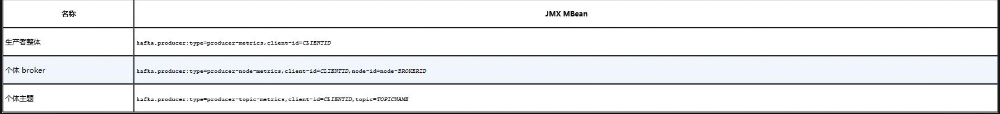

__1.生产者整体指标__

生产者整体指标的属性描述了生产者各个方面的信息，从消息批次的大小到内存缓冲区的使用情况。虽然这些指标在调试时都有一定用处，但只有少数几个会经常用到，而在这几个指标当中，也只有一部分需要监控和告警。下面将讨论一些平均数指标（以 -avg结尾）​，它们都有相应的最大值（以 -max结尾）​，不过这些最大值的用处很有限。

record-error-rate是一个很有必要对其设置告警的属性。这个属性的值一般情况下都是零，如果大于零，则说明生产者正在丢弃无法发送的消息。生产者配置了重试次数和回退策略，如果重试次数达到了上限，那么消息就会被丢弃。也可以跟踪另外一个属性record-retry-rate，不过这个属性不如record-error-rate重要，因为重试是很正常的行为。

也可以对request-latency-avg属性设置告警。这个属性是指生产者向broker发送请求时平均花费的时间。应该为这个指标设置一个基线，并设定告警阈值。请求延迟的增加说明生产者请求速率变慢，有可能是网络出了问题，也有可能是broker出了问题。不管是哪一种原因导致的，都是性能问题，并将导致生产者应用程序出现回压和其他问题。

除了这些关键指标，还需要知道生产者发送了多大的消息量。有3个属性为我们提供了3个不同的视图：outgoing-byte-rate表示每秒发送的消息字节数，record-send-rate表示每秒发送的消息数量，request-rate表示每秒生产者发送给broker的请求数。一个请求可以包含一个或多个批次，一个批次可以包含一条或多条消息，一条消息由多个字节组成。把这些指标都显示在仪表盘上会很有用。

有一些指标描述了消息、请求和批次的大小（都以字节为单位）​。request-size-avg表示生产者发送给broker的请求的平均大小。batch-size-avg表示单个消息批次的平均大小（根据定义，批次包含了属于同一个分区的多条消息）​。record-size-avg表示单条消息的平均大小。对单个主题生产者来说，这些属性提供了有关消息发送的有用信息。对多主题生产者（如MirrorMaker）来说，这些属性就没有那么有用了。除了这3个指标，还有另外一个指标records-per-request-avg，它表示单个生产请求包含的平均消息条数。

最后一个值得推荐的生产指标是record-queue-time-avg，它表示消息在发送给Kafka之前在生产者客户端的平均等待时间（以毫秒为单位）​。应用程序在使用生产者客户端发送消息（调用send方法）之后，生产者会等待以下任一情况发生。

● 有足够多的消息填满批次（根据配置的batch.size）​。

● 距离上一批次发送已经有足够长的时间（根据配置的linger.ms）​。

这两种情况都会促使生产者客户端关闭当前批次，并把它发送给broker。对于较为繁忙的主题，一般会发生第一种情况；对于吞吐量较低的主题，一般会发生第二种情况。record-queue-time-avg指标会告诉我们发送消息用了多长时间，因此，如果希望通过配置上面的两个参数来降低应用程序延迟，那么这个指标会很有用。

__2.个体broker指标和个体主题指标__

除了生产者整体指标，还有一些MBean为每个broker连接和每个主题提供了一系列属性。这些指标在调试问题时很有用，但在平常不需要对它们进行常规的监控。这些MBean属性的名字与整体指标的名字一样，表示的含义也一样（只是它们是应用在个体broker或个体主题上）​。request-latency-avg是最为有用的个体broker指标，因为它比较稳定（在消息批次比较稳定的情况下）​，而且能够显示与某个broker之间的连接是否有问题。其他属性，比如outgoing-byte-rate和request-latency-avg，它们会因为broker所包含分区的不同而有所不同。也就是说，这些指标会随时间发生变化，完全取决于集群的状态。个体主题指标比个体broker指标要有趣一些，但它们只有在生产者向多个主题生成消息时才有用。当然，也只有在生产者不会向过多主题生成消息的情况下才有必要对这些指标进行常规的监控。例如，MirrorMaker有可能向成百上千个主题生成消息。我们无法逐个检查这些指标，也几乎不可能为它们设置合理的告警阈值。与个体broker指标一样，个体主题指标一般用于诊断问题。例如，可以根据record-send-rate和record-error-rate这两个属性将丢弃的消息隔离到特定的主题上（或者作为跨所有主题的可用消息）​。另外还有一个指标byte-rate，它表示主题整体的消息速率（以字节 / 秒表示）​。

### 13.4.2　消费者指标

与生产者客户端类似，消费者客户端将大量的指标属性整合到少数的几个MBean里，去掉了延迟百分位和速率移动平均数指标。因为消费者读取消息的逻辑比生产者发送消息的逻辑复杂，所以消费者的指标会更多，如表13-20所示。

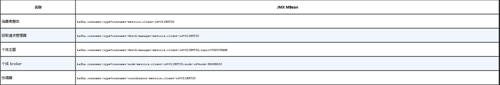

__1.获取请求管理器指标__

在消费者客户端，消费者整体指标MBean的作用并不是很大，因为有用的指标都在获取请求管理器 MBean里。消费者整体指标MBean包含了与底层网络相关的指标，而获取请求管理器MBean则包含了与字节、请求和消息速率相关的指标。与生产者客户端不同，我们可以查看消费者客户端提供的指标，但对它们设置告警并没有太大意义。对于获取请求管理器，需要监控并设置告警的一个指标是fetch-latency-avg。与生产者客户端的request-latency-avg类似，这个指标表示消费者向broker发送请求所需要的时间。为这个指标设置告警的问题在于，请求延迟是通过消费者的fetch.min.bytes和fetch.max.wait.ms这两个参数来控制的。一个低吞吐量的主题会出现不稳定的延迟，有时候broker响应很快（有可用消息）​，有时候却无法在fetch.max.wait.ms指定的时间内完成响应（没有可用消息）​。只有当主题有相对稳定和足够的消息流量时，这个指标才更有用。

要想知道消费者客户端正在处理多少消息流量，可以查看bytes-consumed-rate或records-consumed-rate这两个指标，最好是两个都查看。它们分别表示客户端每秒读取的消息字节数和每秒读取的消息条数。有些用户为它们设置了最小值告警阈值，当消费者工作负载不足时，他们就会收到告警。不过需要注意的是，Kafka会试图解开消费者客户端和生产者客户端之间的耦合，但消费者读取消息的速率经常会依赖于生产者是否在正常运行，所以监控消费者的这些指标实际上是对生产者做了某些假设，这样可能会导致误报。获取请求管理器也提供了一些指标，有助于我们理解字节、消息和请求之间的关系。fetch-rate表示消费者每秒发出的请求数量，fetch-size-avg表示这些请求的平均大小（字节）​，records-per-request-avg表示每个请求的平均消息条数。需要注意的是，消费者并没有提供与生产者record-size-avg相对应的指标，所以我们无法知道消息的平均大小。如果这个对你来说很重要，那么可以用其他指标来推算，或者在应用程序接收到消息之后获取消息的大小。

__2.个体broker指标和个体主题指标__

与生产者客户端类似，消费者客户端也为每个broker连接和主题提供了很多指标，我们可以用它们诊断问题，但可能不需要进行常规的监控。与获取请求管理器一样，个体broker的request-latency-avg指标的用处也是有限的，具体取决于主题的消息流量。incoming-byte-rate和request-rate分别表示从个体broker每秒读取的消息字节数和每秒请求数。我们可以用它们诊断消费者与broker之间的连接问题。如果读取的是多个主题，那么消费者客户端提供的个体主题指标就会很有用，否则它们就与获取请求管理器的指标一样，我们也就没有必要去收集它们。如果客户端（如MirrorMaker）读取了大量主题，那么查看这些指标就会变得很困难。如果你真的打算收集这些指标，那么可以考虑收集最重要的3个：bytes-consumed-rate、records-consumed-rate和fetch-size-avg。bytes-consumed-rate表示从某个主题每秒读取的消息字节数，records-consumed-rate表示每秒读取的消息条数，fetch-size-avg表示每个请求的平均大小。

__3.消费者协调器指标__

如第4章所述，多个消费者客户端组成了消费者群组，群组中会发生一些需要协调的活动，比如新成员加入，或者通过向broker发送心跳来维持群组的成员关系。消费者协调器负责处理这些协调工作，并提供了一组指标。与其他指标一样，协调器指标也提供了很多数字，但只有一小部分需要进行常规的监控。消费者群组在执行同步操作时可能会导致消费者出现停顿。此时，群组中的消费者正在协商哪些分区应该由哪些消费者读取。停顿的时间长短取决于分区的数量。协调器提供了sync-time-avg指标，表示同步活动发生的平均时长（以毫秒为单位）​。sync-rate属性也很有用，表示消费者群组每秒发生同步的次数。在一个稳定的消费者群组中，这个数字大多数时候是零。Kafka会将消费者提交的偏移量作为读取进度的检查点。消费者既可以基于固定的时间间隔自动提交偏移量，也可以在代码中手动提交偏移量。提交偏移量也是一种生成消息的请求（它们有自己的请求类型）​，提交的偏移量会作为消息被发送到一个特定的主题上。协调器提供的commit-latency-avg属性表示提交偏移量所需的平均时长。我们也需要监控这个指标，就像监控生产者请求延迟一样。还要为它设定一个预期的基线和合理的告警阈值。协调器指标的最后一个属性是assigned-partitions，表示分配给消费者客户端（群组中的单个消费者）的分区数量。这个属性之所以有用，是因为我们可以通过比较整个群组各个消费者分配到的分区数量来判断群组的负载是否均衡。可以使用这个属性来识别因协调器分区分配算法所导致的负载不均衡问题。

### 13.4.3　配额

Kafka可以对客户端请求进行节流，防止某个客户端拖垮整个集群。对消费者客户端和生产者客户端来说，这都是可配的，并用每秒允许单个客户端从单个broker读取多少字节或写入多少字节来表示。它有一个broker级别的默认值，客户端可以动态覆盖。当broker发现客户端的流量已经超出配额时，它会暂缓向客户端返回响应，直到客户端流量降到配额以下。broker并不会将客户端被节流的错误码放在响应消息里。也就是说，对应用程序来说，如果不监控这些指标，就不会知道发生了节流。我们需要监控的指标如表13-21所示。

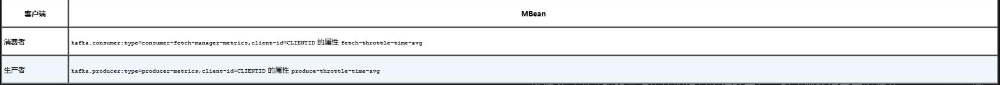

在默认情况下，broker不会开启配额限制。但不管有没有开启，监控这些指标总是安全无害的。况且，配额限制有可能在未来某个时刻被启用，从一开始就监控这些指标要比在后期添加更容易。

## 13.5　滞后监控

对消费者来说，最需要被监控的指标是滞后消息数量，也就是分区生成的最后一条消息和消费者读取的最后一条消息之间的差值。前面讲过，对于消费者滞后，使用外部监控工具比使用客户端提供的指标要好得多。虽然消费者提供了滞后指标，但该指标存在一个问题，即它只表示单个分区（也就是具有最大滞后的那个分区）的滞后，所以不能准确地告诉我们消费者的整体滞后情况。另外，它需要消费者做一些额外的操作，因为这个指标是由消费者对每个发出的获取请求进行计算得出的。如果消费者发生崩溃或离线，那么这个指标要么不准确，要么不可用。监控消费者滞后最好的办法是使用外部工具，它们既能观察broker的分区状态（通过跟踪最近生成的消息的偏移量）​，也能观察消费者的状态（通过跟踪消费者群组提交的最新偏移量）​。这种监控方式提供了一种不依赖消费者状态的客观视图。我们需要监控消费者群组读取的每一个分区。对于大型的消费者，比如MirrorMaker，这意味着需要监控成千上万个分区。

第12章介绍过如何使用命令行工具获取消费者群组的信息，包括提交的偏移量和滞后的消息数量。如果直接监控由命令行工具提供的信息，那么也存在一些问题。首先，需要为每个分区定义一个合理的滞后阈值。每小时接收100条消息的主题和每秒接收10万条消息的主题的滞后阈值显然不同。其次，需要将滞后指标导入监控系统，并为它们设置告警。如果一个消费者群组读取了1500个主题，这些主题的分区数量超过了10万个，那么这将是一项令人望而生畏的任务。

可以使用Burrow来降低这项任务的复杂性。Burrow是一个开源的应用程序，最初由LinkedIn开发。它会收集集群消费者群组的滞后信息，并为每个群组计算出一个独立的状态，告诉我们群组是否运行正常、是否出现了滞后、速度是否变慢或者是否已经停止工作。它不需要通过监控消费者群组的处理进度来获得阈值，不过我们仍然可以从中获得滞后的消息绝对数量。LinkedIn工程博客“Burrow:　Kafka ConsumerMonitoring Reinvented”介绍了Burrow的工作原理。Burrow既可用于监控一个集群中的消费者，也可用于监控多个集群，而且可以很容易被集成到已有的监控和告警系统中。 如果没有其他选择，则可以考虑查看消费者客户端的records-lag-max指标，它提供了消费者消费状态的部分视图。不管怎样，仍然建议使用像Burrow这样的外部监控系统。

### 13.6　端到端监控

我们推荐的另一种外部监控解决方案是端到端监控，它为Kafka集群的健康状态提供了一种客户端视图。消费者客户端和生产者客户端的一些指标能够说明集群可能出现了问题，但这里有猜想的成分，因为延迟的增加有可能是由客户端、网络或Kafka本身引起的。另外，你原本的任务可能只是管理Kafka集群，但现在也需要监控客户端。你需要知道下面这两个问题的答案。

● 可以向Kafka集群写入消息吗？

● 可以从Kafka集群读取消息吗？

理想情况下，你可能希望对每一个主题都执行这些操作。但是，在大多数情况下，向每一个主题都注入人为制造的流量是不合理的。所以，可以考虑将问题提升到broker级别，而这正是Xinfra Monitor（之前叫作Kafka Monitor）要做的事情。这个工具最初由LinkedIn的Kafka团队开发并开源。它会持续地向一个横跨集群所有broker的主题生成消息，并读取这些消息。然后会监控每个broker生产请求和读取请求的可用性，以及生产消息和读取消息之间的整体延迟。这种从外部验证Kafka集群运行状态的监控方式是非常有价值的，因为与监控消费者滞后一样，broker本身无法告知客户端集群是否运行正常。

# 第14章　流式处理

很多基于Kafka构建的流式处理系统将Kafka作为唯一可靠的数据来源，比如Apache Storm、Apache Spark Streaming、Apache Flink、Apache Samza等。

## 14.1　什么是流式处理

首先，数据流是无边界数据集的抽象表示。无边界意味着无限和持续增长。无边界数据集之所以是无限的，是因为随着时间的推移，会有新记录不断加入。谷歌和亚马逊等大多数公司采用了这个定义。

注意，这个简单的模型（事件流）几乎可以用来表示任何一种业务活动，比如信用卡交易、股票交易、包裹递送、流经交换机的网络事件、制造商设备传感器发出的事件、发送出去的邮件、游戏场景中的物体移动，等等。这样的例子不胜枚举，因为大部分事情可以被看成一个事件序列。除了无边界，事件流模型还有其他一些属性。

__事件流是有序的__

事件的发生都有先后顺序。以金融活动事件为例，先把钱存进账户，然后再把钱花掉与先把钱花掉，然后再把钱存入账户的顺序是完全不一样的。后者会出现透支，前者则不会。这是事件流与数据库表的一个区别。需要注意的是，数据库表记录的数据是无序的，SQL语句中的“order by”并不是关系模型的组成部分，它是为了方便查询数据而添加的。

__不可变的数据记录__

事件一旦发生，就不能被改变。一次金融交易被取消，并不是说它消失了，相反，表示前一个交易操作被取消的事件将被添加到事件流中。顾客向商店退货，之前的销售事实并不会消失，退货行为将被视为一个额外的事件。这是数据流与数据表之间的另一个区别——可以删除和修改数据表中的记录，但这些操作都是发生在数据库中的事务，也可以将这些事务当成事件记录到事件流中。如果你熟悉数据库的二进制日志(binlog)、预写式日志(WAL)或重做日志(redo log)，就应该知道，如果向数据库表插入一条记录，再将其删除，那么表中就不会包含这条记录，但重做日志中会有两个事务：插入事务和删除事务。

__事件流是可重放的__

这是事件流非常有价值的一个属性。我们都知道不可重放的流（流经套接字的TCP数据包通常是不可重放的）​，但对大多数业务应用程序来 说，能够重放发生在几个月前（甚至几年前）的原始事件流是非常关键的。可能是为了能够使用新的分析方法纠正过去的错误，或者是为了达到审计的目的。这也是为什么我们相信Kafka能够让现代业务领域的流式处理大获成功——Kafka可以被用来捕获和重放事件流。如果没有这项能力，那么流式处理充其量只是数据科学实验室里的一个玩具而已。

需要注意的是，事件流定义和我们列出的事件流属性都没有提到事件所包含的数据和每秒事件数。不同系统的数据是不一样的，事件可以很小（有时候只有几字节）​，也可以很大（包含很多消息头的XML消息）​，它们可以是完全非结构化的键–值对，可以是半结构化的JSON，也可以是结构化的Avro消息或Protobuf消息。虽然数据流经常被视为“大数据”​，并且包含了每秒数百万个事件，但这里所讨论的技术同样适用（通常是更加适用）于小事件流，可能每秒甚至每分钟只有几个事件。

现在，我们已经知道了什么是事件流，接下来是时候了解“流式处理”的真正含义了。流式处理是指实时地处理一个或多个事件流。流式处理是一种编程范式，就像请求与响应范式和批处理范式一样。下面将对这3种范式进行比较，以便更好地理解如何在软件架构中应用流式处理。

__请求与响应__

